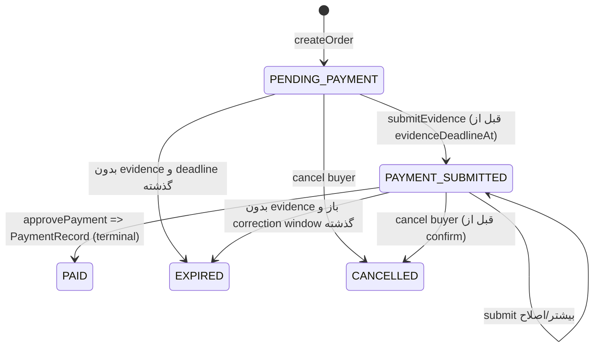
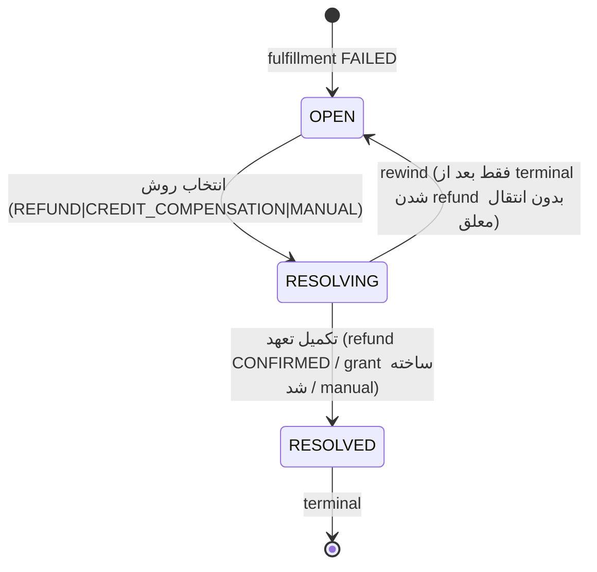

| D-007 | مصرف اعتبار Boost | Standard=۱ و Featured=۲؛ grantهای پلن ۰/۳/۸/۲۰ در هر ۳۰ روز | `SUPERSEDED_BY_V2` | بخش ۴۵ | Credit ledger | — |nها | قیمت‌های v1 تاریخی؛ قیمت پایلوت v2 در بخش ۴۷ | `SUPERSEDED_BY_V2_PILOT` | بخش ۴۷ | revision قیمت | — |ntitlement هر پلن اکنون quota مستقل دارد | `SUPERSEDED_BY_V2` | بخش ۴۰ | entitlement resolver | — |nding عمومی ۱۰ | مقدار تاریخی؛ سقف جاری ۴/۱۵/۲۵/۴۰ بر اساس پلن | `SUPERSEDED_BY_V2` | بخش ۴۰.۵ | quota پلن‌محور | — |ndfathering سقف قبلی | مقدار تاریخی؛ سیاست جاری downgrade در بخش ۴۸ و V2-029 تعریف شده است | `SUPERSEDED_BY_V2` | بخش ۴۸ | حفظ آگهی بدون حذف خودکار | — |ntitlement پلن‌محور | — |numها/قطعه‌کدها به انگلیسی و مطابق repository  
> **وضعیت:** `PRODUCT BASELINE v2.0 — طراحی مبنا با اختیار تفویض‌شده؛ پیاده‌سازی نشده`  
> **محدودهٔ مجاز این مأموریت:** تنها ایجاد همین یک فایل Markdown مجاز بود؛ هیچ کد، Schema، Migration، API، تست، تنظیمات امنیتی، وابستگی یا Git تغییری نکرده است.  
> **نسخهٔ سند:** `2.0` · **تاریخ تهیه:** از روی وضعیت زندهٔ repository در همین جلسه

---

## ۰. یادداشت دربارهٔ طول سند (شفاف)

این سند با هدف «عمق واقعی مهندسی» نوشته شده است، نه «رسیدن به یک عدد خط مشخص». تمام فصل‌های اجباری (۳۵ فصل + فازبندی + registerها) با محتوای واقعی پوشش داده شده‌اند؛ اما از تکرار چندبارهٔ یک الزام، جدول خالی، placeholder و شکستن مصنوعی جمله‌ها خودداری شده است. در نتیجه تعداد خطوط نهایی هرچه باشد، نمایانگر «محتوای کامل و قابل استفاده» است، نه حد بالایی تحمیلی. تعداد خط واقعی در انتهای گزارش نهایی اعلام می‌شود.

---

## فهرست مطالب

**افزودهٔ نسخهٔ 2.0:** بخش‌های ۳۶ تا ۷۷، مبنای جاری محصول و درآمد، پژوهش رقبا، تصمیم‌های قیمت‌گذاری و مشخصات مهندسی را پوشش می‌دهند. در تعارض با متن تاریخی نسخهٔ 1.0، نسخهٔ 2.0 اولویت دارد.

1. پوشش، نسخه، وضعیت و دامنه
2. خلاصهٔ اجرایی
3. روش ممیزی repository
4. معماری وضعیت فعلی
5. رفتار محصول/تجاری وضعیت فعلی
6. تحلیل تفاوت (Delta) بین تاریخچه، مستندات و کد
7. اصول محصول و مدل تجاری
8. سقف آگهی فعال کاربر عادی (۲۰)
9. پول / AFN / pul / credits
10. کاتالوگ Plan و تصمیم‌های قیمت‌گذاری
11. واژه‌نامهٔ دامنه
12. مدل داده
13. State Machineها
14. جریان پرداخت
15. Fulfillment و CommercialException
16. جریان Refund
17. Subscription و Credit Ledger
18. Promotion
19. یکپارچه‌سازی چرخهٔ حیات Listing/Seller
20. امنیت / RBAC
21. مالکیت / مجوزها / Triggerهای PostgreSQL
22. تراکنش‌ها / قفل‌گذاری / هم‌زمانی
23. قرارداد API / نسخه‌بندی
24. جریان‌های Frontend
25. Jobها / Reconciliation
26. Audit / گزارش‌دهی / حریم خصوصی
27. Observability / عملیات
28. استراتژی تست و کاتالوگ تست
29. Migration / استقرار / Rollback
30. فازهای پیاده‌سازی و مسئولیت‌ها
31. دروازه‌های پذیرش
32. Decision Register
33. Traceability Matrix
34. پرسش‌های باز / ریسک‌ها
35. ضمیمه: نمایهٔ شواهد repository و واژه‌نامه

---

## ۱. وضعیت، دامنه و مسئولیت‌ها

| مورد | مقدار |
|---|---|
| نسخهٔ سند | `1.0` |
| وضعیت طرح | `PROPOSED — NOT IMPLEMENTED` |
| وضعیت تأیید | نیازمند تصویب نهایی مالک محصول؛ پیشنهادها در Decision Register با `PROPOSED_NOT_APPROVED` ثبت می‌شوند |
| دامنهٔ مدل درآمدی | آگهی رایگان + `Boost Standard/Featured` + اشتراک `Business/Business Plus` + پرداخت دستی قابل ردیابی (نسخهٔ اول) |
| خارج از دامنه | Gateway خودکار، Wallet، Escrow، Commission/Take-rate، Redis/Kafka، میکروسرویس |
| قاعدهٔ سند | هر ادعای فنی دارای شاهد (مسیر فایل + نماد/خط) است؛ ادعای «انجام/امن/آزموده» بدون شاهد ممنوع است |

**پنج دستهٔ اجباری برای هر ادعا:** (۱) شاهد repository؛ (۲) تصمیم قطعی مالک؛ (۳) تصمیم طرح قبلیِ هنوز معتبر؛ (۴) پیشنهاد نیازمند تأیید؛ (۵) نامعلوم/تعارضی. این دسته‌ها هرگز با هم مخلوط نمی‌شوند و هیچ پیشنهاد عاملی `CONFIRMED_BY_OWNER` نمی‌شود.

---

## ۲. خلاصهٔ اجرایی

WeshBazar بازار آنلاین آگهی برای افغانستان است. ممیزی زندهٔ این جلسه نشان داد **هیچ کد تجاری‌سازی در repository پیاده نشده**؛ مفاهیم مالی (`Payment`, `Subscription`, `Promotion`, `Credit`, `Refund`) فقط در مستندات/طرح‌های Phase 1.0 تا 1.13 آمده‌اند. بنابراین تجاری‌سازی باید یک ماژول جدید از صفر ساخته شود، بدون شکستن قرارداد منجمد `/api/v1`.

دو ستون محصولی سند: (الف) **مدل درآمدی**: آگهی عادی و تمدید عادی رایگان بماند؛ درآمد اولیه از Boost و اشتراک فروشندهٔ حرفه‌ای؛ (ب) **تغییر سقف آگهی فعال کاربر عادی از ۵۰ به ۲۰** (فصل ۸). هیچ‌کدام نباید آگهی موجود را خودکار حذف/بایگانی کند.

معماری پیشنهادی Phase 1.0-1.13: تفکیک «تأیید پرداخت» از «ارائهٔ خدمت» با دو تراکنش (`PaymentRecord` تغییرناپذیر + `FulfillmentStatus`)، مدل پول integer small-unit (پیشنهاد `pul` = 1/100 AFN، نه قطعی)، `CommercialPlanRevision` تغییرناپذیر برای snapshot، و ledger اعتبار مستقل از ledger پول. همهٔ این‌ها «طراحی شده ولی پیاده/تست نشده» هستند.

---

## ۳. روش ممیزی repository

بررسی read-only با این ابزارها انجام شد و برای هر ادعای مهم، مسیر فایل + شمارهٔ خط ثبت شد:

- **Git:** `git rev-parse --abbrev-ref HEAD`، `--short HEAD`، `git status --porcelain` (وضعیت ابتدا و انتها مقایسه شد).
- **ساختار/پیکربندی:** `package.json` (backend/frontend)، `tsconfig.json`، `prisma/schema.prisma`، `prisma.config.ts`، `docker-compose.yml`، `.env.example` (فقط نمونه؛ `.env` واقعیِ رازآلود خوانده نشد)، `AGENTS.md`.
- **کد:** جستجوی نماد + خواندن مستقیم controllers/services/DTO/presenters/guards/config/jobs.
- **اسناد:** `AGENTS.md`، `README` (backend/frontend)، `docs/ROADMAP.md`، `docs/RUNBOOK.md`، `weshbazar-backend/docs/{architecture.md, api-freeze-summary.md, openapi.json, api-contract-audit.md, implementation-status.md, frontend-api-contract.md, frontend-error-map.md}`، `docs/audit/*.md`.

**محدودیت‌های صادقانه:**
- هیچ تستی اجرا نشد (شرط read-only؛ فقط «وجود» test suiteها و ادعاهای CI/مستندات ثبت شد؛ هیچ نتیچه PASS ادعا نمی‌شود).
- `.env` واقعی خوانده نشد (راز).
- دیتابیس زنده در دسترس نبود؛ بنابراین هیچ grant/trigger/index/role/ownership «verified on PostgreSQL» ادعا نمی‌شود. هر آیتم وابسته به DB با `UNVERIFIED`/`DESIGNED_NOT_TESTED` ثبت می‌شود.
- سقف‌ها و transitionها از کد واقعی (`env.schema.ts`, `listings.service.ts`, `listing-state.ts`, `configuration.ts`, `config.types.ts`, `error-codes.ts`) استخراج شد.

---

## ۴. معماری وضعیت فعلی

| لایه | وضعیت واقعی | شاهد |
|---|---|---|
| Backend | NestJS (Fastify)، modular monolith | `package.json`؛ `README` ("modular monolith") |
| Runtime | Node.js ≥24، TypeScript strict | `package.json` `engines`؛ `tsconfig.json` |
| ORM/DB | Prisma 7 (`@prisma/adapter-pg`+`pg`) → PostgreSQL 17 | `schema.prisma` datasource؛ `docker-compose.yml` |
| Auth | JWT دوتوکنی + Argon2 + OTP موبایل | `modules/auth/*` |
| Validation | `class-validator`+`class-transformer` (whitelist) + `zod` env | `common/validation/validation.pipe.ts`؛ `config/env.schema.ts` |
| RBAC | `UserRole=USER\|MODERATOR\|ADMIN` + permission map (TS) | `schema.prisma` enum؛ `permissions.ts:35-39` |
| Listing lifecycle | `DRAFT→PENDING_REVIEW→ACTIVE→SOLD/ARCHIVED` (+REJECTED، expiry/stale-draft jobs) | `listing-state.ts:64-130` |
| Search | `pg_trgm`؛ sorts = `newest/price_asc/price_desc/most_viewed` | `search.provider.ts:25` |
| Jobs | درون‌فرآیندی؛ ۵ job + archived-image (off/dry-run) | `jobs.service.ts:60-67`؛ `env.schema.ts:144-148` |
| Storage | `STORAGE_PROVIDER=local` (dev), pluggable | `providers/storage/*` |
| Analytics | `Listing.views/favoriteCount` + `ListingDailyStat` | `schema.prisma:722-742` |
| Idempotency | `IdempotencyKey` unique `[scope,subject,key]` + `requestHash` + `responseBody` | `schema.prisma:748-769` |
| Audit | `AuditLog` append-only (فقط `.create`)؛ `AuditAction` ۲۷ مقدار (هیچ‌کدام مالی) | `schema.prisma:662-716`؛ `audit.service.ts:82-108` |
| Frontend | Next.js 15 App Router، React 19، TS strict، Tailwind/shadcn، TanStack Query، Jest | `weshbazar-frontend/package.json` |
| زبان/جهت | دری `fa-AF`، RTL | `config/site.ts:13`؛ `layout.tsx` |
| Contract | `openapi.json` (3.0.0، 88 operationId)؛ global prefix `api/v1` | `bootstrap.ts:100-105`؛ `openapi-document.ts:38` |

**وضعیت Git:** branch `qwen`، HEAD `df75a8d` (نخستین ممیزی این گفتگو HEAD `a086f39` بود — repository بین دو ممیزی پیش رفته است). `git status --porcelain` پیش از این سند **خالی** بود (working tree پاک). تنها تغییری که این مأموریت ایجاد می‌کند، همین فایل سند است.

---

## ۵. رفتار محصول/تجاری وضعیت فعلی (شواهد)

- **انتشار و تمدید رایگان:** هیچ سازوکار پرداخت/اشتراک/ارتقا در کد نیست. جستجوی `Payment|Subscription|Plan|Promotion|Boost|Featured|Credit|Refund|Wallet|Commission|Payout` در `apps/api/src/**` و `weshbazar-frontend/src/**` فقط ارجاع به مستندات/قواعد `.devin/rules` داد، نه کد پیاده‌شده.
- **سقف فعلی آگهی:** ۵۰ فعال / ۱۰ pending برای هر `SellerAccount`. تعریف: `env.schema.ts:128-129` (`MAX_ACTIVE_LISTINGS_PER_USER: intEnv(50)`, `MAX_PENDING_LISTINGS_PER_USER: intEnv(10)`)، نگاشت `configuration.ts:94-95`، تایپ `config.types.ts:91-92`، اعمال در `assertPublishAllowance` (`listings.service.ts:1167-1191`).
- **نقاط فراخوانی `assertPublishAllowance`:** `submitForReview` (`:417`)، `approve` (`:713`)، `restoreByAdmin` (`:865`). شمارش با `prisma.listing.count({ where: { sellerAccountId, status: 'ACTIVE'|'PENDING_REVIEW', deletedAt: null } })` انجام می‌شود. خطا: `LISTING_LIMIT_REACHED` (HTTP 409) با `details.scope` و `details.limit` (`error-codes.ts:310-313`).
- **پیام دری موجود:** `features/listings/sell/errors.ts:17-18` («به سقف مجاز آگهی‌های حساب خود رسیده‌اید؛ برای ثبت آگهی جدید یکی از آگهی‌های قدیمی را بایگانی کنید.») و `features/admin/errors.ts:35-36`.
- **قیمت کالا در برابر قیمت خدمات:** `PricingType = PAID|FREE|CONTACT` و `Listing.price Decimal(14,2)` + `currency=AFN` (`schema.prisma:380-384, 423-425`) فقط برای کالای آگهی است؛ برای قیمت خدمات WeshBazar هرگز بازاستفاده نمی‌شود.
- **مسیرهای خارج‌کردن Listing از ACTIVE:** `MARK_SOLD`، `ARCHIVE`، `ADMIN_ARCHIVE`، `EXPIRE` (job)، `ARCHIVE_STALE_DRAFT` (job) — از طریق `resolveListingTransition` و `commitTransition` (conditional `updateMany` با `version`، خطای `LISTING_VERSION_CONFLICT`).

**محدودیت شناسایی‌شده در شمارش quota:** `assertPublishAllowance` یک `count` جداگانه و **بدون** `FOR UPDATE` روی `SellerAccount` است؛ بنابراین در فاز پیاده‌سازی سقف ۲۰، برای تضمین race-free بودن (دو publish هم‌زمان از ۱۹→۲۱) باید قفل `SellerAccount`/شمارش اتمی اضافه شود. این موضوع دقیق در فصل ۸ تحلیل می‌شود.

---

## ۶. تحلیل تفاوت (Delta) — تاریخچه، مستندات، کد

| ادعای تاریخی | وضعیت واقعی امروز | دسته |
|---|---|---|
| API `/api/v1` و «frozen» | `AGENTS.md:1` «Backend API is frozen at v1.0.0» + `openapi.json`; global prefix `api/v1` (`bootstrap.ts:100`); `enableVersioning` فعال **نیست** | شاهد کد |
| `IdempotencyKey` با `[scope,subject,key]` + `responseBody` | موجود (`schema.prisma:748-769`)؛ سرویس/میان‌افزار عمومیِ مصرف‌کننده پیدا نشد (فقط جدول + error codes) | شاهد کد + شکاف |
| `AuditLog` append-only | `.create` فقط؛ بدون `.update/.delete` در سرویس | شاهد کد |
| `UserRole = USER|MODERATOR|ADMIN` | دقیق | شاهد کد |
| `SellerAccountType = INDIVIDUAL` فقط | دقیق (`schema.prisma:92-94`) | شاهد کد |
| `SellerAccount.ownerUserId @unique`، `Listing.sellerAccountId` | دقیق | شاهد کد |
| سقف ۵۰ فعال / ۱۰ pending | دقیق (`env.schema.ts:128-129`) | شاهد کد |
| هیچ Payment/Subscription/Promotion/Credit/Refund در کد | دقیق؛ فقط در مستندات/طرح | شاهد کد |
| Payment/fulfillment/refund/credit/promotion models (Phase 1.5-1.13) | فقط طرح؛ **هیچ** migration/model/route/test ندارد | `PROPOSED_NOT_APPROVED` |

**تعارض/ناهماهنگی مستندشده:** سقف گزارش‌شدهٔ قدیمی ۵۰ است؛ **سیاست جدید موردنظر ۲۰ است** (فصل ۸). هیچ پیاده‌سازی برای سقف ۲۰ هنوز وجود ندارد. گزارش `api-freeze-summary` می‌گوید ۷۰ مسیر/۸۳ operationId، ولی `openapi.json` فعلی ۸۸ `operationId` دارد — این تفاوت عددی ثبت می‌شود ولی تأثیری بر طراحی ندارد.

---

## ۷. اصول محصول و مدل تجاری

**اصول غیرقابل مذاکره:**
1. آگهی عادی و تمدید عادی **رایگان** بماند، مگر مالک تصمیم صریح و مستند دیگری بگیرد.
2. quota به‌صورت پنهانی یا بدون تحلیل اثر رشد کاهش نیابد؛ کاهش ۵۰→۲۰ صرفاً برای مجبورکردن کاربر به خرید اشتراک نیست.
3. فروشنده بداند دقیقاً بابت چه خدمتی پول می‌دهد.
4. وضعیت پرداخت، اعتبار و ارائهٔ خدمت از هم تفکیک شوند.
5. پلتفرم خدمتی را «ارائه‌شده» گزارش نکند مگر شواهد انجام آن وجود داشته باشد.
6. گزارش مالی از آمار بازدید/کلیک Listing جدا باشد.
7. `Listing.price` هرگز مبلغ کارمزد یا قیمت خدمات WeshBazar نیست.

**مدل درآمدی پیشنهادی (نیازمند تأیید):** درآمد اولیه از `Boost Standard` (ارتقای دیده‌شدن)، `Boost Featured`، و اشتراک `Business/Business Plus`. درآمدهای آینده (تبلیغات، lead generation، commission/escrow، خدمات اعتمادسازی) فقط در صورت توجیه عملیاتی/حقوقی و تصمیم جداگانهٔ مالک.

---

## ۸. سقف آگهی فعال عمومی — نسخهٔ تاریخی 1.0؛ سیاست جاری در بخش دوم v2.0

> **یادداشت نسخهٔ ۲٫۰:** تمام شمارش‌ها، سقف ۲۰/۵۰، Pending=۱۰، grandfathering و تحلیل‌های این فصل فقط وضعیت تاریخی نسخهٔ 1.0 را توصیف می‌کنند. برای تصمیم جاری، فقط بخش‌های ۴۰، ۴۸، ۶۰، ۷۱ و Decision Register نسخهٔ 2.0 معتبرند.

> **تاریخچه:** سقف عمومی ۲۰ در نسخهٔ 1.0 ثبت شده بود. این سیاست در نسخهٔ 2.0 با سقف پلن‌محور جایگزین شده است: رایگان ۸، Business ۸۰، Business Plus ۱۵۰ و Pro ۳۰۰ آگهی فعال هم‌زمان. جدول entitlement نسخهٔ 2.0 مرجع جاری است؛ این سیاست هنوز در کد پیاده نشده است.

### ۸.۱ وضعیت فعلی enforcement (شواهد دقیق)

| لایه | محل | رفتار |
|---|---|---|
| env | `env.schema.ts:128-129` | `MAX_ACTIVE_LISTINGS_PER_USER=50`, `MAX_PENDING_LISTINGS_PER_USER=10` |
| config | `configuration.ts:94-95` → `config.types.ts:91-92` | `maxActivePerUser`, `maxPendingPerUser` |
| GUI/service | `listings.service.ts:1167-1191` | `assertPublishAllowance`: count `ACTIVE`/`PENDING_REVIEW` (deletedAt null)؛ throw `LISTING_LIMIT_REACHED` |
| فراخوانی | `submitForReview :417`، `approve :713`، `restoreByAdmin :865` | هر سه مسیر قبل از activate دوباره بررسی می‌کنند |
| خطا | `error-codes.ts:310-313` | `LISTING_LIMIT_REACHED` (409) + `details.scope` |
| تست موجود | `test/e2e/listings.e2e-spec.ts` (ادعا از مستندات، نه اجرا) | رفتار سقف را با `LISTING_LIMIT_REACHED` پوشش می‌دهد |
| test env | `test/setup/test-env.ts:67-68` | مقدار 50/10 برای تست |

### ۸.۲ پرسش‌های تحلیل‌گرایانه و پاسخ مبتنی بر کد

1. **کدام لایه‌ها enforce می‌کنند؟** یک جا: `assertPublishAllowance` (سرویس Listings). هیچ constraint دیتابیسی برای سقف وجود ندارد.
2. **active count فقط ACTIVE است؟** بله؛ `status:'ACTIVE'` و در مسیر pending جدا `status:'PENDING_REVIEW'`. هیچ وضعیت دیگری شمرده نمی‌شود.
3. **pending جدا است؟** بله؛ سقف جداگانهٔ ۱۰.
4. **آیا publish/renew/relist/edit/approval/bulk از یک guard مشترک است؟** همه از `assertPublishAllowance` عبور نمی‌کنند؛ نقاط تأییدشده: submit (`:417`)، approve (`:713`)، admin restore (`:865`). `renew` (re-activate) از مسیر `approve` نمی‌گذرد؛ برای سقف ۲۰ باید مسیرهای renew/relist به‌صورت صریح audit شوند.
5. **race بین دو درخواست ۱۹→۲۱؟** `count` بدون `FOR UPDATE` روی `SellerAccount` است، پس در شرایط هم‌زمان **می‌تواند** از سقف عبور کند. این یک شکاف تأییدشدهٔ فعلی است.
6. **counter/reservation یا lock؟** برای سقف ۲۰ باید `SellerAccount` به‌طور `FOR UPDATE` قفل شود، سپس count، سپس transition — یا یک شمارندهٔ اتمی.
7. **کاربری که بیش از ۲۰ دارد؟** سیاست پیشنهادی: grandfathering (نگه‌داشتن آگهی‌های موجود، ممنوع‌کردن فعال‌سازی جدید تا زیر سقف).
8. **pending هنگام انتشار؟** `approve` دوباره quota را بررسی می‌کند (`:713`)، پس pending فعلی از طریق approval در معرض سقف ۲۰ قرار می‌گیرد.
9. **entitlement تجاری؟** هنوز تصمیم قطعی ندارد؛ هیچ quota بالاتر/نامحدود و استثنایی خودسرانه تعریف نمی‌شود.
10. **quota بر اساس User یا SellerAccount؟** فعلاً `SellerAccount` (`assertPublishAllowance(sellerAccountId, …)`). چون امروز ۱:۱ (`SellerAccount.ownerUserId @unique`)، عملاً هر دو معادل‌اند؛ سند بر SellerAccount مبنای فعلی را حفظ می‌کند.
11. **خطا/متن/UI/رفع مشكل؟** `LISTING_LIMIT_REACHED` + متن دری موجود؛ برای سقف ۲۰ متن جدید لازم است.
12. **admin/moderator/import؟** مسیر admin restore هم `assertPublishAllowance` را صدا می‌زند (`:865`)؛ «import/system» مسیر جدا ندارد، پس باید سیاست آن صریح شود (پیش‌فرض: همان سقف، بدون استثنا).

### ۸.۳ تحلیل race-condition برای سقف ۲۰ (اجباری)

سناریوهای لازم و راه‌حل پایه (از الگوی transaction فعلی، بدون تحمیل طرح فرضی):

| سناریو | راه تضمین |
|---|---|
| دو `publish` هم‌زمان یک User | قفل `SellerAccount FOR UPDATE` قبل از count+transition؛ count اتمی داخل همان transaction |
| `approve` هم‌زمان چند pending | `approve` (`:713`) قبل از activate؛ همان قفل SellerAccount |
| publish هم‌زمان با archive | archive از `commitTransition` (قفل ردیف Listing)؛ هر دو در گذر از «قفل SellerAccount» serialize می‌شوند |
| publish هم‌زمان با suspension | قفل ترتیب `User→SellerAccount` (مطابق طرح Phase 1.13)؛ suspension ابتدا وضعیت را غیرفعال می‌کند، سپس publish رد می‌شود |
| renew هم‌زمان با expiry | renew/expiry هر دو از `resolveListingTransition`+`commitTransition` (قفل ردیف Listing) |
| دو SellerAccount برای یک User | امروز ۱:۱ (`ownerUserId @unique`)؛ امکان چندتایی وجود ندارد؛ در صورت آینده، سقف باید به‌ازای هر SellerAccount بازتعریف شود |
| retry idempotent پس از timeout | `IdempotencyKey` موجود (unique `[scope,subject,key]`) برای دستورات create/submit |

**معیار پذیرش (اصلاح‌شده برای سازگاری با grandfathering):** پس از commit هر تراکنش، تعداد آگهی‌های `ACTIVE` (deletedAt null) برای یک `SellerAccount` عادی **نسبت به مقدار موجود لحظهٔ rollout افزایش نیابد** (و هرگز از سقف پایهٔ ۲۰ عبور نکند، مگر کاربر از قبل grandfathered باشد که سقف مؤثر او = مقدار فعلی‌اش). یعنی: کاربرِ ۱۹ → حداکثر ۲۰؛ کاربرِ ۲۱ (grandfathered) → حداکثر ۲۱ و ممنوعیت هر افزایش جدید تا زیر سقف پایه.

### ۸.۴ سیاست کاربران فعلی (grandfathering) — تأییدشده توسط مالک

- از لحظهٔ فعال‌شدن policy، کاربر عادی نمی‌تواند آگهی فعال جدید تا جایی که مجموع فعال‌هایش از ۲۰ بیشتر شود، ایجاد/فعال کند.
- آگهی‌های موجود پیش از release خودکار حذف/archive/reject/غیرفعال **نمی‌شوند**.
- کاربر دارای بیش از ۲۰ در لحظهٔ rollout: آگهی‌های موجود grandfathered می‌مانند؛ فعال‌سازی جدید تا کاهش زیر سقف ممنوع.
- هیچ hard-delete/بایگانی انبوه برای اجرای quota طراحی نشود.
- تمدید/renew که منجر به ادامهٔ فعال‌بودن یا بازفعال‌سازی پس از انقضا می‌شود: رایگان‌بودن renewal به معنای معافیت از سقف نیست.
- `approve` آگهی pending دوباره quota را بررسی کند (بررسی فقط در submit کافی نیست).
- بدون تصمیم قطعی account/business entitlement، هیچ quota بالاتر/unlimited/استثنا تعریف نشود.

### ۸.۵ UX/پیام برای سقف ۲۰ (خلاصه)

حالت‌ها: کاربر ۱۹ فعال (مجاز)، ۲۰ فعال (رد جدید)، ۲۱+ grandfathered (رد جدید)، pending منتظر تأیید، archive/sold یک آگهی سپس تأیید pending، درخواست هم‌زمان، suspension، admin override (اگر مجاز). پیام باید بگوید چه چیزی محدود شده و چه اقدام معقولی ممکن است؛ کاربر را به خرید اشتراک مجبور یا گمراه نکند مگر entitlement تجاری واقعاً تعریف/تأیید شده باشد.

### ۸.۶ تعریف «کاربر عادی» و پوشش کامل مسیرهای فعال‌سازی

- **کاربر عادی** = `SellerAccount` با `type=INDIVIDUAL` و بدون entitlement تجاری افزایش‌سقف. چون امروز `SellerAccountType` فقط `INDIVIDUAL` است (`schema.prisma:92-94`)، همهٔ فروشندگان عادی‌اند.
- **اشتراک Business/Business Plus به‌صورت خودکار سقف ۲۰ را افزایش نمی‌دهد.** افزایش احتمالی سقف فقط با entitlement جداگانهٔ تأییدشدهٔ مالک (D-004) انجام می‌شود؛ هیچ quota بالاتر/unlimited/نباید به‌صورت خودسرانه تعریف شود.
- **تمام مسیرهایی که وضعیت Listing را به `ACTIVE` می‌رسانند و باید توسط سقف ۲۰ کنترل شوند (فاز پیاده‌سازی باید هر یک را audit/تست کند):**
  1. انتشار (`submitForReview` → ACTIVE در AUTO_APPROVE).
  2. تأیید pending (`approve`).
  3. بازیابی توسط admin (`restoreByAdmin`).
  4. تمدید/بازفعال‌سازی (`renew`؛ ACTIVE→ACTIVE تمدید runway یا ARCHIVED→DRAFT سپس بررسی مجدد).
  5. هر `EDIT` یا مسیر آینده‌ای که وضعیت را دوباره به ACTIVE می‌برد (soft-delete restore و…).
- قفل `SellerAccount FOR UPDATE` + count + transition باید در **یک جریان تراکنشی منسجم** باشد؛ نمی‌توان فرض کرد مسیرهای archive/approval به‌طور خودکار همان قفل را دارند (امروز `assertPublishAllowance` بدون قفل است — risk تأییدشده).

---

## ۹. پول، واحدها و قیمت‌گذاری

> **یادداشت نسخهٔ ۲٫۰:** جدول تعرفهٔ این فصل snapshot تاریخی v1 است. قیمت پایلوت و محصول‌های جاری در بخش‌های ۴۰، ۴۵ و ۴۷ نسخهٔ 2.0 آمده‌اند و بر این جدول اولویت دارند.

### ۹.۱ جداسازی پول از قیمت Listing

- تمام مبالغ خدمات تجاری از `Listing.price` جدا هستند.
- **پیشنهاد واحد پایه:** `pul` با `1 AFN = 100 pul`، ذخیره **integer**، بدون floating point، `amountPul` + واحد صریح. **این تعریف هنوز قطعی نیست** (`OWNER_DECISION_REQUIRED`).
- اگر مالک تصمیم دیگری دهد، فاکتور تبدیل باید در Decision Register ثبت شود و در API/UI به‌صورت مستند تبدیل شود.
- `credits` (اعتبار خدمات) از `amountPul` (پول) و از `Listing.price` (کالا) و از analytics metrics (بازدید/کلیک) کاملاً جدا است.

### ۹.۲ کاتالوگ قیمت پیشنهادی قبلی (غیرقطعی)

| محصول | AFN پیشنهادی | pul پیشنهادی | مدت/اعتبار پیشنهادی |
|---|---:|---:|---|
| Boost Standard | 50 | 5,000 | 3 روز |
| Boost Featured | 100 | 10,000 | 7 روز |
| Business Monthly | 99 | 9,900 | 30 روز، 3 credits |
| Business Annual | 999 | 99,900 | 365 روز، 30 credits |
| Business Plus Monthly | 199 | 19,900 | 30 روز، 8 credits |
| Business Plus Annual | 1,999 | 199,900 | 365 روز، 80 credits |

**نیازمند تأیید مالک:** قیمت‌های نهایی؛ قیمت‌گذاری در برابر تورم/هزینه؛ entitlements دقیق Business/Business Plus؛ carry-over اعتبار؛ هزینهٔ credit برای Boost (پیشنهاد قبلی Standard=1، Featured=2)؛ ظرفیت slotهای Featured؛ تخفیف/مالیات/اصلاح قیمت؛ زمان شروع plan ماهانه/سالانه.

---

## ۱۰. کاتالوگ Plan و تصمیم‌های قیمت‌گذاری

> **یادداشت نسخهٔ ۲٫۰:** کاتالوگ این فصل طراحی تاریخی v1 است. چهار پلن FREE، BUSINESS، BUSINESS_PLUS و PRO و entitlement کامل آن‌ها در بخش‌های ۴۰ تا ۴۳ نسخهٔ 2.0 مرجع جاری‌اند.

**`CommercialPlan` (کاتالوگ، علی الظاهر mutable با audited change) و `CommercialPlanRevision` (تغییرناپذیر — snapshot):**

| فیلد کلیدی `CommercialPlanRevision` | معنای پیشنهادی (DESIGNED_NOT_TESTED) |
|---|---|
| `id`, `planId`, `version` | هویت؛ unique `[planId, version]` |
| `code` | `BOOST_STANDARD`, `BOOST_FEATURED`, `BUSINESS_MONTHLY`, `BUSINESS_ANNUAL`, `BUSINESS_PLUS_MONTHLY`, `BUSINESS_PLUS_ANNUAL` |
| `kind` | `SUBSCRIPTION | PROMOTION` |
| `tier` | `STANDARD | FEATURED | BUSINESS | BUSINESS_PLUS` |
| `amountPul` | قیمت پولی snapshot (integer pul)؛ `currency` افغانی |
| `billingPeriod` | `MONTHLY | ANNUAL` (null برای promotion) |
| `durationDays` | مدت (promotion=3/7؛ subscription=30/365) |
| `creditsRequired` | هزینهٔ credit برای redeem (فقط promotion) |
| `creditsIncluded` | credit اعطاشده توسط subscription (فقط subscription) |
| `storefrontTier`, `analyticsTier`, `conditionRef` | entitlements و نسخهٔ شرایط پذیرفته‌شده |

قانون سازگاری: `kind=SUBSCRIPTION ⇒ creditsIncluded>0 AND creditsRequired=0`؛ `kind=PROMOTION ⇒ creditsRequired>0 AND creditsIncluded=0` (CHECK در migration).

**اصل تغییرناپذیری:** کاتالوگ تغییر قیمت/entitlement = ایجاد revision جدید (`version++`)؛ order/subscription/promotion همیشه به revision انتخابی زمان خرید pin شده است و تغییر بعدی کاتالوگ بر آن اثر ندارد. `CommercialPlanRevision` در سطح DB با trigger `BEFORE UPDATE OR DELETE` + `REVOKE` محافظت می‌شود.

---

## ۱۱. واژه‌نامهٔ دامنه

| واژه | تعریف دقیق (طراحی؛ پیاده‌نشده) |
|---|---|
| `amountPul` | مبلغ پولی به integer در کوچک‌ترین واحد پولی (پیشنهاد pul؛ قطعی نشده) — **نه** credit، **نه** `Listing.price` |
| `credits` | اعتبار خدمات (integer) — قابل برداشت/انتقال نیست؛ فقط مصرف promotion |
| `PurchaseOrder` | سفارش پولی با snapshot قیمت/entitlement؛ منبع کاش، نه credit redeem |
| `PaymentSubmission` | evidence کاربر (شواهد پرداخت)؛ proof پرداخت نیست |
| `PaymentReviewDecision` | تصمیم نهایی روی یک submission (`APPROVED|REJECTED|SUPERSEDED`)؛ تغییرناپذیر |
| `PaymentRecord` | واقعیت تأییدشدهٔ دریافت پول؛ تغییرناپذیر؛ یکی برای هر order |
| `FulfillmentStatus` | projection ارائهٔ خدمت (`PENDING|FULFILLED|FAILED|COMPENSATED`) |
| `Subscription` | entitlement فروشگاه؛ مالکیت `SellerAccount`؛ یک ACTIVE در هر فروشگاه |
| `CreditGrant` | اعتبار اعطاشده؛ منبع `SUBSCRIPTION|COMPENSATION`؛ counters |
| `CreditConsumption` | مصرف اتمی credit؛ تغییرناپذیر |
| `CreditReversal` | بازگرداندن کامل مصرف (idempotent، یک عدد برای هر consumption) |
| `CreditExpiration` | رویداد منقضی‌شدن اعتبار باقی‌مانده؛ تغییرناپذیر |
| `Promotion` | پنجرهٔ دیده‌شدن پولی روی یک listing؛ funding `DIRECT_PAYMENT|SUBSCRIPTION_CREDIT` |
| `CommercialException` | مسئلهٔ مالی/ارائهٔ خدمت؛ `OPEN→RESOLVING→RESOLVED` (rewind مجاز) |
| `RefundRequest` | درخواست بازپرداخت با مبلغ ثابت؛ فقط `status` mutable |
| `RefundTransferAttempt` | تلاش انتقال (facts تغییرناپذیر + projection کنترل‌شده `terminalStatus`) |
| `RefundTransferEvent` | رویداد append-only (`SENT|FAILED|CONFIRMED`) با شواهد/بازبین |

---

## ۱۲. مدل داده (خلاصهٔ کامل aggregateها)

### ۱۲.۱ جداول پیشنهادی (هیچ‌کدام در schema فعلی وجود ندارد)

**Cash flow:** `CommercialPlan`, `CommercialPlanRevision`, `PurchaseOrder`, `PaymentSubmission`, `PaymentReviewDecision`, `PaymentRecord`, `RefundRequest`, `RefundTransferAttempt`, `RefundTransferEvent`, `RefundStatusChange`, `CommercialException`, `CommercialExceptionEvent`.

**Credit flow:** `Subscription`, `CreditGrant`, `CreditConsumption`, `CreditReversal`, `CreditExpiration`.

**Shared outcome:** `Promotion`.

### ۱۲.۲ دسته‌بندی جداول از نظر تغییرپذیری (برای فصل ۲۱)

| دسته | جداول |
|---|---|
| Immutable fact/event | `PaymentSubmission`, `PaymentReviewDecision`, `PaymentRecord`, `RefundTransferEvent`, `RefundStatusChange`, `CommercialExceptionEvent`, `CreditConsumption`, `CreditReversal`, `CreditExpiration`, `CommercialPlanRevision` |
| Mutable projection (فقط ستون‌های مشخص) | `PurchaseOrder.status/fulfillmentStatus`, `RefundRequest.status`, `Subscription.status`, `Promotion.status`, `CreditGrant.consumedCredits/expiredCredits`, `CommercialException.status/resolution` |
| Controlled projection + immutable facts | `RefundTransferAttempt` (`terminalStatus` تنها ستون mutable؛ بقیه immutable) |
| Mutable catalog | `CommercialPlan` (`isActive`, `version`؛ audited) |

### ۱۲.۳ روابط کلیدی مالکیت (بر اساس کد فعلی)

- `User.sellerAccount` (1:1) → `SellerAccount`؛ `SellerAccount.ownerUserId @unique`.
- `Listing.sellerAccountId` → `SellerAccount` (مالکیت آگهی).
- `Subscription` → `SellerAccount` (مالک فروشگاه)؛ خریدار = `User` که مالک آن SellerAccount است.
- `PurchaseOrder.buyerUserId` و `PurchaseOrder.sellerAccountId` با invariant «buyer مالک store است».

---

## ۱۳. State Machineها (طراحی؛ پیاده‌نشده)

هر transition با: transition مجاز/غیرمجاز، actor/permission، lock order، atomicity، idempotency، retry، audit/event، terminal، recovery، و مسیر (API/job/internal) مشخص می‌شود.

### ۱۳.۱ PurchaseOrder (cash)


- **دسترسی:** ایجاد/cancel توسط `USER` (مالک)؛ approve توسط `PAYMENT_APPROVE`؛ expire توسط job (سیستم).
- **قفل:** اولین قفل مشترک `PurchaseOrder`. submit و expire هر دو `PurchaseOrder FOR UPDATE`.
- **correctionDeadlineAt:** بعد از REJECT، ۴۸ ساعت (`PROPOSED`)؛ تصمیم نهایی مالک لازم.

### ۱۳.۲ PaymentSubmission → PaymentReviewDecision

- `PaymentReviewDecision.submissionId @unique` (یک تصمیم نهایی برای هر submission).
- تصمیم‌ها: `APPROVED`, `REJECTED`, `SUPERSEDED`.
- با APPRive یک submission، سایر submissionهای undecided همان order به `SUPERSEDED` در همان transaction.

### ۱۳.۳ CommercialException (refund/exception)


قواعد resolution (جدول Stage): `OPEN→OPEN` فقط `NONE`؛ `OPEN→RESOLVING` یک روش؛ `RESOLVING→RESOLVING` بدون تغییر؛ `RESOLVING→OPEN` فقط `NONE`؛ `RESOLVING→RESOLVED` همان روش؛ `RESOLVED` تغییرناپذیر.

### ۱۳.۴ RefundRequest / RefundTransferAttempt / Event

- `RefundRequest.status`: `OPEN → COMPLETED|CANCELLED|SUPERSEDED|FAILED_TERMINAL` (terminal تغییرناپذیر).
- `COMPLETED` فقط با `RefundTransferEvent(CONFIRMED)` و بدون unsettled attempt.
- `CANCELLED/SUPERSEDED/FAILED_TERMINAL` فقط وقتی هیچ unsettled attempt و (برای cancel/fail) هیچ confirmed نباشد.
- Attempt فقط با `terminalStatus=NULL`؛ یک unsettled و یک confirmed برای هر request (partial unique indexes).

### ۱۳.۵ Subscription / Promotion / Credit

- `Subscription`: `PENDING→ACTIVE→EXPIRED/CANCELLED/REFUNDED`؛ suspension → `SUSPENDED` (reversible)؛ یک ACTIVE در هر فروشگاه.
- `Promotion`: `PENDING→ACTIVE→COMPLETED/CANCELLED/REFUNDED`؛ فقط ACTIVE در نمایش/رتبه.
- `CreditGrant` تعادل: `remaining = totalCredits - consumedCredits - expiredCredits`.

---

## ۱۴. جریان پرداخت (دستی، قابل ردیابی)

### ۱۴.۱ Transaction A — تأیید پول

```
BEGIN;
  SELECT id FROM "PurchaseOrder" WHERE id=:oid FOR UPDATE;   (قفل)
  validate: submission undecided; submission.amountPul == order.amountPul (FK);
           approver != buyer (SELF_APPROVAL_FORBIDDEN)
  INSERT PaymentReviewDecision(APPROVED) + SUPERSEDED برای siblings;
  INSERT PaymentRecord(orderId, submissionId, approverUserId, transactionRefNormalized);  (تغییرناپذیر)
  UPDATE PurchaseOrder SET status='PAID', fulfillmentStatus='PENDING';
COMMIT;
```

### ۱۴.۲ Transaction B — ارائهٔ خدمت

```
BEGIN;
  lock PurchaseOrder; (re-check status=PAID و fulfillmentStatus=PENDING)
  subscribe: seller ACTIVE -> INSERT Subscription(ACTIVE) + CreditGrant
  promote:   listing ACTIVE + seller ACTIVE -> INSERT Promotion(ACTIVE, paymentRecordId)
  eligible -> fulfillmentStatus=FULFILLED
  نه -> fulfillmentStatus=FAILED + INSERT CommercialException(OPEN)
COMMIT;
```

- Crash بین A و B ⇒ `PAID + PENDING` پایدار؛ job دوباره B را idempotent اجرا می‌کند.
- `PaymentRecord` هرگز به دلیل شکست B rollback نمی‌شود.

### ۱۴.۳ قواعد پولی

- `PaymentSubmission.amountPul` باید برابر `PurchaseOrder.amountPul` باشد (FK). مبلغ اشتباه در v1 قابل تأیید نیست و override مالی وجود ندارد.
- یک submission فقط یک‌بار approve؛ یک order فقط یک `PaymentRecord` (`orderId @unique`).
- مرجع تراکنش نرمال‌شده در `PaymentRecord` unique است (جلوگیری از تأیید دوبارهٔ یک انتقال).

---

## ۱۵. Fulfillment و CommercialException

- **جداسازی بنیادی**: `PAID` (پول تأیید شد) ≠ `FULFILLED` (خدمت ارائه شد). خرابی ارائهٔ خدمت هرگز واقعیت پرداخت را پاک نمی‌کند.
- **fulfillmentStatus** روی PurchaseOrder: `PENDING → FULFILLED | FAILED | COMPENSATED`.
- **CommercialException** (Open/Resolving/Resolved) رکورد پایدار مسئلهٔ مالی/ارائهٔ خدمت است؛ با rewind قابل حل شدن به OPEN در صورت شکست نهایی refund (بدون انتقال معلق).
- **دفع‌بدون-پرداخت**: اگر listing در Transaction B دیگر ACTIVE/واجد شرایط نباشد (SOLD/ARCHIVED/rejected/deleted یا seller suspended) ⇒ `FAILED` + `CommercialException`؛ نه فعال‌سازی promotion و نه حذف PaymentRecord.
- **retry**: فقط PENDING؛ FULFILLED/FAILED بدون retry خودکار (FAILED مسیر admin).

---

## ۱۶. جریان Refund

```
RefundRequest(OPEN, مبلغ ثابت)
  └─ RefundTransferAttempt (facts immutable, terminalStatus=NULL)
        └─ RefundTransferEvent(SENT) [auto-created توسط AFTER INSERT trigger]
        └─ RefundTransferEvent(CONFIRMED|FAILED) [terminal، با evidence+reviewer]
```
- **رزرو:** مجموع `confirmed + outstanding(OPEN)` هرگز از `PaymentRecord.amountPul` بیشتر نمی‌شود؛ با قفل `PaymentRecord FOR UPDATE` در ایجاد و تأیید.
- **SENT = نامعلوم**؛ رزرو آزاد نمی‌شود تا attempt به CONFIRMED/FAILED برسد.
- **CONFIRMED** نیازمند `confirmationRef` نرمال‌شده + `verifiedByUserId`؛ **FAILED** نیازمند `failureEvidence` غیرخالی + reviewer.
- partial refund = requestهای جدا با مبلغ ثابت.

---

## ۱۷. Subscription و Credit Ledger

- مالکیت اشتراک = `SellerAccount`؛ یک ACTIVE در هر فروشگاه (partial unique). خرید توسط `User` مالک فروشگاه.
- grant منبع: `SUBSCRIPTION` (subscriptionId NULLتشدنی ولی در این حالت NOT NULL) یا `COMPENSATION` (subscriptionId NULL، exceptionId FK، reason، expiresAt، issuedBy).
- `totalCredits/consumedCredits/expiredCredits`؛ `remaining = total - consumed - expired`.
- **مصرف اتمی:** guarded `UPDATE` با `expiresAt > clock_timestamp()` و `remaining >= :n` و owner ACTIVE؛ قفل ترتیب `User → SellerAccount → Subscription(اگر لازم) → CreditGrant`.
- **Reversal:** یک full reversal برای هر consumption (`consumptionId @unique`؛ `credits == consumption.credits` via composite FK).
- **Expiration:** فقط وقتی باقی مثبت؛ یک `CreditExpiration` برای هر grant (`grantId @unique`).
- **Reconcile:** CTE جدا برای consumption/reversal/expiration (جلوگیری از fan-out).

---

## ۱۸. Promotion

- محصول‌ها: `Boost Standard` (3 روز، 50 AFN/5000 pul) و `Boost Featured` (7 روز، 100 AFN/10000 pul) — غیرقطعی.
- Funding: `DIRECT_PAYMENT` (PaymentRecord) یا `SUBSCRIPTION_CREDIT` (CreditConsumption)؛ CHECK و composite FK تضمین «دقیقاً یک منبع».
- فقط روی listing ACTIVE قابل خرید/فعال‌شدن؛ در طول promotion اگر listing SOLD/ARCHIVED/deleted یا seller suspended شد، promotion لغو می‌شود (همان transaction چند transition، + filter زنده در مصرف‌کننده).
- نمایش/رتبه فقط `status=ACTIVE`؛ `PENDING` نامرئی.
- slot محدود + rotation روزانه/context-based؛ بدون تضمین impressions/کلیک/فروش.

---

## ۱۹. یکپارچه‌سازی چرخهٔ حیات Listing/Seller

- مسیرهای خارج‌کردن از ACTIVE که باید promotionها را در همان transaction لغو کنند: `MARK_SOLD`، `ARCHIVE`، `ADMIN_ARCHIVE`، `REJECT`، `EXPIRE` (job)، `ARCHIVE_STALE_DRAFT` (job) و هر soft-delete آینده. (فهرست واقعی از `listing-state.ts` و `commitTransition` استخراج شود.)
- suspension کاربر/فروشنده: subscription فعال → `SUSPENDED` و promotionهای PENDING/ACTIVE → `CANCELLED` (مسیر admin suspend). restore فقط در صورت باقی‌بودن مدت؛ promotion لغوشده خودکار فعال نمی‌شود.
- مصرف‌کننده/ranking مستقل از job، وضعیت promotion+listing+seller+user را کنترل می‌کند (فیلتر زنده).

---

## ۲۰. امنیت / RBAC

**ماتریس مجاز (پیشنهادی؛ permissionها در کد امروز وجود ندارند و additive خواهند بود):**

| Permission | دارنده | کاربرد |
|---|---|---|
| `PAYMENT_REVIEW` | `FINANCE`, `ADMIN` | خواندن صف/جزئیات پرداخت |
| `PAYMENT_APPROVE` | `FINANCE`, `ADMIN` | تأیید پرداخت + فعال‌سازی |
| `PAYMENT_REJECT` | `FINANCE`, `ADMIN` | رد evidence با دلیل |
| `REFUND_MANAGE` | `FINANCE`, `ADMIN` | refund/compensation |
| `COMMERCIAL_PLAN_MANAGE` | `FINANCE`, `ADMIN` | مدیریت کاتالوگ (audited) |
| `FINANCIAL_REPORT_VIEW` | `FINANCE`, `ADMIN` | گزارش تجاری |

- **تفکیک وظیفه:** `FINANCE` از moderation (`LISTING_*`, `USER_*`)، taxonomy، locations جدا است. moderation `MODERATOR` مجوز مالی ندارد.
- `UserRole` فعلی `USER|MODERATOR|ADMIN` است؛ `FINANCE` یک مقدار جدید additive (`ALTER TYPE ... ADD VALUE`) است و در `permissions.ts` یک entry جدید می‌شود.
- self-approval ممنوع (`approver` ≠ `buyer`).
- permission در لایهٔ API (`@RequirePermissions` + guard) enforcement می‌شود؛ DB نقش/ستون‌ها در فصل ۲۱.

### Threat model (خلاصه)

| تهدید | asset | کنترل | residual |
|---|---|---|---|
| direct SQL writer | مبلغ/وضعیت مالی | column-level REVOKE + trigger تغییرناپذیری | migration owner باید جدا باشد |
| replay/duplicate | order/submission | `IdempotencyKey` + uniques | — |
| wrong amount | order/submission | FK amount equality | — |
| forged transfer ref | PaymentRecord/RefundEvent | normalization + partial unique | prev در صورت کمبود مجوز |
| credit double-spend | CreditGrant | guarded UPDATE + unique | نیازمند قفل مالک |
| over-refund | PaymentRecord | rزرو با FOR UPDATE + جمع | — |
| reviewer سوءاستفاده | decisions | permission + self-approval guard | — |
| credential escalation | role inheritance | `FINANCE` بدون ارث moderation | — |
| job crash/replay | fulfillment/refund | idempotent conditional updates | — |
| log leakage | evidence | redaction / no raw refs in logs | policy |

---

## ۲۱. مالکیت / مجوزها / Triggerهای PostgreSQL

- **اصول:** جداول/functionها/triggerها مالک `weshbazar_migrator` هستند؛ runtime role `weshbazar` مالک نیست و فقط DML حداقلی می‌گیرد.
- **مجوزهای جدول (دسته‌بندی فصل ۱۲.۲):**
  - Immutable: `SELECT, INSERT` فقط؛ `REVOKE UPDATE, DELETE, TRUNCATE` + `REVOKE FROM PUBLIC`.
  - Mutable projection: `GRANT UPDATE (col)` ستونی.
  - `RefundTransferAttempt`: `GRANT UPDATE ("terminalStatus")` (فقط؛ بقیه immutable).
- **`SELECT ... FOR UPDATE`:** نیازمند مجوز UPDATE (حداقل یک ستون)؛ به همین دلیل ستون projection باید مجوز UPDATE داشته باشد. مجوز table-level قبلی باید اول `REVOKE` شود.
- **TRUNCATE:** با trigger ردیفی مسدود نمی‌شود؛ با نبود مالکیت + `REVOKE TRUNCATE` کنترل می‌شود.
- **Trigger ordering:** چند trigger هم‌نوع الفبایی اجرا می‌شوند؛ trigger قدیمی must صریحاً `DROP` شود؛ stack نشود.
- **Triggerهای کلیدی (طراحی):** `trg_attempt_insert_guard` (قفل والد + terminalStatus NULL + request OPEN + no unsettled)، `trg_attempt_auto_sent` (AFTER INSERT → SENT)، `trg_attempt_update` (immutability facts + NULL→FAILED|CONFIRMED با event)، `refund_event_projection_consistent` (deferred)، `trg_refund_event_order`، `trg_refund_event_evidence`، `trg_refund_request_status`، `trg_refund_request_immutable`، `trg_refund_request_insert_status`، `trg_exception_transition`، `trg_plan_revision_immutable`.

---

## ۲۲. تراکنش‌ها / قفل‌گذاری / هم‌زمانی

### ۲۲.۱ Lock-order registry (نهایی)

| جریان | ترتیب قفل |
|---|---|
| Refund/Exception | `PaymentRecord → CommercialException → RefundRequest → RefundTransferAttempt` |
| Credit spend / suspension | `User → SellerAccount → Subscription(در صورت grant اشتراکی) → CreditGrant` |
| PurchaseOrder submit/expire/approve | `PurchaseOrder` اول |
| Listing transition + promotion cancel | همان transaction، با قفل ردیف Listing (`commitTransition`) |

هر عملیات چند-row دقیقاً این ترتیب را رعایت می‌کند؛ هر دو جریان که یک ردیف مشترک را با ترتیب متفاوت بگیرند = deadlock cycle، ممنوع.

### ۲۲.۲ Concurrency test matrix (ضروری)

`approve vs expire`، `دو approve`، `دو submission`، `refund request vs request`، `دو attempt`، `CONFIRMED vs FAILED یک attempt`، `confirmation vs cancellation`، `credit spend vs suspension`، `دو credit spend`، `expiration vs spend`، `promotion activation vs listing archive`، `promotion vs seller suspension`، `دو publish vs cap=20`، `چند pending approval vs cap=20`، `job retry after crash`.

---

## ۲۳. قرارداد API / نسخه‌بندی

- **واقعیت:** global prefix `api/v1` (`bootstrap.ts:100`)؛ `enableVersioning` فعال نیست؛ controllerها با `@Controller('...')` بدون version.
- **پیشنهاد namespace:** `/api/commercial/v1/**` جدا از `/api/v1/**`؛ با global prefix `api` و commercial controllers با `VERSION_NEUTRAL` + مسیر literal `commercial/v1/...`.
- **بدون تغییر route قدیمی:** route snapshot قبل/بعد باید byte-identical بماند (RFC: 88 operationId فعلی).
- **OpenAPI:** سند v1 دست‌نخورده؛ سند دوم `openapi-commercial.json` از `buildSwaggerConfig` دوم (generator فعلی unique-operationId را enforce می‌کند).
- **خطاهای دامنه:** `error.code` empty catalog جدا؛ پیام دری؛ no DB error leak.

---

## ۲۴. جریان‌های Frontend (طراحی UX؛ RTL/دری)

- **اصول فعلی:** Next.js App Router، React 19، TypeScript strict، Tailwind/shadcn، TanStack Query، RHF+Zod، `nuqs`، Jest؛ RTL `fa-AF` (`config/site.ts:13`). بدون سیستم component موازی.
- **جریان‌ها:** مشاهدهٔ plan/benefit؛ ایجاد order؛ نمایش دستور پرداخت دستی؛ ارسال evidence؛ وضعیت در حال بررسی؛ اصلاح submission در correction window؛ نمایش approval/rejection با علت؛ `PAID` جدا از `FULFILLED`؛ نمایش `CommercialException` با پیام قابل فهم (بدون افشای داخلی)؛ subscription/credit balance/history؛ خرید/مصرف Boost؛ promotion pending/active/expired/cancelled؛ درخواست refund و وضعیت انتقال.
- **سقف ۲۰ UX:** حالات ۱۹ (مجاز)/۲۰ (رد)/۲۱+ (grandfathered رد جدید)/pending approval/آرشیو-سپس-تأیید/هم‌زمان/suspension/admin override. پیام دری دقیق و غیرگمراه‌کننده.
- **اصول UX:** RTL، دری افغانستان، AFN و قالب عدد مناسب، responsive برای اینترنت ضعیف، عدم افشای شناسهٔ فنی/stack/وضعیت مالی داخلی، accessibility، loading/empty/error/success، جلوگیری double-submit، نمایش دقیق deadline/انقضا بر اساس timezone policy.

---

## ۲۵. Jobها / Reconciliation / عملیات

با قابلیت فعلی درون‌فرآیندی (`@nestjs/schedule`، `JOBS_ENABLED`)؛ بدون Redis/Kafka.

| Job پیشنهادی | scope/قفل | idempotency |
|---|---|---|
| PurchaseOrder expiry | status IN (PENDING_PAYMENT,PAYMENT_SUBMITTED) + deadline + no undecided | conditional UPDATE |
| Fulfillment retry | status=PAID AND fulfillmentStatus=PENDING | re-run Tx B (unique + status guard) |
| Credit expiration | grant expiresAt<=now AND remaining>0 | `expiredCredits=0` guard + event unique |
| Subscription expiration | expiresAt<=now AND ACTIVE | partial unique + owner lock |
| Promotion expiration/cancel | status=ACTIVE AND expiresAt<=now | conditional UPDATE |
| Refund outstanding attempt | SENT بدون terminal | manual admin reconcile (no auto re-transfer) |
| Unmatched/undecided submissions | submission بدون decision | report/admin |
| Stale OPEN exception | status=OPEN قدیمی | report/admin |
| Quota drift | count(ACTIVE) > 20 | alert (بدون حذف خودکار) |

هر job: schedule/timezone، batch، lock، retry/backoff، failure handling، metrics/logs، alert threshold، manual recovery، feature flag.

---

## ۲۶. Audit / گزارش‌دهی / حریم خصوصی

- **تفکیک گزارش‌ها:** gross confirmed payments؛ fulfilled orders؛ failed fulfillment؛ refunds requested/reserved/outstanding/confirmed؛ credit granted/consumed/reversed/expired؛ active subscriptions؛ active promotions؛ promotion impressions/clicks (اگر وجود داشته باشد)؛ listing views/leads (درآمد نیست)؛ revenue recognized در برابر cash received (فقط اگر تعریف حسابداری تصویب شود). از دوباره‌شماری اجتناب.
- **Audit:** `AuditLog` append-only برای «who/when/why» فنی؛ مالی amounts فقط در جداول تغییرناپذیر. evidence/transfer reference: retention، access control، masking (بیش از ۴ رقم آخر نمایش نده)، عدم ورود خام به log/analytics عمومی.

---

## ۲۷. Observability / عملیات

pino structured events با `requestId`؛ رویدادهای کلیدی: `order.created`, `payment.submitted/approved/rejected`, `entitlement.activated`, `credit.granted/consumed/reversed/expired`, `promotion.started/completed/cancelled`, `refund.requested/sent/confirmed/failed`, `exception.opened/resolving/resolved`. Redact PII و reference خام. alert: quota near-cap، pending review old، outstanding SENT old، reconciliation mismatch.

---

## ۲۸. استراتژی تست و کاتالوگ تست

| Test ID | هدف | invariant | DB/runtime |
|---|---|---|---|
| T-001 | wrong amount | `fk_sub_amount` | real PG |
| T-002 | duplicate evidence | uniques/IdempotencyKey | real PG |
| T-003 | double approval | `PaymentRecord.orderId @unique` | real PG |
| T-004 | approve vs expire | PurchaseOrder lock | real PG barrier |
| T-005 | payment fact persists on fulfillment fail | PaymentRecord immutable | real PG |
| T-006 | crash A↔B | PENDING پایدار | real PG |
| T-007 | fulfillment retry idempotency | status guard+uniques | real PG |
| T-008 | refund cap | PaymentRecord lock + جمع | real PG |
| T-009 | partial refunds | request جدا | real PG |
| T-010 | SENT reservation | no-cancel unsettled | real PG |
| T-011..T-025 | (به فصل ۲۲/۱۵ رجوع) | — | real PG |
| T-026 | cap=20 concurrent publish | SellerAccount lock | real PG barrier |
| T-027 | pending approval vs 20 | approve re-check | real PG |
| T-028 | grandfathered >20 | no auto archive | real PG |
| T-029 | old API unchanged | route snapshot | contract |

هر تست: setup/action/expected DB state/expected API/UI/invariant/محل تست/نوع DB+role/pass-fail. تست‌های وابسته به lock/index/deferred trigger/role باید روی PostgreSQL واقعی با role `weshbazar` اجرا شوند؛ mock/SQLite جایگزین نیست.

---

## ۲۹. Migration / استقرار / Rollback

- **فقط additive:** enum مقادیر جدید (`FINANCE`, commercial enums, `AuditAction` مالی) + جداول جدید + FK/composite unique/partial unique/CHECK + triggerهای جدید + indexes additive (create concurrently).
- **rollback مخرب مالی ممنوع** پس از اولین رکورد واقعی (boundary = اولین `PurchaseOrder`/`PaymentSubmission`/`PaymentRecord`، نه «اولین پرداخت تأییدشده»). قبل از آن drop جداول مجاز است.
- **روال استقرار:** schema deploy → app deploy با flag خاموش → seed catalog → finance readiness → staff pilot → درصد/لیست محدود → progressive enable → metrics/alerts → stop conditions → rollback app → DB forward-fix (بدون حذف مالی).

---

## ۳۰. فازهای پیاده‌سازی و مسئولیت‌ها

هر فاز با: هدف، دلیل ترتیب، پیش‌نیازها، خارج از scope، فایل‌های درگیر، domain، DB، API، Frontend، امنیت، قفل/تراکنش، idempotency/retry، jobs، تست، acceptance، شواهد، failure modes، rollback/fix، مسئولیت، شرایط ورود به فاز بعد توصیف می‌شود.

| فاز | هدف | پیش‌نیاز | خروجی کلیدی | دروازه |
|---|---|---|---|---|
| Phase 0 | Repository Truth & Baseline Freeze | — | inventory + baseline + quota فعلی + gapهای مستند | تأیید baseline |
| Phase 1 | Domain & Decision Freeze | P0 | واژگان، aggregates، state machine، lock order، quota=20، قیمت‌ها (تصمیم مالک) | register بسته |
| Phase 2 | Database Foundation & Security | P1 | schema additive، FK/index/check/trigger، migrator/runtime ownership | migration روی PG خالی |
| Phase 3 | Catalog & Purchase Orders | P2 | plan/revision، order lifecycle، expiry، idempotency | order tests |
| Phase 4 | Manual Payment & Finance Review | P3 | submission، correction، approve/reject/supersede، finance role | payment tests |
| Phase 5 | Payment Fact & Fulfillment | P4 | PaymentRecord، PAID/FULFILLED، دو تراکنش، exception | crash/retry tests |
| Phase 6 | Refund & Transfer | P5 | reservation، attempt/event، SENT auto، terminal projection | refund tests |
| Phase 7 | Subscription & Credit Ledger | P5 | grant/consume/reverse/expire، compensation، reconcile | credit tests |
| Phase 8 | Promotion Engine | P7 | boost products، eligibility، funding، slot/rotation | promotion tests |
| Phase 9 | Listing Quota 20 | P1 (می‌تواند زودتر) | enforcement اتمی، grandfathering، pending approval، UI/پیام | cap race tests |
| Phase 10 | API & Authz Completion | P3-P8 | routes، guards، error catalog، OpenAPI، snapshot | contract tests |
| Phase 11 | Frontend Commercial Workflows | P10 | UI flowها + quota UX + RTL | e2e + UI |
| Phase 12 | Jobs & Ops | P5-P9 | jobs، reconcile، metrics/alerts، runbooks | ops tests |
| Phase 13 | Independent Verification & Release Gate | all | full matrix روی PG واقعی با role، migration، security، staging pilot | مالک تأیید release |

**ترتیب خاص quota=20:** به دلیل وابستگی به مدل تجاری (خطای `LISTING_LIMIT_REACHED` و grandfathering) می‌تواند هم‌زمان با Phase 2/3 اما حداقل پیش از Phase 11 انجام شود؛ تصمیم quota نباید گم شود یا بدون تست بماند.

**مسئولیت‌های منطقی (اگر یک ایجنت همه را انجام دهد → workstream):** Product Owner (قیمت/policy/entitlement/rollout)، Backend (domain/API/authz/مراکنش)، Database (schema/trigger/grants/ownership)، Frontend (UX/اتصال)، QA (unit/integration/e2e/contract/concurrency)، Security (privilege/threat/data)، Operations/Release (deploy/flags/rollback).

---

## ۳۱. دروازه‌های پذیرش

- هیچ migration تا `prisma validate` و اجرای روی PG خالی سبز نشود.
- هیچ claim `PASS` بدون اجرای واقعی؛ نتایج واقعی دستورها ثبت شود.
- تست‌های lock/index/deferred-trigger/grant روی PostgreSQL واقعی با role `weshbazar`.
- route snapshot `/api/v1` قبل/بعد byte-identical.
- سقف ۲۰: race tests پاس؛ no auto-deletion؛ grandfathered رفتار مستند و تست‌شده.
- Feature flags خاموش به‌صورت پیش‌فرض؛ rollback غیرمخرب مالی.
- پس از Phase 13 و، بدون تأیید مالک، هیچ تغییر Backend/Schema نخورد.

---

## ۳۲. Decision Register

| ID | موضوع | گزینه/تصمیم | وضعیت | شاهد | اثر فنی | مسئول تأیید |
|---|---|---|---|---|---|---|
| D-001 | سقف آگهی فعال کاربر عادی | ۵۰ → **۲۰** | `CONFIRMED_BY_OWNER` | `env.schema.ts:128` (فعلی 50) | تغییر سقف + enforcement اتمی | مالک |
| D-002 | کاربران >۲۰ | grandfathering؛ ممنوعیت فعال جدید تا زیر سقف | `CONFIRMED_BY_OWNER` | — | سیاست rollout | مالک |
| D-003 | سقف pending | ۱۰ (بدون تغییر) | `CONFIRMED_BY_EXISTING_CODE` | `env.schema.ts:129` | — | — |
| D-004 | اثر اشتراک بر quota | اشتراک به‌طور خودکار سقف ۲۰ را افزایش نمی‌دهد | `CONFIRMED_BY_OWNER` | — | بدون quota بالاتر؛ افزایش آینده فقط با entitlement جداگانه | مالک |
| D-005 | قیمت نهایی planها | جدول فصل ۹/۱۰ | `PROPOSED_NOT_APPROVED` | — | snapshot | مالک |
| D-006 | نسبت AFN/pul | 1 AFN=100 pul | `OWNER_DECISION_REQUIRED` | — | integer small-unit | مالک |
| D-007 | هزینه credit boost | Standard=1،Featured=2 | `PROPOSED_NOT_APPROVED` | — | `creditsRequired` | مالک |
| D-008 | refund cooling-off | 72h | `PROPOSED_NOT_APPROVED` | — | refund eligibility | مالک |
| D-009 | correction window | 48h | `PROPOSED_NOT_APPROVED` | — | `correctionDeadlineAt` | مالک |
| D-010 | شواهد/verified ref | CONFIRMED:ref+reviewer؛ FAILED:evidence+reviewer | `PROPOSED_NOT_APPROVED` | — | trigger/uniq | مالک |
| D-011 | refund terminal timeout | 72h | `PROPOSED_NOT_APPROVED` | — | fail-terminal | مالک |
| D-012 | compensation هنگام rewind | یک Exception = یک تعهد | `PROPOSED_NOT_APPROVED` | — | `credit_grant_exception_uk` | مالک |
| D-013 | promotion slot caps | config | `PROPOSED_NOT_APPROVED` | — | bounded tray | مالک |
| D-014 | auto-cancel promotion on suspension | بله؛ بدون auto-restore | `PROPOSED_NOT_APPROVED` | — | suspension tx | مالک |
| D-015 | PaymentSubmission immutability | immutable | `PROPOSED_NOT_APPROVED` | — | trigger+REVOKE | مالک |
| D-016 | zero-credit expiration | بدون رویداد | `PROPOSED_NOT_APPROVED` | — | expiry guard | مالک |
| D-017 | reversal بعد expiry | restored-on-expired + compensation | `PROPOSED_NOT_APPROVED` | — | reconcile | مالک |
| D-018 | finance role | `FINANCE` additive | `PROPOSED_NOT_APPROVED` | `UserRole` فعلی ۳ مقدار | enum+permissions | مالک |
| D-019 | مسیر API commercial | `/api/commercial/v1/**` | `PROPOSED_NOT_APPROVED` | `bootstrap.ts:100` | routing | مالک |
| D-020 | feature flag names | `COMMERCIAL_PUBLIC_ENABLED` و… | `PROPOSED_NOT_APPROVED` | — | guards | مالک |
| D-021 | retention/privacy evidence | mask + retention policy | `UNKNOWN` | — | ops | مالک |

**قاعده:** هیچ `PROPOSED_NOT_APPROVED` در پیاده‌سازی به‌عنوان «قطعی» تلقی نمی‌شود.

---

## ۳۳. Traceability Matrix

| Req | الزام | منبع | component | DB invariant | API/UI | Test | Phase |
|---|---|---|---|---|---|---|---|
| RQ-COM-001 | آگهی رایگان | تصمیم مالک | listings | — | متن دری | — | P1 |
| RQ-COM-002 | جدایی Listing.price | کد/تصمیم | commercial | `amountPul` جدا | — | — | P1 |
| RQ-COM-003 | Payment fact immutable | طرح | PaymentRecord | trigger+REVOKE | — | T-005 | P5 |
| RQ-COM-004 | paid ≠ fulfilled | طرح | PurchaseOrder | fulfillmentStatus | UI | T-006 | P5 |
| RQ-COM-005 | refund cap | طرح | Refund | FOR UPDATE + جمع | — | T-008 | P6 |
| RQ-COM-006 | credit atomic | طرح | CreditGrant | guarded UPDATE + unique | — | (فصل ۲۲) | P7 |
| RQ-COM-007 | promotion eligible only | طرح | Promotion | live predicate | — | (فصل ۲۲) | P8 |
| RQ-COM-008 | finance ≠ moderation | طرح | RBAC | `FINANCE` بدون moderation | guards | — | P4 |
| RQ-COM-009 | runtime نتواند immutable تغییر | طرح | DB grants | REVOKE+trigger | — | (فصل ۲۱) | P2 |
| RQ-COM-010 | API قدیمی backward | طرح | routing | snapshot | route snapshot | T-029 | P10 |
| RQ-LST-020 | سقف فعال ۲۰ | تصمیم مالک | listings | enforcement اتمی | پیام دری | T-026 | P9 |
| RQ-LST-021 | concurrency دور نمی‌زند ۲۰ | تصمیم مالک | listings | SellerAccount lock | — | T-026 | P9 |
| RQ-LST-022 | no auto-delete در rollout | تصمیم مالک | rollout | grandfathering | — | T-028 | P9 |
| RQ-LST-023 | approve pending re-check quota | تصمیم مالک | listings | approve+assert | — | T-027 | P9 |

---

## ۳۴. پرسش‌های باز / ریسک‌ها

- نسبت AFN/pul قطعی نشده (D-006)؛ قیمت‌ها قطعی نیستند (D-005).
- هیچ PostgreSQL واقعی تست نشده؛ grant/trigger/owner/effective privileges `UNVERIFIED`.
- رفتار تجاری بر quota (D-004) نامعلوم.
- `assertPublishAllowance` فعلی race دارد (count بدون قفل)؛ برای سقف ۲۰ باید قفل SellerAccount اضافه شود.
- مسیر `renew`/relist از `assertPublishAllowance` عبور نمی‌کند؛ audit کامل لازم.
- `IdempotencyKey` سرویس عمومی ندارد (فقط جدول)؛ باید سرویس کوچک ساخته شود.

---

## ۳۵. ضمیمه: نمایهٔ شواهد repository

- `AGENTS.md:1-7` (freeze/RTL/قرارداد).
- `weshbazar-backend/package.json` (NestJS/Prisma/workspaces)؛ `weshbazar-frontend/package.json` (Next 15/React 19).
- `prisma/schema.prisma` (User/SellerAccount/Listing/PricingType=PAID|FREE|CONTACT/ListingStatus/AuditLog/IdempotencyKey/ListingDailyStat).
- `apps/api/src/config/env.schema.ts:128-129` (سقف 50/10)؛ `configuration.ts:94-95`؛ `config.types.ts:91-92`.
- `apps/api/src/modules/listings/listings.service.ts:1167-1191` (`assertPublishAllowance`) و فراخوانی `:417/:713/:865`.
- `apps/api/src/modules/listings/listing-state.ts:64-130`؛ `commitTransition` `:1332-1373`.
- `apps/api/src/common/authz/permissions.ts:35-39` (RBAC).
- `apps/api/src/common/errors/error-codes.ts:310-313` (`LISTING_LIMIT_REACHED`).
- `apps/api/src/bootstrap.ts:100-105` (global prefix)؛ `common/http/openapi-document.ts:38`.
- `apps/api/src/modules/audit/audit.service.ts:82-108` (append-only).
- `apps/api/src/modules/jobs/jobs.service.ts:60-67` (jobs).
- `weshbazar-frontend/src/features/listings/sell/errors.ts:17-18`؛ `features/admin/errors.ts:35-36` (متن دری سقف).
- `docker-compose.yml` (Postgres فقط، ADR-005).

> این سند فقط طرح و مرجع است؛ هیچ بخش آن پیاده‌سازی یا روی PostgreSQL آزمایش نشده است. هر ادعای «وجود/امن/آزموده» در زمان پیاده‌سازی باید با اجرای واقعی اثبات شود.
---

# بخش دوم — مبنای قطعی مدل محصول و درآمد v2.0

> این بخش بر تمام پیشنهادها و فرض‌های متعارض نسخهٔ 1.0 اولویت دارد.
>
> تاریخ تصمیم‌گذاری: ۲۳ نوامبر ۲۰۲۶
> دامنه: مدل درآمد، پلن‌ها، سهمیه، خدمات تبلیغاتی، اعتماد، پرداخت، عملیات تجاری، تحلیل، امنیت، تجربهٔ کاربری و نقشهٔ پیاده‌سازی.
>
> هدف، کامل‌کردن تصمیم‌های قابل تصمیم‌گیری پیش از پیاده‌سازی است. حجم متن یا تعداد خطوط معیار کیفیت نیست. هرجا واقعیت بازار، قانون یا دادهٔ عملیاتی هنوز لازم است، روش بررسی و شرط فعال‌سازی مشخص می‌شود؛ مقدار ساختگی به‌عنوان حقیقت وارد کد نخواهد شد.

## ۳۶. خلاصهٔ اجرایی v2.0

### ۳۶.۱ تصمیم‌های اصلی

1. ویش‌بازار یک بازار آگهی دوطرفه است؛ در نسخهٔ فعلی خریدار و فروشنده مستقیم با هم تماس می‌گیرند.
2. درآمد مرحلهٔ اول از دو محصول اصلی ساخته می‌شود: اشتراک ظرفیت و ابزار فروشنده، و Boost برای دیده‌شدن یک آگهی مشخص.
3. تبلیغات بنری و اسپانسر دسته‌بندی در مرحلهٔ بعد، پس از ایجاد ترافیک قابل‌اندازه‌گیری، عرضه می‌شود.
4. کارمزد فروش کالا، پرداخت خریدار به فروشنده، Escrow، کیف پول نقدی، ارسال و تسویه در Release 1 وجود ندارد.
5. پلن‌های اشتراک چهار سطح دارند: رایگان، Business، Business Plus و Pro.
6. سقف فعال هم‌زمان به‌ترتیب ۸، ۸۰، ۱۵۰ و ۳۰۰ آگهی است.
7. مدت عادی آگهی ۳۰ روز است و تمدید عادی برای تمام پلن‌ها رایگان می‌ماند.
8. اشتراک پولی حق عبور از بررسی محتوا، اعتبار هویتی، اولویت Moderation یا مصونیت از مسدودسازی نمی‌دهد.
9. نشان هویت فروشنده مستقل از خرید اشتراک است.
10. پرداخت نسخهٔ اول به روش محلی و قابل‌ردیابی، با تطبیق مالی و تأیید انسانی انجام می‌شود؛ درگاه خودکار تا وقتی ارائه‌دهندهٔ معتبر و اقتصادی تأیید نشده، پیش‌فرض نیست.
11. هیچ آگهی موجود به علت انقضای اشتراک، کاهش پلن یا تغییر تعرفه خودکار حذف یا بایگانی نمی‌شود.
12. هیچ تبلیغ پولی نباید به‌گونه‌ای نمایش داده شود که خریدار آن را نتیجهٔ طبیعی جست‌وجو یا توصیهٔ بی‌طرفانه تصور کند.

### ۳۶.۲ جایگاه انتخاب‌شده

- فروشندهٔ شخصی: ثبت آگهی ساده، رایگان، دری، سریع و سازگار با اینترنت ضعیف.
- فروشگاه کوچک: صفحهٔ فروشگاه، ظرفیت بیشتر و آمار قابل فهم.
- فروشندهٔ حرفه‌ای: مدیریت گروهی، گزارش، کارکنان و واردکردن فهرست کالا.
- خریدار: جست‌وجوی مرتبط، فروشندهٔ قابل‌شناسایی، برچسب تبلیغ شفاف و راه آسان گزارش تخلف.
- پلتفرم: درآمد تکرارشوندهٔ اشتراک و درآمد مستقل Boost، بدون ادعای کنترل معامله‌ای که واقعاً کنترل نمی‌کند.

### ۳۶.۳ موارد خارج از Release 1

- کمیسیون درصدی از قیمت کالای آگهی‌شده؛
- رتبهٔ ارگانیک قابل خرید یا دستکاری پنهانی جست‌وجو؛
- نشان Verified در برابر پول؛
- تضمین فروش، تماس یا تعداد بازدید؛
- فروش دادهٔ شخصی؛
- تمدید خودکار پولی بدون رضایت روشن؛
- اعتبار نقدشونده یا قابل‌انتقال؛
- checkout و پرداخت کالا؛
- خدمات حمل و تحویل؛
- معماری میکروسرویس، Redis یا Kafka بدون توجیه مقیاس.

## ۳۷. اصول حاکم و سلسله‌مراتب تصمیم

### ۳۷.۱ اصول غیرقابل مذاکره

| اصل | قاعدهٔ اجرایی | دلیل |
|---|---|---|
| بازار دوطرفه | خریدار برای جست‌وجو و تماس عادی پول نمی‌پردازد | حفظ نقدشوندگی بازار |
| رایگان واقعی | Free برای فروش شخصی قابل استفاده می‌ماند | رشد عرضه و اعتماد |
| ارزش در برابر پول | هر entitlement پولی منفعت مشخص دارد | جلوگیری از پلن صوری |
| شفافیت تبلیغ | هر جایگاه خریداری‌شده برچسب تبلیغ دارد | تمایز تبلیغ از رتبهٔ ارگانیک |
| عدم وعدهٔ غیرقابل‌اندازه‌گیری | Boost فروش یا تماس تضمین نمی‌کند | جلوگیری از ادعای گمراه‌کننده |
| حفاظت از موجودی | انقضای اشتراک محتوا را حذف نمی‌کند | اعتماد فروشنده |
| عدالت جست‌وجو | پرداخت، ارتباط و کیفیت را کاملاً کنار نمی‌زند | تجربهٔ خریدار |
| استقلال اعتماد | تأیید هویت از پلن جدا است | جلوگیری از فروش اعتماد |
| دفتر مالی | پرداخت، بازپرداخت و ارائهٔ خدمت قابل ردیابی‌اند | کنترل مالی |
| حداقل دسترسی | نقش مالی از Moderation جدا است | جلوگیری از سوءاستفادهٔ داخلی |
| سازگاری | قرارداد منجمد API v1 شکسته نمی‌شود | محافظت از کلاینت‌ها |
| بازگشت‌پذیری | Feature flag خاموش و rollout مرحله‌ای | کاهش ریسک انتشار |

### ۳۷.۲ وضعیت هر الزام

هر بند باید یکی از این وضعیت‌ها را داشته باشد:

- DECIDED: تصمیم طراحی گرفته شده؛
- IMPLEMENTED: کد و Migration و UX پیاده شده؛
- TESTED: تست متناسب واقعاً اجرا شده؛
- OPERATIONALLY_VERIFIED: در محیط زنده با دادهٔ واقعی بررسی شده؛
- DEFERRED: آگاهانه به نسخهٔ بعد موکول شده؛
- BLOCKED: پیش‌نیاز یا مجوز موجود نیست؛
- RETIRED: الزام قدیمی منسوخ شده است.

وجود بند در سند به‌معنای پیاده‌شدن آن نیست. گزارش توسعه هرگز حق ندارد DECIDED را IMPLEMENTED یا TESTED معرفی کند.

### ۳۷.۳ اولویت منابع تصمیم

هنگام تعارض، ترتیب زیر لازم‌الاجرا است:
1. قانون و الزام نهاد ذی‌صلاح افغانستان که با بررسی حقوقی معتبر شده باشد؛
2. امنیت، حریم خصوصی و جلوگیری از آسیب کاربر؛
3. مبنای محصول v2.0؛
4. قرارداد و محدودیت واقعی Repository؛
5. تجربهٔ رقبا به‌عنوان الگو، نه دستور؛
6. پیشنهاد جدید عامل یا توسعه‌دهنده، تنها پس از تحلیل و ثبت.

رقیب مجوز تقلید رفتار فریبنده یا غیرمنصفانه نیست.

## ۳۸. پژوهش رقبا و نتیجهٔ قابل استفاده

### ۳۸.۱ روش

- صفحات عمومی و اسناد قابل دسترس بررسی شده‌اند.
- قیمت‌ها به‌عنوان محتوای مشاهده‌شده در تاریخ پژوهش ثبت شده‌اند، نه تضمین قیمت برای هر کاربر.
- اختلاف نسخه‌های یک وب‌سایت پنهان نشده است.
- نبودن صفحهٔ رسمی قابل تأیید، به معنی نبودن قابلیت در محصول نیست.
- قیمت ایران و آمریکا مستقیماً به AFN تبدیل و معادل فرض نمی‌شود.

### ۳۸.۲ Diwal / دیوال افغانستان

منابع:
- [Diwal.app Plans](https://diwal.app/plans)
- [Diwal.af Plans](https://diwal.af/plans)
- [Diwal.app Experience](https://diwal.app/experience)

صفحهٔ Diwal.app این ساختار را نشان می‌دهد:

| پلن | قیمت درج‌شده | آگهی | عکس هر آگهی | مزیت درج‌شده |
|---|---:|---:|---:|---|
| Free | ۰ | ۱۰ | ۵ | نمایش پایه |
| Premium | ۹۹۹ AFN سالانه | ۱۰۰ | ۱۰ | ۵۰ Boost credit، نشان Premium، پشتیبانی اولویت‌دار |
| Premium Plus | ۱٬۹۹۹ AFN سالانه | ۱٬۰۰۰ | ۱۰ | ۲۰۰ Credit، تحلیل پیشرفته، جایگاه بالاتر و Featured homepage |

خدمات تبلیغی همان صفحه:
- Standard Boost: مبلغ ۵۰ AFN برای ۳ روز؛
- Premium Boost: مبلغ ۱۰۰ AFN برای ۷ روز؛
- بستهٔ ۵۰ اعتبار: مبلغ ۲٬۰۰۰ AFN.

**اختلاف نسخه:** صفحهٔ diwal.af رقم ۲٬۹۹۹ AFN سالانه برای Premium Plus نشان می‌دهد؛ درحالی‌که صفحهٔ diwal.app رقم ۱٬۹۹۹ را نمایش می‌دهد. این سند این اختلاف را ثبت می‌کند و هیچ‌یک را قیمت قطعی و دائمی رقیب فرض نمی‌کند.

قابلیت‌های عمومی قابل مشاهده:
- تأیید تلفن/ایمیل و نشان فروشنده؛
- جست‌وجو با دسته، شهر و محدودهٔ قیمت؛
- پیام‌رسان داخلی؛
- Boost در نتایج و صفحهٔ اول؛
- اپلیکیشن موبایل و طراحی Mobile-first؛
- مدیریت آگهی از پنل حساب.

درس‌ها:
1. Free/Premium/Professional برای بازار افغانستان قابل فهم است.
2. Boost باید از اشتراک جدا و برای هر آگهی قابل خرید باشد.
3. اعتبار داخل اشتراک استفاده از تبلیغ را ساده می‌کند.
4. درصد چند برابر شدن بازدید را بدون اندازه‌گیری مستقل کپی نکنیم.
5. پیام‌رسان داخلی مزیت است، ولی هزینهٔ Spam، Moderation، حریم خصوصی و نگهداری دارد؛ در MVP ویش‌بازار پیش‌شرط نیست.

### ۳۸.۳ Page.af

منبع: [Page.af Plans](https://www.page.af/plans)

صفحهٔ عمومی این ساختار را نشان می‌دهد:

| پلن | قیمت | سقف آگهی | عکس |
|---|---:|---:|---:|
| رایگان | ۰ | ۱۰ | ۵ |
| Premium | ۹۹۹ AFN سالانه | ۱۰۰ | ۸ |
| Premium Plus | ۲٬۹۹۹ AFN سالانه | ۱٬۰۰۰ | ۱۰ |

ویژه‌سازی:
- ۷ روز: ۱۰۰ AFN؛
- ۱۵ روز: ۱۸۰ AFN؛
- ۳۰ روز: ۳۰۰ AFN.

صفحه پرداخت بسته از کیف پول را ذکر می‌کند. کیف پول نقدی در ویش‌بازار تا زمانی که ledger، reconciliation، ریسک ماندهٔ مشتری و بازپرداخت پیاده نشده، پیشنهاد نمی‌شود.

### ۳۸.۴ afdivar.com — دیوار افغانستان

منابع:
- [صفحهٔ Home 5](https://afdivar.com/home-5/)
- [صفحهٔ Home 4](https://afdivar.com/home-4/)
- [معرفی کسب‌وکارها](https://afdivar.com/digital-market-afghanistan/)

در Home 5 این قیمت‌ها دیده شد:

| پلن | قیمت ماهانه | آگهی | ویژه | برتر | نردبان |
|---|---:|---:|---:|---:|---:|
| رایگان | ۰ | ۳ | ۰ | ۰ | ۰ |
| برنزی | ۱۰ | ۳ | ۱ | ۱ | ۱ |
| نقره‌ای | ۲۰ | ۵ | ۲ | ۳ | ۴ |
| طلایی | ۵۰ | ۱۰ | ۵ | ۶ | ۷ |

Home 4 ساختار متفاوتی با ۵۰، ۱۰۰ و ۱۵۰ AFN و یک آگهی در هر سطح نشان می‌دهد. صفحهٔ معرفی کسب‌وکارها نیز ۱۰۰، ۳۰۰ و ۵۰۰ AFN ماهانه برای آگهی ساده، محتوا/SEO و صفحهٔ اختصاصی نشان می‌دهد.

نتیجه: صفحات عمومی این دامنه سازگار نیستند. این اعداد برای فهم مدل محصول مفیدند، نه قیمت مرجع نهایی ویش‌بازار.

### ۳۸.۵ Divar ایران

منابع:
- [کانال رسمی Divar](https://www.youtube.com/channel/UCvw4asKnOL8MP_esQAZQSMg)
- [گزارش Digiato دربارهٔ نردبان خودکار](https://digiato.com/iran-technology-news/divar-auto-ladder-feature)

معرفی رسمی عمومی دیوار از پنل‌های تخصصی برای آژانس‌ها/مشاوران املاک، نمایشگاه‌های موتر و فروشگاه‌ها یاد می‌کند. گزارش Digiato در ۱۳ جوزای ۱۴۰۴ از قابلیت نردبان خودکار در دیوار حرفه‌ای می‌گوید؛ فروشنده می‌تواند زمان‌بندی و دفعات نردبان آگهی را مشخص کند.

درس:
- ابزار زمان‌بندی خودکار یک مزیت قابل دفاع برای Pro است.
- فروشندهٔ پرتعداد به داشبورد مدیریت یکپارچه نیاز دارد.
- پنل تخصصی هر دسته فقط پس از اثبات تقاضا ساخته شود.
- قیمت جاری و قابل استناد پلن تجاری دیوار ایران در این پژوهش تثبیت نشد؛ رقم حدسی وارد benchmark نمی‌شود.

### ۳۸.۶ Sheypoor / شیپور ایران

منابع:
- [وب‌سایت شیپور](https://www.sheypoor.com/)
- [معرفی شرکتی شیپور](https://www.linkedin.com/company/sheypoor/)

شیپور به‌عنوان بازار آگهی و نیازمندی‌های آنلاین قابل شناسایی است؛ اما در منابع رسمی عمومی بررسی‌شده، جدول فعلی و قابل مقایسهٔ قیمت پلن فروشنده تثبیت نشد. بنابراین دربارهٔ قیمت یا entitlement فعلی آن ادعای قطعی نمی‌شود.

### ۳۸.۷ eBay

منابع رسمی:
- [eBay Stores Overview](https://www.ebay.com/help/selling/ebay-stores?id=4071)
- [eBay Store Fees](https://www.ebay.com/help/selling/fees-credits-invoices/store-selling-fees?id=4809)
- [Set up your Store](https://www.ebay.com/sellercenter/selling/how-to-sell/set-up-your-store)
- [Seller Hub](https://www.ebay.com/sellercenter/selling/how-to-sell/seller-hub)
- [Promoted Listings](https://www.ebay.com/sellercenter/growth/ebay-advertising/promoted-listings)
- [Product Research](https://www.ebay.com/sellercenter/growth/ebay-research-tools)

سطوح Store در eBay:
- Starter؛
- Basic؛
- Premium؛
- Anchor؛
- Enterprise.

Store فقط سهمیهٔ آگهی بیشتر نیست؛ مکان برنددار با لوگو، Billboard، دسته‌بندی داخلی، Featured listings، ابزار بازاریابی و گزارش است. Seller Hub بخش Listings، Reports، Performance، Research، Marketing و Payments را یک‌جا می‌آورد.

Promoted Listings در ساختار فعلی eBay دو استراتژی کلی دارد:
- General: پرداخت پس از فروش واجد شرایطی که از تبلیغ منتسب شده؛
- Priority: پرداخت به‌ازای کلیک با کنترل و هدف‌گیری بیشتر.

Product Research برای فروشندگان Seller Hub در دسترس است؛ Sourcing Insights برای Basic یا بالاتر ذکر شده است.

درس‌ها:
1. صفحهٔ فروشگاه یک دارایی مستقل محصولی است.
2. ابزارهای عملیات و گزارش تفاوت واقعی بین پلن‌ها می‌سازند.
3. بعضی آمارهای پایه بهتر است برای همه بماند؛ ابزار عمیق‌تر می‌تواند پولی باشد.
4. مدل پرداخت به‌ازای فروش eBay در ویش‌بازار فعلاً قابل تقلید نیست؛ چون ویش‌بازار فروش واقعی را مشاهده نمی‌کند.
5. Promoted Store در آینده برای تبلیغ برند فروشگاه قابل بررسی است.

### ۳۸.۸ جمع‌بندی رقابتی

| بازار | مدل پلن | خدمات تبلیغ | ابزار حرفه‌ای | محدودیت شواهد |
|---|---|---|---|---|
| Diwal | Free/Premium/Premium Plus | Standard/Premium و credit | Badge، تحلیل، پشتیبانی، پیام‌رسان | اختلاف قیمت در دو دامنه |
| Page.af | Free/Premium/Premium Plus | ویژه‌سازی ۷/۱۵/۳۰ روز | کیف پول و بستهٔ سالانه | جزئیات پنل حرفه‌ای محدود |
| afdivar.com | چند پلن ماهانه | ویژه، برتر، نردبان | صفحهٔ معرفی کسب‌وکار/SEO | صفحات تعرفه متفاوت |
| Divar ایران | پنل تجاری/تخصصی | نردبان و زمان‌بندی خودکار | پنل فروشگاه و دسته‌ها | قیمت عمومی جاری تثبیت نشد |
| Sheypoor | آگهی و خدمات نیازمندی | تعرفهٔ جاری تأیید نشد | شواهد عمومی محدود | نباید حدس زد |
| eBay | پنج سطح Store | Promoted Listings/Stores | Seller Hub، تحقیق، گزارش، bulk | بازار دارای checkout و کارمزد فروش |

---

## ۳۹. مدل درآمدی منتخب

### ۳۹.۱ ستون اول: اشتراک فروشنده

اشتراک ظرفیت و ابزار می‌فروشد:
- تعداد آگهی فعال؛
- تصویر بیشتر؛
- صفحهٔ فروشگاه؛
- تاریخچهٔ آماری بیشتر؛
- عملیات گروهی؛
- ورود و خروج داده؛
- حساب همکار؛
- اعتبار تبلیغاتی دوره‌ای.

اشتراک به معنی مالکیت آگهی، اولویت بررسی یا اعتبار هویتی نیست.

### ۳۹.۲ ستون دوم: Boost

Boost محصول مستقل است:
- یک آگهی مشخص؛
- مدت معین؛
- جایگاه و قواعد نمایش؛
- قیمت مشخص؛
- شروع و پایان قابل مشاهده؛
- گزارش عملکرد؛
- سیاست لغو و جبران روشن.

دارندهٔ Free نیز می‌تواند Boost بخرد، بدون اینکه مجبور به خرید اشتراک باشد.

### ۳۹.۳ ستون سوم: تبلیغات تجاری

محصول‌های آینده:
- بنر صفحهٔ اصلی؛
- بنر دسته؛
- Sponsorship شهر/ولایت؛
- تبلیغ برند فروشگاه؛
- Sponsored collection؛
- صفحهٔ فرود کمپین.

شرط فعال‌سازی: ترافیک یکتا، Impression قابل‌تعریف، کلیک معتبر، ظرفیت جایگاه، گزارش کمپین و فرآیند رد تبلیغ‌دهنده.

در شروع تعرفهٔ ثابت برای مدت و جایگاه مشخص مناسب‌تر از CPM/CPC است؛ چون قبل از Event measurement قابل اعتماد، فروش بر اساس Impression می‌تواند اختلاف مالی بسازد.

### ۳۹.۴ ستون چهارم: ابزار حرفه‌ای

- Import محصولات؛
- Export گزارش؛
- چند کارمند؛
- ویرایش گروهی؛
- مجموعه‌های محصول؛
- زمان‌بندی کمپین؛
- تحلیل تقاضای دسته‌ها در صورت وجود دادهٔ کافی.

این قابلیت‌ها در Business Plus/Pro یا Add-on محدود باشند؛ هر قابلیت کوچک جداگانه فروخته نشود.

### ۳۹.۵ ستون پنجم: سرنخ مشتری

در آینده قیمت‌گذاری Lead فقط وقتی قابل بررسی است که:
- تماس یا پیام در داخل پلتفرم ثبت شود؛
- تماس موفق از کلیک ساده تفکیک شود؛
- Lead تکراری/تقلبی شناسایی شود؛
- فروشنده از روش شمارش آگاه باشد؛
- اعتراض و تعدیل هزینه وجود داشته باشد.

تا آن زمان «بازشدن شماره» یا «کلیک WhatsApp» فروش یا تماس موفق نیست.

### ۳۹.۶ ستون ششم: کمیسیون معامله

کمیسیون فقط پس از ساخت جریان واقعی معامله قابل بررسی است:
- Checkout؛
- Order؛
- پرداخت مجاز؛
- تحویل/تأیید دریافت؛
- بازپرداخت؛
- اختلاف و پشتیبانی؛
- مدیریت تقلب؛
- قرارداد با پردازشگر پرداخت.

در وضعیت فعلی قیمت درج‌شده در آگهی پول دریافتی ویش‌بازار نیست؛ پس commission بر پایهٔ آن قابل دفاع نیست.

### ۳۹.۷ خدماتی که نباید پولی شوند

- ثبت‌نام؛
- جست‌وجوی عادی؛
- بازدید جزئیات؛
- گزارش تخلف؛
- مسدودسازی و ابزار امنیتی؛
- تمدید عادی آگهی؛
- تصحیح خطای پلتفرم؛
- اعتراض به Moderation؛
- دریافت نشان هویتی؛
- مشاهدهٔ سوابق و رسیدهای خود کاربر.

---

## ۴۰. معماری پلن‌ها و entitlement

### ۴۰.۱ نام‌گذاری

| نام نمایشی دری | شناسهٔ فنی |
|---|---|
| رایگان | FREE |
| تجارتی | BUSINESS |
| تجارتی پلاس | BUSINESS_PLUS |
| حرفه‌ای | PRO |

شناسهٔ فنی فقط برای API/Database/Logs است. UI عمومی دری و RTL باقی می‌ماند.

### ۴۰.۲ جدول سهمیه و قیمت

تمام قیمت‌ها تعرفهٔ آغازین پایلوت افغانستان‌اند؛ نه قیمت ابدی یا ضمانت پذیرش بازار.

| قابلیت | رایگان | تجارتی | تجارتی پلاس | حرفه‌ای |
|---|---:|---:|---:|---:|
| قیمت ماهانه | ۰ | ۹۹ AFN | ۱۹۹ AFN | ۳۹۹ AFN |
| قیمت سالانه | ۰ | ۹۹۰ AFN | ۱٬۹۹۰ AFN | ۳٬۹۹۰ AFN |
| مدت ماهانه | — | ۳۰ روز | ۳۰ روز | ۳۰ روز |
| مدت سالانه | — | ۳۶۵ روز | ۳۶۵ روز | ۳۶۵ روز |
| آگهی فعال هم‌زمان | ۸ | ۸۰ | ۱۵۰ | ۳۰۰ |
| Pending هم‌زمان | ۴ | ۱۵ | ۲۵ | ۴۰ |
| Draft هم‌زمان | ۱۰ | ۳۰ | ۷۵ | ۱۵۰ |
| عکس هر آگهی | ۵ | ۱۰ | ۱۵ | ۲۰ |
| اعتبار Boost در هر ۳۰ روز | ۰ | ۳ | ۸ | ۲۰ |
| تاریخچهٔ Analytics | ۳۰ روز | ۹۰ روز | ۱۸۰ روز | ۳۶۵ روز |
| صفحهٔ فروشگاه | پروفایل پایه | برنددار | پیشرفته | حرفه‌ای |
| دسته‌بندی داخلی فروشگاه | خیر | پایه | چندبخشی | پیشرفته |
| محصول منتخب | ۰ | ۴ | ۱۲ | ۲۴ |
| CSV Export | خیر | خیر | محدود | کامل |
| CSV Import | خیر | خیر | خیر | بله |
| ویرایش گروهی در هر عملیات | خیر | ۲۰ | ۵۰ | ۳۰۰ |
| صندلی کارمند علاوه بر مالک | ۰ | ۰ | ۱ | ۴ |
| زمان‌بندی Boost | خیر | خیر | بعداً محدود | بله |
| پشتیبانی اولویت‌دار | صف عادی | هدف ۲ روز کاری | هدف ۱ روز کاری | هدف ۱ روز کاری |

### ۴۰.۳ منطق ظرفیت

- ۸ رایگان: کافی برای فروشندهٔ شخصی، نه برای مدیریت موجودی یک دکان.
- ۸۰ تجارتی: برای فروشگاه کوچک.
- ۱۵۰ تجارتی پلاس: برای فروشگاه فعال و چند دسته.
- ۳۰۰ Pro: برای فروشندهٔ بزرگ با ابزارهای عملیات.

هیچ سطحی نامحدود نیست. ظرفیت نامحدود، هزینهٔ Moderation، Storage، Duplicate detection و پشتیبانی را غیرقابل پیش‌بینی می‌کند.

### ۴۰.۴ تعریف آگهی فعال در ماه

سقف به معنی تعداد آگهی فعال هم‌زمان است، نه تعداد ثبت جدید در ماه:
- ACTIVE و PENDING_REVIEW ظرفیت را اشغال می‌کنند؛
- SOLD، ARCHIVED، EXPIRED، REJECTED و DRAFT ظرفیت فعال نمی‌گیرند؛
- Pending علاوه بر quota کل، سقف جدا دارد؛
- هر SellerAccount سهمیهٔ خودش را دارد؛
- Restore و Relist دوباره سهمیه را بررسی می‌کنند؛
- Renew همان آگهی ظرفیت تازه نمی‌گیرد؛
- تغییر عنوان/قیمت آگهی موجود ظرفیت جدید نمی‌گیرد، اما ممکن است Moderation لازم داشته باشد.

مثال: حساب Free هشت آگهی فعال دارد و یکی Sold می‌شود؛ یک فضای جدید آزاد می‌شود و فروشنده می‌تواند آگهی تازه ثبت کند.

### ۴۰.۵ سقف Pending

| پلن | Pending max |
|---|---:|
| رایگان | ۴ |
| تجارتی | ۱۵ |
| تجارتی پلاس | ۲۵ |
| حرفه‌ای | ۴۰ |

قواعد:
1. مجموع ACTIVE و PENDING_REVIEW از quota پلن تجاوز نمی‌کند.
2. Pending مستقل از quota کل، از سقف Pending هم نمی‌گذرد.
3. پلن پولی از بررسی محتوا معاف نیست.
4. تأیید Admin دوباره quota را داخل transaction بررسی می‌کند.
5. رد/لغو Pending فضای رزروشده را آزاد می‌کند.

### ۴۰.۶ سقف Draft

Draft فعال محسوب نمی‌شود، اما Storage و DB مصرف می‌کند. سقف:
- Free: ۱۰؛
- Business: ۳۰؛
- Business Plus: ۷۵؛
- Pro: ۱۵۰.

Draft قدیمی طبق Job و retention policy پاک‌سازی منطقی شود. حذف Object Storage فقط با dry-run و سیاست retention تأییدشده انجام شود.

### ۴۰.۷ تصاویر

| پلن | تعداد تصویر |
|---|---:|
| Free | ۵ |
| Business | ۱۰ |
| Business Plus | ۱۵ |
| Pro | ۲۰ |

قواعد فنی مشترک:
- MIME و محتوای واقعی فایل اعتبارسنجی شود؛
- EXIF حساس حذف شود؛
- فرمت/ابعاد استاندارد شوند؛
- سقف حجم پیش از آپلود نمایش داده شود؛
- URL عمومی فقط برای محتوای منتشرشده باشد؛
- ویدیو و GIF در baseline پشتیبانی نمی‌شود؛
- تصاویر Archived مطابق policy نگهداری فعلی بمانند، مگر cleanup job جداگانه تأیید شود.

---

## ۴۱. جزئیات ارزش هر پلن

### ۴۱.۱ رایگان

مخاطب: فروشندهٔ شخصی، کاربر تازه‌وارد و فروش محدود اجناس دست‌دوم.

شامل:
- ۸ فضای آگهی فعال؛
- ۵ تصویر؛
- اعتبار ۳۰ روز؛
- تمدید عادی رایگان؛
- ساخت، ویرایش، Sold و Archive؛
- نمایش ارگانیک در جست‌وجو؛
- پروفایل پایه؛
- راه‌های تماس عادی؛
- آمار پایهٔ ۳۰ روزه؛
- Report و ابزار امنیتی کامل؛
- امکان خرید Boost مستقل.

محدودیت:
- بدون Storefront برنددار؛
- بدون گزارش تاریخی طولانی؛
- بدون Boost credit ماهانه؛
- بدون ویرایش گروهی؛
- بدون Import/Export؛
- بدون کارمند؛
- بدون زمان‌بندی تبلیغ.

### ۴۱.۲ تجارتی (Business)

مخاطب: دکان کوچک، موبایل‌فروشی، فروشگاه لوازم خانه و فروشندهٔ دائمی.

شامل:
- ۸۰ فضای فعال؛
- ۱۰ تصویر؛
- Storefront با نام، توضیح، لوگو و Cover؛
- دسته‌بندی پایه؛
- چهار محصول منتخب؛
- Analytics نود روزه؛
- سه Boost credit در هر ۳۰ روز؛
- ویرایش گروهی تا ۲۰ آگهی؛
- هدف پاسخ پشتیبانی دو روز کاری.

### ۴۱.۳ تجارتی پلاس

مخاطب: فروشگاه فعال با چند گروه محصول و یک کمک‌کار.

شامل:
- ۱۵۰ فضای فعال؛
- ۱۵ تصویر؛
- Storefront چندبخشی؛
- ۱۲ محصول منتخب؛
- Analytics صدوهشتاد روزه؛
- هشت Boost credit در هر ۳۰ روز؛
- Export محدود CSV؛
- ویرایش گروهی تا ۵۰ آگهی؛
- یک صندلی کارمند علاوه بر مالک؛
- هدف پاسخ پشتیبانی یک روز کاری.

### ۴۱.۴ حرفه‌ای (Pro)

مخاطب: فروشگاه پُرمحصول، نمایشگاه و تیم کوچک فروش.

شامل:
- ۳۰۰ فضای فعال؛
- ۲۰ تصویر؛
- Storefront حرفه‌ای با slug داخلی؛
- ۲۴ محصول منتخب؛
- Analytics یک‌ساله؛
- ۲۰ Boost credit در هر ۳۰ روز؛
- CSV Import/Export با validation؛
- ویرایش گروهی تا ۳۰۰ مورد؛
- چهار صندلی کارمند علاوه بر مالک؛
- زمان‌بندی Boost با سقف مشخص؛
- هدف پاسخ پشتیبانی یک روز کاری.

Pro حق API نامحدود، ارسال انبوه، انتشار بدون بررسی، دورزدن Rate limit یا ساخت حساب انبوه نمی‌دهد.

---

## ۴۲. صفحهٔ فروشگاه

### ۴۲.۱ تعریف

Storefront یک صفحهٔ عمومی و برنددار برای SellerAccount است؛ با صفحهٔ جزئیات Listing فرق دارد.

### ۴۲.۲ فیلدها

- نام نمایشی فروشگاه؛
- slug عمومی یکتا؛
- توضیح کوتاه و توضیح کامل طبق پلن؛
- لوگو؛
- Cover؛
- شهر و ولایت؛
- دسته‌های فعالیت؛
- راه‌های تماس انتخاب‌شده توسط مالک؛
- آگهی‌های فعال همان Store؛
- محصولات منتخب؛
- وضعیت فعال/محدود با متن عمومی مناسب.

### ۴۲.۳ سطوح

| ویژگی | Free | Business | Business Plus | Pro |
|---|---|---|---|---|
| پروفایل پایه | بله | بله | بله | بله |
| لوگو | محدود | بله | بله | بله |
| Cover | خیر | بله | بله | بله |
| توضیح کامل | کوتاه | بله | بله | بله |
| بخش‌بندی | خیر | پایه | چندبخشی | پیشرفته |
| محصول منتخب | خیر | ۴ | ۱۲ | ۲۴ |
| slug قابل انتخاب | خیر | خیر | محدود | بله |

### ۴۲.۴ قواعد اعتماد و امنیت

- نام فروشگاه نباید ادعای نمایندگی رسمی بدون مدرک کند.
- جعل لوگوی بانک/سازمان/برند ممنوع است.
- تغییر نام/slug باید Audit شود.
- slug قدیمی فوراً به فروشگاه دیگر واگذار نشود.
- شمارهٔ تماس فقط براساس privacy setting مالک نمایش داده شود.
- آدرس منزل خصوصی خودکار عمومی نشود.
- Storefront بدون تأیید هویت، علامت Verified نمی‌گیرد.

### ۴۲.۵ خارج از دامنه

- دامنهٔ اختصاصی؛
- وب‌سایت مستقل هر فروشنده؛
- checkout و سبد خرید؛
- حسابداری فروشنده؛
- POS و ERP.

---

## ۴۳. مدیریت گروهی و کارکنان

### ۴۳.۱ عملیات گروهی

- انتخاب چند آگهی؛
- Archive گروهی؛
- Sold گروهی؛
- تغییر قیمت گروهی؛
- Export قبل از عملیات مهم؛
- Preview تعداد ردیف؛
- نتیجهٔ جداگانهٔ هر ردیف؛
- retry امن برای ردیف‌های Failed.

هر عملیات باید Idempotency key داشته باشد. عملیات stale باید version check انجام دهد. یک خطا نباید با سکوت روی همهٔ ردیف‌ها اعمال شود. تغییر گروهی قیمت باید مقدار جدید و تعداد موارد را پیش از تأیید نشان دهد.

### ۴۳.۲ CSV Import/Export

Import فقط برای Pro فعال می‌شود:
- فایل UTF-8؛
- حداکثر ۳۰۰ ردیف در هر فایل در Release 1؛
- Preview اجباری؛
- validation سطر به سطر؛
- Draft-only؛
- Publish خودکار ممنوع؛
- URL خارجی برای Fetch تصویر ممنوع؛
- CSV formula injection هنگام Export خنثی شود؛
- نتیجهٔ خطا قابل دانلود باشد؛
- Idempotency مانع ایجاد تکراری شود؛
- فایل موقت طبق retention پاک شود.

قالب شامل title، description، category، city، pricing type، amount، condition و contact preference است. شناسهٔ تصویر فقط از Upload flow داخلی پذیرفته می‌شود.

### ۴۳.۳ نقش کارکنان

| نقش | مشاهده | ساخت/ویرایش | Sold/Archive | مالی/اشتراک | مدیریت کارکنان |
|---|---|---|---|---|---|
| Owner | بله | بله | بله | بله | بله |
| Admin فروشگاه | بله | بله | بله | خیر | محدود |
| Editor | بله | بله | محدود | خیر | خیر |
| Viewer | بله | خیر | خیر | خیر | خیر |

- مالک اصلی با تغییر کارمند عوض نمی‌شود.
- حذف کارمند آگهی‌ها را حذف نمی‌کند.
- دسترسی کارمند به SellerAccount و نقش محدود است.
- کارمند هیچ‌گاه به Finance/Refund دسترسی پیش‌فرض ندارد.
- لغو دعوت و دسترسی باید فوراً session مربوط را revoke کند.

---

## ۴۴. Analytics و تعریف KPI

### ۴۴.۱ رویدادهای مجاز

- Listing impression؛
- Listing detail view؛
- Favorite؛
- Contact reveal؛
- Phone click؛
- WhatsApp click؛
- Store view؛
- Promotion impression؛
- Promotion click؛
- Search impression/click؛
- Report submitted.

### ۴۴.۲ معنای دقیق

| نام نمایشی | رویداد | چیزی که ثابت نمی‌کند |
|---|---|---|
| نمایش آگهی | impression ثبت‌شده | دیده‌شدن واقعی توسط انسان |
| بازدید جزئیات | detail view | قصد خرید |
| علاقه‌مندی | favorite | معامله |
| بازشدن شماره | contact reveal | تماس برقرارشده |
| کلیک تماس | phone click | مکالمهٔ موفق |
| کلیک واتساپ | WhatsApp click | پیام ارسال/خوانده‌شده |
| فروش | فقط با جریان تأیید معتبر | در سیستم تماس مستقیم قابل استنتاج نیست |

### ۴۴.۳ پنجرهٔ گزارش

- Free: ۳۰ روز؛
- Business: ۹۰ روز؛
- Business Plus: ۱۸۰ روز؛
- Pro: ۳۶۵ روز.

محدودکردن پنجرهٔ UI به معنی حذف فوری دادهٔ خام نیست. retention داده جداگانه تعریف می‌شود.

### ۴۴.۴ دقت و ضدتقلب

- Bot و refreshهای تکراری فیلتر شوند.
- رویداد تکراری deduplicate شود.
- شمارهٔ تلفن خام وارد Analytics نشود.
- timezone و تاریخ گزارش روشن باشد.
- تغییر تعریف KPI نسخه‌دار باشد.
- View و Click با پول و درآمد مخلوط نشود.

### ۴۴.۵ retention پیشنهادی

| داده | دورهٔ پیشنهادی |
|---|---|
| Raw analytics event | ۹۰ روز |
| Daily aggregate | ۲۵ ماه |
| Payment fact | طبق الزام مالی/حقوقی معتبر |
| Payment evidence | حداقل لازم، دسترسی محدود |
| Security audit | براساس risk policy |
| Support attachment | محدود و سیاست‌محور |

این ارقام پیشنهاد فنی‌اند؛ قبل از production باید با privacy/legal review نهایی شوند.

---

## ۴۵. Boost و Promotion

### ۴۵.۱ محصولات آغازین

| محصول | قیمت پایلوت | مدت | Credit | اثر |
|---|---:|---:|---:|---|
| Boost Standard | ۵۰ AFN | ۳ روز | ۱ | اولویت محدود در نتایج مرتبط |
| Boost Featured | ۱۰۰ AFN | ۷ روز | ۲ | جایگاه ویژهٔ دسته/صفحهٔ اول با rotation |

این قیمت‌ها با نرخ مشاهده‌شده در Diwal.app هم‌راستا هستند، اما قیمت پایلوت ویش‌بازارند و باید با دادهٔ واقعی سنجیده شوند.

### ۴۵.۲ Eligibility

آگهی برای Boost باید:
- ACTIVE باشد؛
- حذف نشده باشد؛
- در دستهٔ مجاز باشد؛
- فروشنده suspended نباشد؛
- تاریخ اعتبار آگهی نگذشته باشد؛
- تخلف محتوایی مؤثر نداشته باشد؛
- ظرفیت inventory موجود باشد؛
- منبع مالی تأییدشده داشته باشد.

### ۴۵.۳ نمایش و عدالت

- Promotion آگهی نامرتبط به Query را بالا نمی‌آورد.
- Sponsored inventory از Organic result جدا باشد.
- نسبت آغازین Search حداکثر یک Sponsored در برابر ۸ Organic باشد.
- صفحهٔ اصلی حداکثر دو جایگاه پولی از هر ۲۰ کارت قابل مشاهده داشته باشد.
- یک فروشگاه در یک viewport بیش از حد تکرار نشود.
- Rotation بین Promotionهای هم‌شرط منصفانه باشد.
- بیش از یک Promotion فعال برای یک Listing مجاز نباشد.
- خرید اشتراک به‌تنهایی رتبهٔ ارگانیک را تغییر نمی‌دهد.

این نسبت‌ها launch guardrail هستند؛ تغییر آن‌ها باید با سنجش و ثبت تصمیم انجام شود.

### ۴۵.۴ برچسب

در UI دری «تبلیغ» یا «آگهی تبلیغاتی» نمایش داده شود. واژهٔ «ویژه» به‌تنهایی disclosure کافی نیست. برچسب در کارت، صفحهٔ جزئیات و موبایل واضح باشد؛ نه فقط Tooltip یا Terms.

### ۴۵.۵ Credit

- Money، Subscription entitlement و Promotion credit سه مفهوم جدا هستند.
- credit نقدشونده یا قابل انتقال نیست.
- Standard یک credit و Featured دو credit است.
- مصرف اتمی و idempotent است.
- included credit هر دورهٔ ۳۰ روزه در پایان همان دوره منقضی می‌شود.
- credit سالانه یک‌باره ۱۲ برابر اعطا نمی‌شود؛ grant هر ۳۰ روز ثبت می‌شود.
- بستهٔ مستقل ۵۰ credit مشابه برخی رقبا تا پس از ۹۰ روز دادهٔ مصرف عرضه نمی‌شود.

سهمیهٔ اعتبار هر ۳۰ روز:
- Free: صفر؛
- Business: سه؛
- Business Plus: هشت؛
- Pro: بیست.

### ۴۵.۶ لغو و جبران

- Sold/Archived/Expired باعث توقف نمایش می‌شود.
- Seller suspended باعث توقف Promotion می‌شود.
- خطای پلتفرم موجب تمدید معادل یا credit compensation می‌شود.
- Archive/Sold داوطلبانه: باقی‌ماندهٔ روزهای کامل به Service Credit برگردد.
- تخلف عمدی: جبران خودکار ممنوع؛ بررسی انسانی و اعتراض لازم است.
- هر جبران به Promotion و منبع مالی اصلی متصل باشد.

---

## ۴۶. بنر و Sponsorship

محصول‌های آتی:
- بنر Home؛
- بنر دسته؛
- Sponsorship ولایت/شهر؛
- تبلیغ فروشگاه؛
- Sponsored Collection؛
- صفحهٔ فرود کمپین.

فروش تا زمانی که موارد زیر وجود ندارند ممنوع است:
- ترافیک یکتا و قابل اعتماد؛
- تعریف Impression و Click؛
- جلوگیری از Bot/Click fraud؛
- ظرفیت جایگاه؛
- داشبورد کمپین؛
- رسید؛
- شرایط تبلیغ‌دهنده؛
- moderation تبلیغ؛
- گزارش پایان کمپین.

در شروع تعرفهٔ ثابت جایگاه/مدت انتخاب شود. CPM/CPC بعداً و فقط با measurement معتبر فعال شود.

---

## ۴۷. قیمت، Billing، Upgrade و Downgrade

### ۴۷.۱ قیمت آغازین پایلوت

| پلن | ماهانه | سالانه |
|---|---:|---:|
| رایگان | ۰ | ۰ |
| Business | ۹۹ AFN | ۹۹۰ AFN |
| Business Plus | ۱۹۹ AFN | ۱٬۹۹۰ AFN |
| Pro | ۳۹۹ AFN | ۳٬۹۹۰ AFN |

Annual تقریباً معادل ۱۰ ماه پرداخت ماهانه است؛ حدود دو ماه تخفیف سالانه.

### ۴۷.۲ دلیل انتخاب

- Business در محدودهٔ قیمت سالانهٔ Premiumهای مشاهده‌شده در بازار افغانستان است.
- Plus قیمت بالاتر را با گزارش، Staff و ابزار گروهی توجیه می‌کند.
- Pro با Import/Export و تیم کوچک فروش ارزش بیشتری می‌دهد.
- این قیمت‌ها Pilot Launch Price هستند؛ بازبینی ۳۰، ۶۰ و ۹۰ روزه لازم است.

### ۴۷.۳ تغییر قیمت

- هر تغییر، revision جدید می‌سازد.
- revision خریداری‌شده در دورهٔ فعال تغییر نمی‌کند.
- renewal بعدی با تعرفهٔ جاری انجام می‌شود.
- اطلاع تغییر قیمت حداقل ۳۰ روز قبل باشد، مگر الزام قانونی.
- تخفیف دستی دلیل، approver و بازهٔ زمانی داشته باشد.

### ۴۷.۴ دوره

- Monthly برابر ۳۰ روز؛
- Annual برابر ۳۶۵ روز؛
- زمان در DB به UTC؛
- نمایش Asia/Kabul؛
- تاریخ activation و expiration در رسید ثبت شود؛
- renewal خودکار در MVP خاموش است.

### ۴۷.۵ Upgrade

- پس از تأیید پرداخت، entitlement بالاتر اعمال شود.
- اگر دورهٔ جاری زمان باقی‌مانده دارد، مبلغ upgrade براساس اختلاف نرخ دو پلن در همان دوره و روزهای باقی‌مانده محاسبه شود.
- Upgrade ماهانه به سالانه در MVP از پایان دورهٔ جاری آغاز شود.
- فقط یک subscription فعال برای هر SellerAccount مجاز باشد.
- تغییر entitlement و ثبت مالی باید idempotent و در transaction درست باشد.

### ۴۷.۶ Downgrade

- در MVP برای پایان دوره زمان‌بندی شود.
- entitlement فعلی تا endAt باقی بماند.
- اعتبار نقدی برای زمان استفاده‌نشده ساخته نشود.
- پس از پایان دوره پلن جدید اعمال شود.
- اگر آگهی‌های فعال بیشتر از سقف جدیدند، حذف نمی‌شوند؛ انتشار/restore تازه تا زیر سقف بسته می‌ماند.

### ۴۷.۷ Cancel و Grace

- Cancel یعنی عدم تمدید در پایان دوره، نه لغو فوری.
- Grace خودکار برای پرداخت تأییدنشده وجود ندارد.
- اگر درخواست پرداخت پیش از پایان اشتراک ثبت شد اما بررسی مالی عقب افتاد، اپراتور مجاز می‌تواند extension محدود و Audit‌شده صادر کند.
- screenshot یا پیام کاربر به‌تنهایی تمدید ایجاد نمی‌کند.

---

## ۴۸. حفظ آگهی در Downgrade

فروشندهٔ Pro با ۲۲۰ آگهی فعال پس از پایان اشتراک به Free با سقف ۸ می‌رود:
- تمام ۲۲۰ آگهی فعلی حفظ می‌شوند؛
- هیچ‌یک خودکار Archive یا حذف نمی‌شود؛
- ویرایش، Sold و Archive مجاز می‌ماند؛
- Publish/Restore جدید تا رسیدن occupied slots به ۸ بسته است؛
- هر Sold/Archive ظرفیت را آزاد می‌کند؛
- پس از کاهش موجودی به ۸، ثبت دوباره مجاز می‌شود.

این قاعده برای حفاظت از موجودی مشتری است. با حساب‌های ساختگی نمایشگاه و fixture data ارتباط ندارد و هیچ امتیاز ویژه‌ای برای آن حساب‌ها ایجاد نمی‌کند.

---

## ۴۹. پرداخت و عملیات مالی افغانستان

### ۴۹.۱ زمینهٔ کشور

گزارش Afghanistan Development Update بانک جهانی در نوامبر ۲۰۲۶ محدودیت پذیرش پرداخت دیجیتال در کسب‌وکارهای خرد، اعتماد شکننده به سیستم بانکی و هزینه/چالش کانال‌های پرداخت را مطرح می‌کند. در عین حال APS زیرساخت ملی پرداخت افغانستان است و بانک‌ها و نهادهای پول الکترونیکی را به هم وصل می‌کند.

نتیجه:
- Release 1 به Checkout پیچیده متکی نیست.
- روش پرداخت باید محلی، رسمی و قابل تطبیق باشد.
- فقط حساب/کانال رسمی پلتفرم نمایش داده شود.
- پرداخت کالا به فروشنده، پرداخت خدمات WeshBazar محسوب نمی‌شود.
- provider خودکار بعد از بررسی مجوز، settlement، fee، reconciliation و reliability انتخاب می‌شود.

### ۴۹.۲ روش‌های قابل فعال‌سازی

فقط پس از تأیید عملیاتی:
- انتقال بانکی به حساب رسمی؛
- انتقال موبایل‌مانی از طریق EMI یا اپراتور مجاز و قابل تطبیق؛
- پرداخت حضوری به Agent مجاز با رسید شماره‌دار؛
- سایر کانال‌های رسمی که Finance Admin اضافه کند.

این فهرست به معنی فعال بودن provider خاص نیست. هر PaymentMethod باید Enabled/Disabled و دستور روشن داشته باشد.

### ۴۹.۳ ممنوعیت

- پرداخت به حساب شخصی کارمند بدون قرارداد و Audit؛
- درخواست PIN، password یا OTP بانکی؛
- ذخیرهٔ شمارهٔ کامل کارت؛
- قبول screenshot به‌عنوان proof قطعی؛
- تأیید و refund توسط یک نقش بدون کنترل؛
- Fulfillment قبل از PaymentRecord؛
- تمدید بر اساس پیام WhatsApp؛
- تغییر شمارهٔ دریافت پول بدون approval و اطلاع‌رسانی.

### ۴۹.۴ جریان Order

1. کاربر Plan یا Boost را انتخاب می‌کند.
2. Server قیمت و revision را snapshot می‌کند.
3. PurchaseOrder با AFN و deadline ساخته می‌شود.
4. فقط روش Enabled نمایش داده می‌شود.
5. کاربر خارج از سایت انتقال انجام می‌دهد.
6. Reference و proof اختیاری را Submit می‌کند.
7. Finance Reviewer آن را با statement واقعی تطبیق می‌دهد.
8. در صورت تأیید PaymentRecord immutable ساخته می‌شود.
9. Fulfillment به‌شکل idempotent اجرا می‌شود.
10. Subscription/Credit/Promotion فعال می‌شود.
11. Receipt و notification صادر می‌شود.
12. reconciliation روزانه mismatch را گزارش می‌کند.

### ۴۹.۵ Payment evidence

- PurchaseOrder ID؛
- PaymentMethod؛
- transaction reference؛
- مبلغ ادعاشده؛
- زمان تقریبی؛
- payer reference؛
- evidence اختیاری و private.

Screenshot proof قطعی نیست. Reference باید با دریافت‌کننده تطبیق شود. duplicate reference در scope provider رد شود. فایل evidence public نباشد. rejection reason قابل فهم ذخیره شود.

### ۴۹.۶ Finance Role

Finance از Moderation جدا باشد:
- Finance Reviewer: تطبیق و تأیید؛
- Finance Manager: refund و exception طبق سقف؛
- Moderator: فقط محتوا؛
- Admin: مدیریت پلتفرم.

برای refund بزرگ، تغییر حساب دریافت، اصلاح Ledger یا credit grant استثنایی، کنترل چهارچشمی لازم است.

### ۴۹.۷ Receipt

رسید شامل:
- شماره یکتا؛
- Order ID؛
- مبلغ AFN؛
- محصول؛
- پلن و revision؛
- دوره؛
- تاریخ پرداخت و activation؛
- وضعیت؛
- روش پرداخت masked؛
- Reference؛
- صادرکننده.

رسید اشتراک به معنی تأیید فروش کالای فروشنده نیست.

---

## ۵۰. Refund و جبران

### ۵۰.۱ اصول

- Payment fact پاک/overwrite نمی‌شود.
- Refund یک رخداد مالی جدید است.
- Payment rejected با fulfillment failed متفاوت است.
- Credit compensation از پول نقد جدا است.
- هر refund به Payment و Order اصلی متصل است.
- درخواست refund به معنی انتقال پول نیست.

### ۵۰.۲ قواعد پایه

| حالت | تصمیم |
|---|---|
| پرداخت تکراری | مبلغ اضافه کامل برگردد |
| پول دریافت شد ولی entitlement ایجاد نشد | retry؛ در failure نهایی refund یا compensation |
| پول پس از expiry سفارش رسید | بررسی انسانی و refund یا order جدید با رضایت |
| اشتراک فعال و استفاده شده | refund خودکار به علت پشیمانی نیست؛ بررسی موردی |
| خطای پلتفرم مدت سرویس را از بین برد | تمدید معادل یا credit؛ در عدم امکان refund |
| Boost اجرا نشد | credit یا refund طبق منبع |
| آگهی به علت تخلف عمدی متوقف شد | بررسی موردی؛ جبران خودکار ممنوع |
| فروشنده آگهی را Sold/Archive کرد | Service Credit برای روزهای کامل استفاده‌نشده طبق Promotion policy |
| renewal لغو شد | استفاده تا endAt باقی است |

### ۵۰.۳ Workflow

درخواست، بررسی eligibility، محاسبه مبلغ مجاز، رزرو مبلغ، ثبت attempt، انتقال واقعی، ثبت reference، تأیید، terminal state و reconciliation.

اگر transfer timeout شود، attempt دوم کورکورانه ایجاد نشود؛ ابتدا وضعیت قبلی بررسی شود.

---

## ۵۱. هویت، نشان و Reviews

### ۵۱.۱ استقلال نشان

نشان هویتی در برابر اشتراک/Boost فروخته نمی‌شود. کاربر Pro ممکن است تأییدنشده و کاربر Free تأییدشده باشد.

### ۵۱.۲ سطوح

| سطح | معنا | شرط |
|---|---|---|
| شماره تأییدشده | کنترل شماره | OTP موفق از provider فعال |
| هویت بررسی‌شده | هویت شخص بررسی شده | مدرک حداقل و reviewer ثبت‌شده |
| کسب‌وکار بررسی‌شده | وجود کسب‌وکار بررسی شده | سند معتبر و تاریخ |
| نمایندگی برند | رابطه رسمی با برند | مجوز مستقل |

UI باید دقیقاً بگوید چه چیزی بررسی شده؛ Verified کلی و گمراه‌کننده ممنوع.

### ۵۱.۳ مدارک

- مدارک هویت در Storage عمومی آگهی ذخیره نشوند.
- دسترسی محدود و Audit شود.
- اصل سند فقط تا حد لازم نگهداری شود.
- شماره و تصویر مدارک وارد Log/Analytics نشود.
- retention و حذف پس از بررسی حقوقی تعیین شود.
- جمع‌آوری مدارک پیش از privacy/legal review فعال نشود.

### ۵۱.۴ Reviews

تا زمانی که checkout یا تعامل قابل اثبات وجود ندارد، Reviews عمومی فروشنده DEFERRED است.

قبل از فعال‌سازی باید اصول ISO 20488:2018 بررسی شود:
- eligibility روشن؛
- عدم حذف گزینشی نظر منفی؛
- moderation مستقل؛
- transparency؛
- جلوگیری از خرید Review؛
- disclosure incentive؛
- اعتراض و Audit؛
- پاسخ فروشنده.

تا پیش از تأیید تعامل معتبر، عبارت «خریدار تأییدشده» یا «خرید تأییدشده» استفاده نشود.

### ۵۱.۵ Report و Block

برای همهٔ پلن‌ها برابر:
- Report listing؛
- Report user؛
- Block؛
- Safety guidance؛
- appeal؛
- contact support.

هیچ سطح پولی امکان Report یا امنیت بیشتر نمی‌خرد.

---

## ۵۲. جست‌وجو و Sponsored separation

### ۵۲.۱ عوامل Organic

- تطابق Query و دسته؛
- ولایت/شهر؛
- تازگی معتبر؛
- کامل‌بودن و کیفیت اطلاعات؛
- عکس قابل خواندن؛
- وضعیت policy/trust؛
- فیلتر قیمت/شرایط کاربر؛
- تعامل معتبر با کنترل bot.

### ۵۲.۲ عوامل ممنوع Organic

- قیمت اشتراک؛
- پرداخت برای Badge؛
- پرداخت برای Moderation approval؛
- درآمد فروشنده؛
- تعداد Boost خارج از inventory تبلیغی؛
- تبعیض علیه Free.

### ۵۲.۳ جداسازی

- Organic candidates و Sponsored candidates جدا تولید شوند.
- Merge در Presentation layer و براساس ratio باشد.
- DTO نشان Sponsored صریح داشته باشد.
- Analytics تبلیغ از Organic جدا باشد.
- اگر Sponsored موجود نیست، Organic فضا را پر کند.

---

## ۵۳. دسته‌های تخصصی آینده

در آینده ابزار تخصصی برای:
- موتر: مدل، سال، کارکرد، سوخت؛
- املاک: نوع ملک، اتاق، متراژ، موقعیت؛
- موبایل: برند، مدل، حافظه، وضعیت؛
- استخدام: نوع قرارداد، معاش، محل؛
- خدمات: ناحیه، قیمت/تماس، مهارت؛
قابل بررسی است.

فعلاً قیمت اشتراک یکسان بماند. Category-specific pricing فقط با شواهد هزینه، تقاضا، notice و migration plan قابل تصویب است.

---

## ۵۴. Notification

کانال‌ها:
- notification داخل پنل؛
- email معتبر؛
- SMS فقط با provider تأییدشده و اقتصادی؛
- WhatsApp فقط با integration مجاز؛
- Push در فاز Native app.

Subscription و Payment به SMS وابسته نیستند. SMS کانال اطلاع‌رسانی/OTP است، نه منبع حقیقت مالی.

پیام‌های الزامی:
- subscription activated؛
- ending reminder؛
- payment correction؛
- payment approved/rejected؛
- Boost start/end/cancel؛
- quota near limit؛
- security alert؛
- staff invitation/revocation.

---

## ۵۵. Anti-abuse

تهدیدها:
- duplicate listings؛
- account farms برای دورزدن quota؛
- spam/keyword stuffing؛
- تصویر سرقتی؛
- fake price؛
- fake payment evidence؛
- reference replay؛
- fake Promotion impressions؛
- staff privilege misuse؛
- CSV injection؛
- fake reviews؛
- brand impersonation.

کنترل‌ها:
- per-user/per-seller rate limit؛
- idempotency؛
- duplicate detector؛
- file validation؛
- audit؛
- reference uniqueness؛
- event dedup؛
- moderation queue؛
- quota row lock؛
- staff permission؛
- appeal.

Pro هیچ‌کدام از کنترل‌های امنیتی یا Moderation را دور نمی‌زند.

---

## ۵۶. پشتیبانی و هدف پاسخ

| پلن | هدف پاسخ اولیه |
|---|---|
| Free | صف عادی، بدون SLA اختصاصی |
| Business | تا ۲ روز کاری |
| Business Plus | تا ۱ روز کاری |
| Pro | تا ۱ روز کاری |

این Response target است، نه تضمین حل کامل مشکل. ساعات کاری واقعی در سایت اعلام شود. 24/7 فقط با تیم شیفتی واقعی وعده داده شود.

اولویت P0 امنیت/افشای داده؛ P1 پرداخت/اشتراک؛ P2 مشکل عادی آگهی؛ P3 درخواست ویژگی. رسیدگی امنیتی و مالی نباید به علت پلن Free عقب بیفتد.

---

## ۵۷. صفحهٔ مقایسه و UX قیمت

صفحه باید نشان دهد:
- نام و قیمت ماهانه/سالانه؛
- مدت؛
- تعداد آگهی فعال؛
- Pending؛
- عکس؛
- Boost credit و expiry؛
- Storefront؛
- Analytics window؛
- staff seats؛
- Import/Export؛
- پشتیبانی؛
- شرایط downgrade/refund؛
- renewal auto-off.

متن‌های ممنوع:
- نامحدود بدون سقف واقعی؛
- فروش تضمینی؛
- چند برابر شدن مشتری بدون measurement؛
- Verified در برابر پرداخت؛
- جایگاه اول تضمینی در Organic؛
- بدون محدودیت وقتی rate limit وجود دارد.

نمونهٔ مناسب:
- «تا ۸۰ آگهی فعال هم‌زمان»؛
- «تا ۱۰ تصویر برای هر آگهی»؛
- «سه اعتبار تبلیغاتی در هر دورهٔ ۳۰ روزه»؛
- «آمار ۹۰ روز اخیر»؛
- «هدف پاسخ پشتیبانی تا دو روز کاری»؛
- «نمایش در جایگاه ویژه با rotation؛ فروش تضمین نمی‌شود».

مقایسه باید RTL، موبایل‌پسند و دسترس‌پذیر باشد. رنگ به‌تنهایی نباید تفاوت پلن را نشان دهد. قیمت AFN و دوره واضح باشد.

---

## ۵۸. Unit Economics و KPI

### ۵۸.۱ درآمد

- تعداد فروشندهٔ پرداخت‌کننده؛
- conversion Free به Paid؛
- MRR equivalent؛
- cash received؛
- annual contract value؛
- average revenue per paying seller؛
- plan mix؛
- renewal؛
- churn؛
- refund؛
- Boost spend؛
- credit redemption؛
- net revenue.

### ۵۸.۲ بازار

- active listings؛
- qualified active sellers؛
- search-to-detail CTR؛
- detail-to-contact click؛
- favorite rate؛
- zero-result rate؛
- expiry/renew؛
- self-reported sold/archive؛
- duplicate/rejection؛
- moderation latency؛
- complaint rate؛
- organic/sponsored share.

### ۵۸.۳ هزینهٔ واقعی پلن

Contribution per plan =
gross cash
منهای payment fee، refund، support labor، storage/egress، image processing، SMS/email، moderation increment و sales cost.

اگر Pro به‌دلیل پشتیبانی/Storage زیان‌ده باشد، قیمت یا entitlement باید تغییر کند. زیادشدن تعداد subscriber به‌تنهایی موفقیت نیست.

### ۵۸.۴ درآمد نقدی در برابر MRR

- پرداخت سالانه در روز دریافت، cash receipt است.
- برای گزارش مدیریتی، MRR equivalent برابر مبلغ سالانه تقسیم بر ۱۲ است.
- Cash received و recognized revenue جدا نمایش داده شوند.
- Refund در گزارش درآمد به‌صورت جدا و منفی ثبت شود.
- Credit grant بدهی/تعهد خدمت بالقوه است؛ درآمد نقدی مستقل نیست.
- Boost یک‌باره از Subscription جدا باشد.
- View/Click درآمد محسوب نمی‌شود.

### ۵۸.۵ بازبینی

- روز ۳۰: funnel و خطا؛
- روز ۶۰: conversion و مصرف؛
- روز ۹۰: قیمت، ظرفیت، پشتیبانی و margin.

---

## ۵۹. پایلوت بازار

### ۵۹.۱ نمونه

- ۱۰ تا ۲۰ فروشگاه واقعی؛
- چند دستهٔ متفاوت؛
- کاربران Free واقعی؛
- Business با بیش از ۸ آگهی واقعی؛
- Pro فقط برای فروشندهٔ پرمحصول و دارای نیاز Import/Staff.

### ۵۹.۲ آزمایش

1. intent ماهانه در برابر سالانه؛
2. Business با ۹۹ AFN ماهانه؛
3. Plus با ۱۹۹ AFN؛
4. Pro با ۳۹۹ AFN برای فروشندهٔ واقعاً پرتعداد؛
5. استفادهٔ Storefront؛
6. redemption Boost؛
7. بازدید/تماس پیش و پس از Boost با گروه مقایسه؛
8. هزینهٔ پشتیبانی؛
9. کافی‌بودن ۸ سهمیهٔ Free؛
10. مناسب‌بودن سهمیه‌های ۸۰/۱۵۰/۳۰۰.

حساب نمایشی، fixture و فروشندهٔ داخلی وارد cohort واقعی نشود. برای افزایش conversion ادعای دروغ مجاز نیست.

### ۵۹.۳ نتیجهٔ آزمایش

هر تغییر باید فرضیه، cohort، مدت، sample size، KPI، نتیجه و تصمیم داشته باشد. حدس توسعه‌دهنده جای دادهٔ بازار را نمی‌گیرد.

---

## ۶۰. مدل داده و Domain

### ۶۰.۱ Aggregateهای موردنیاز

- CommercialPlan؛
- CommercialPlanRevision؛
- PurchaseOrder؛
- PaymentSubmission؛
- PaymentReviewDecision؛
- PaymentRecord؛
- Subscription؛
- SubscriptionChange؛
- CreditGrant؛
- CreditConsumption؛
- CreditReversal؛
- CreditExpiration؛
- Promotion؛
- RefundRequest؛
- RefundTransferAttempt؛
- RefundTransferEvent؛
- CommercialException؛
- StorefrontProfile؛
- StoreStaffMembership؛
- StoreStaffInvitation؛
- AnalyticsDailyAggregate؛
- SponsoredPlacement؛
- SupportTicket؛
- FinanceAuditEvent.

این‌ها conceptual aggregate هستند؛ Prisma model/constraint دقیق پس از Phase 0/1 freeze شود.

### ۶۰.۲ CommercialPlanRevision

فیلدهای لازم:
- id؛
- planId؛
- version؛
- code؛
- displayNameSnapshot؛
- currency؛
- amountPul؛
- billingPeriod؛
- durationDays؛
- maxActiveListings؛
- maxPendingListings؛
- maxDrafts؛
- maxPhotosPerListing؛
- includedBoostCreditsPer30Days؛
- analyticsRetentionDays؛
- storefrontTier؛
- featuredStoreItemsLimit؛
- bulkEditLimit؛
- csvExportAllowed؛
- csvImportAllowed؛
- staffSeats؛
- scheduledBoostAllowed؛
- supportTier؛
- termsVersion؛
- effectiveAt؛
- retiredAt؛
- createdAt.

Revision خریداری‌شده immutable است. تغییر catalog نسخهٔ قبلی را تغییر نمی‌دهد.

### ۶۰.۳ Free plan

- Free default entitlement است.
- برای استفادهٔ رایگان subscription پولی لازم نیست.
- entitlement از catalog versioned config خوانده شود.
- تغییر سقف Free نیز revision جدید داشته باشد.
- subscription مصنوعی برای Free تنها در صورت نیاز حسابداری و با دلیل ساخته شود.

### ۶۰.۴ Subscription

- sellerAccountId؛
- planRevisionId؛
- status؛
- startsAt؛
- endsAt؛
- billingPeriod؛
- purchaseOrderId؛
- cancellationAt؛
- activatedBy؛
- previousSubscriptionId اختیاری؛
- timestamps.

برای هر SellerAccount فقط یک subscription فعال مجاز باشد؛ period overlap ممنوع، مگر schedule آیندهٔ مشخص.

### ۶۰.۵ Entitlement resolver

ورودی SellerAccount و now؛ خروجی entitlement canonical.
- Subscription معتبر = entitlement revision همان اشتراک؛
- نبود اشتراک یا پایان = Free revision جاری؛
- temporary extension فقط با record و Audit؛
- plan از query string/client دریافت نشود؛
- cache فقط با invalidation قابل اثبات؛ در غیر آن خواندن صحیح DB اولویت دارد.

### ۶۰.۶ Quota service

یک سرویس واحد:
- شمارش occupied slots؛
- resolve پلن؛
- enforce active+pending؛
- enforce maxPending؛
- enforce drafts؛
- enforce photo count؛
- بررسی restore/relist؛
- قفل SellerAccount؛
- re-check داخل transaction؛
- خطای پایدار با جزئیات scope/limit.

هیچ route نباید quota مستقل و ناقص حساب کند.

### ۶۰.۷ Transitionهای الزامی برای Audit quota

Create Draft، Submit Review، Auto-approve، Admin approve، Reject، Publish، Renew، Relist، Restore، Sold، Archive، Expire Job، stale Draft Job، Admin override، batch، CSV Import، plan downgrade، upgrade و seller suspension/restore.

---

## ۶۱. Concurrency و Idempotency

### ۶۱.۱ Race

حساب Free هفت occupied slot دارد؛ دو درخواست هم‌زمان برای دو آگهی می‌آید. قفل SellerAccount باید آن‌ها را serialize کند. اولی می‌تواند به ۸ برسد؛ دومی پس از lock دوباره count می‌کند و رد می‌شود. مقدار نهایی هرگز ۹ نمی‌شود.

### ۶۱.۲ Lock order

در جریان چندaggregate، ترتیب واحد و مستند:
1. User در صورت نیاز؛
2. SellerAccount؛
3. Subscription؛
4. CreditGrant؛
5. Listing؛
6. Promotion.

جریان مخالف این ترتیب مجاز نیست، مگر lock registry و طراحی مجدد آن را تأیید کند.

### ۶۱.۳ Idempotency scope

- create order؛
- submit evidence؛
- approve payment؛
- activate subscription؛
- grant/consume/reverse credit؛
- create Promotion؛
- bulk operation؛
- CSV import؛
- refund attempt؛
- staff invitation.

کلید شامل scope، actor، request hash و response snapshot باشد.

### ۶۱.۴ External systems

Exactly-once شبکه‌ای تضمین‌شده نیست. هدف:
- at-least-once؛
- idempotent handler؛
- unique business key؛
- reconciliation؛
- جلوگیری از fulfillment تکراری.

### ۶۱.۵ Job failure

- retry محدود؛
- backoff؛
- failure قابل مشاهده؛
- replay کنترل‌شده؛
- عدم مصرف دوبارهٔ credit؛
- عدم refund دوگانه؛
- عدم auto-archive به‌دلیل downgrade.

---

## ۶۲. API و جداسازی قرارداد

- API موجود /api/v1 منجمد می‌ماند.
- Commercial API در namespace جدا مانند /api/commercial/v1 طراحی می‌شود.
- OpenAPI مستقل ساخته می‌شود.
- route snapshot قبل/بعد باید با قرارداد فعلی سازگار باشد.
- plan entitlement از Backend منبع حقیقت است.
- Frontend حق ارسال price/limit نهایی را ندارد.

گروه‌های route:
- public catalog؛
- owner subscription؛
- purchase order؛
- payment evidence؛
- billing history؛
- promotion؛
- storefront؛
- staff؛
- analytics؛
- CSV؛
- Finance Admin؛
- catalog administration؛
- refund/reconciliation.

Error codes حداقل:
- PLAN_NOT_AVAILABLE؛
- SUBSCRIPTION_REQUIRED؛
- SUBSCRIPTION_EXPIRED؛
- PLAN_CHANGE_NOT_ALLOWED؛
- LISTING_QUOTA_REACHED؛
- PENDING_QUOTA_REACHED؛
- DRAFT_QUOTA_REACHED؛
- PHOTO_QUOTA_REACHED؛
- STAFF_SEAT_LIMIT_REACHED؛
- PROMOTION_NOT_ELIGIBLE؛
- PROMOTION_SLOT_UNAVAILABLE؛
- INSUFFICIENT_PROMOTION_CREDIT؛
- PAYMENT_REFERENCE_DUPLICATE؛
- PAYMENT_REVIEW_REQUIRED؛
- CSV_IMPORT_INVALID؛
- BULK_OPERATION_LIMIT_REACHED.

---

## ۶۳. استانداردهای امنیت و تجارت

### ۶۳.۱ OECD E-Commerce

توصیه‌نامهٔ OECD دربارهٔ حمایت از مصرف‌کننده در تجارت الکترونیکی بر:
- رفتار تجاری منصفانه؛
- افشای روشن و دقیق؛
- اطلاعات کافی پیش از خرید؛
- پرداخت امن و تأیید تراکنش؛
- رسیدگی به اختلاف؛
- حفاظت از داده و Reviews؛
تأکید دارد.

این توصیه‌نامه قانون افغانستان نیست؛ baseline طراحی تجربهٔ منصفانه است.

### ۶۳.۲ FTC Native Advertising

راهنمای FTC دربارهٔ Native Advertising می‌گوید تبلیغ باید از لحاظ ماهیت تجاری قابل تشخیص و در صورت نیاز با disclosure واضح و برجسته نمایش داده شود. این راهنما در این سند best practice است، نه ادعای قانون قابل اعمال خودکار در افغانستان.

### ۶۳.۳ ISO 20488:2018

مرجع تخصصی گردآوری، Moderation و انتشار Reviews آنلاین است. این استاندارد در بررسی رسمی ISO در ۲۰۲۴ تأیید شده و current گزارش شده است. در صورت اضافه‌شدن Reviews، eligibility، fairness، moderation، disclosure و اعتراض باید براساس آن بررسی شود.

### ۶۳.۴ OWASP API Security Top 10:2023

ریسک‌های کلیدی برای ویش‌بازار:
- Broken Object Level Authorization؛
- Broken Authentication؛
- Broken Object Property Level Authorization؛
- Unrestricted Resource Consumption؛
- Broken Function Level Authorization؛
- Unrestricted Access to Sensitive Business Flows؛
- Security Misconfiguration؛
- Improper Inventory Management؛
- Unsafe Consumption of APIs.

کاربرد:
- Seller به Listing/Receipt دیگران دسترسی نداشته باشد؛
- Client نتواند plan را override کند؛
- CSV/Bulk موجب resource exhaustion نشود؛
- approval/refund محدود و rate-limited باشد؛
- staff roleها محدود باشند؛
- URL خارجی برای Fetch تصویر از Backend پذیرفته نشود.

### ۶۳.۵ PCI DSS

نسخهٔ اول کارت بانکی را دریافت/ذخیره/پردازش نمی‌کند. در صورت افزودن Card Gateway:
- scope PCI با acquirer/provider بررسی شود؛
- hosted checkout/tokenization می‌تواند scope را کاهش دهد، ولی مسئولیت‌ها را خودکار حذف نمی‌کند؛
- PAN/CVV/PIN وارد Database، Log یا Support ticket نشود؛
- compliance و shared responsibility provider مستند شود.

### ۶۳.۶ Privacy

- کمینه‌سازی داده؛
- pseudonymous analytics؛
- عدم ذخیرهٔ تلفن خام در event تبلیغاتی؛
- عدم فروش دادهٔ شخصی؛
- دسترسی حداقلی کارکنان؛
- consent/notice دری در زمان مناسب؛
- retention و حذف مستند؛
- بررسی حقوقی پیش از دریافت مدارک هویت.

### ۶۳.۷ وضعیت حقوقی افغانستان

این سند تفسیر جامع قانون افغانستان دربارهٔ تجارت الکترونیک، مالیات، حفاظت داده، تبلیغات یا خدمات مالی نیست. قبل از فعال‌سازی پرداخت واقعی، بررسی محلی لازم است:
- هویت دریافت‌کنندهٔ پول؛
- مجازبودن کانال پرداخت؛
- مالیات و رسید؛
- شرایط استفاده؛
- privacy و retention؛
- تبلیغات دسته‌های محدود؛
- بازپرداخت؛
- مجوز provider.

تا آن زمان payment flags خاموش می‌مانند.

---

## ۶۴. UX دری و RTL

### ۶۴.۱ زبان

- دری افغانستان پیش‌فرض؛
- RTL واقعی؛
- اصطلاح روشن: آگهی فعال، اعتبار تبلیغاتی، صفحهٔ فروشگاه، درخواست پرداخت، رسید؛
- قیمت AFN؛
- تاریخ Asia/Kabul؛
- خطای action-oriented.

### ۶۴.۲ Quota states

حالات:
- صفر از سقف؛
- ۷۵٪؛
- ۹۰٪؛
- سقف پر؛
- Pending max پر؛
- Draft max پر؛
- اشتراک نزدیک پایان؛
- موجودی بالاتر از سقف پس از downgrade؛
- پرداخت در انتظار بررسی؛
- fulfillment pending.

متن نمونه:
«۸ آگهی فعال دارید و به سقف پلن رایگان رسیده‌اید. برای ثبت آگهی تازه، یکی از آگهی‌های فعلی را بایگانی کنید یا پلن خود را ارتقا دهید.»

متن نمونه:
«پرداخت شما ثبت شده و در انتظار بررسی است؛ تا تأیید نهایی، خدمات پولی فعال نمی‌شود.»

### ۶۴.۳ Upgrade screen

- پلن فعلی و مقصد؛
- سهمیهٔ فعلی و جدید؛
- مبلغ دقیق؛
- زمان شروع/پایان؛
- امکانات افزوده؛
- شرایط Downgrade؛
- هزینه‌های جانبی در صورت وجود؛
- consent روشن پیش از خرید.

### ۶۴.۴ Boost screen

- آگهی؛
- نوع Boost؛
- مدت؛
- قیمت/credit؛
- جایگاه تقریبی؛
- برچسب تبلیغ؛
- زمان شروع/پایان؛
- عدم تضمین فروش/تماس؛
- شرایط توقف.

---

## ۶۵. Frontend architecture

بخش‌های UI:
- Plan catalog؛
- Subscription overview؛
- Purchase/Payment؛
- Billing history؛
- Storefront editor؛
- Staff manager؛
- Analytics dashboard؛
- Promotion manager؛
- CSV Import/Export؛
- Quota meter؛
- Admin Finance؛
- Commercial catalog admin.

قواعد:
- Server response منبع حقیقت entitlement باشد.
- optimistic update برای پرداخت/اشتراک ممنوع است.
- بعد از تغییر plan queryها invalidation شوند.
- CSV Import مرحله‌ای باشد.
- عملیات طولانی progress و per-row outcome داشته باشد.
- dashboard گزارش‌ها را از Backend aggregate بگیرد، نه raw event.
- UI loading/empty/error/retry state کامل داشته باشد.
- رفتار روی موبایل و اینترنت ضعیف آزمایش شود.

---

## ۶۶. Backend و Jobs

Commercialization در modular monolith بماند؛ ماژول‌های منطقی:
- commercial catalog؛
- subscriptions؛
- payments؛
- promotions؛
- credits؛
- storefront؛
- analytics؛
- finance admin.

Jobs:
- expire-subscriptions؛
- grant-periodic-credits؛
- expire-credits؛
- expire-promotions؛
- cancel-ineligible-promotions؛
- payment-order-expiry؛
- payment-reconciliation؛
- fulfillment-retry؛
- refund-reconciliation؛
- analytics-aggregation؛
- quota-drift-check؛
- csv-temp-cleanup.

هر Job:
- enable flag؛
- dry-run در صورت اثر مخرب؛
- batch size؛
- lock؛
- idempotency؛
- bounded retry؛
- metrics؛
- manual recovery.

---

## ۶۷. Admin و Audit

### ۶۷.۱ Roleها

- ADMIN؛
- MODERATOR؛
- FINANCE؛
- FINANCE_MANAGER؛
- SUPPORT؛
- SELLER_OWNER؛
- STORE_ADMIN؛
- STORE_EDITOR؛
- STORE_VIEWER.

FINANCE به‌صورت additive به RBAC اضافه شود. Moderator به‌طور خودکار Finance permission نمی‌گیرد.

### ۶۷.۲ Audit actions

- plan revision created/retired؛
- price changed؛
- payment method enabled/disabled؛
- payment approved/rejected؛
- subscription activated/expired/extended؛
- plan changed؛
- credit grant/consume/reversal/expiry؛
- Promotion activated/cancelled؛
- refund requested/approved/sent/confirmed؛
- staff invited/removed/role changed؛
- storefront identity changed؛
- export/import initiated/completed/failed.

Audit باید actor، timestamp، subject، reason، requestId و before/after safe fields داشته باشد.

### ۶۷.۳ ممنوعیت عملیاتی

- حذف PaymentRecord؛
- تغییر مبلغ Order بعد از evidence؛
- تغییر Revision خریداری‌شده؛
- credit بدون source/reason؛
- refund بدون transfer attempt؛
- Staff دسترسی Finance؛
- نشان پولی Verified؛
- Promotion بدون funding source؛
- ثبت فروش تأییدشده بدون evidence معتبر.

---

## ۶۸. گزارش‌های مالی Admin

داشبورد روزانه:
- Order created؛
- payment submission؛
- approved/rejected/needs correction؛
- fulfillment pending/failed؛
- active subscription per plan؛
- expiry/renewal؛
- outstanding refund؛
- active Promotion؛
- credit remaining/expired؛
- daily cash received.

گزارش ماهانه:
- gross cash collected؛
- net after refunds؛
- MRR equivalent؛
- monthly/annual mix؛
- plan migrations؛
- churn؛
- Boost revenue؛
- banner revenue؛
- payment method mix؛
- support cost per plan؛
- contribution margin.

Reconciliation سه مسیر:
1. statement دریافت‌کننده در برابر PaymentRecord؛
2. PaymentRecord در برابر PurchaseOrder؛
3. Paid Order در برابر Fulfillment/Subscription/Credit/Promotion.

هر mismatch دارای شناسه، مبلغ، علت احتمالی، مسئول، وضعیت و resolvedAt باشد.

---

## ۶۹. Feature flags و rollout

Flags پیشنهادی:
- COMMERCIAL_CATALOG_ENABLED؛
- COMMERCIAL_SUBSCRIPTIONS_ENABLED؛
- COMMERCIAL_MANUAL_PAYMENTS_ENABLED؛
- COMMERCIAL_FULFILLMENT_ENABLED؛
- COMMERCIAL_PROMOTIONS_ENABLED؛
- COMMERCIAL_STOREFRONT_ENABLED؛
- COMMERCIAL_STAFF_ENABLED؛
- COMMERCIAL_ANALYTICS_PRO_ENABLED؛
- COMMERCIAL_CSV_IMPORT_ENABLED؛
- COMMERCIAL_BANNER_ADS_ENABLED.

پیش‌فرض خاموش.

مراحل:
1. schema/code با flags خاموش deploy شود؛
2. catalog seed؛
3. entitlement resolver test؛
4. Finance/RBAC test؛
5. staging order؛
6. pilot محدود؛
7. پرداخت دستی با limit کوچک؛
8. fulfillment؛
9. Boost پس از QA placement؛
10. گسترش پس از telemetry و incident review.

Stop conditions:
- duplicate payment؛
- entitlement اشتباه؛
- quota bypass؛
- credit منفی؛
- Promotion روی Listing نامعتبر؛
- payment evidence عمومی؛
- Finance permission leakage؛
- مبلغ AFN اشتباه؛
- API v1 regression؛
- reconciliation mismatch حل‌نشده.

---

## ۷۰. نقشهٔ فازبندی

| فاز | هدف | دروازهٔ پذیرش |
|---|---|---|
| ۰ | freeze همین Product baseline | Decision Register |
| ۱ | Plan catalog و immutable revision | unit/DB tests |
| ۲ | Entitlement resolver | lifecycle tests |
| ۳ | Quota ۸/۸۰/۱۵۰/۳۰۰ | PostgreSQL concurrency tests |
| ۴ | Seller dashboard پایه | e2e و responsive QA |
| ۵ | Manual Order/Payment/Finance | finance workflow tests |
| ۶ | Subscription fulfillment | lifecycle/idempotency |
| ۷ | Storefront Business | permissions/media tests |
| ۸ | Boost و Credit ledger | eligibility/concurrency |
| ۹ | Analytics | event/data QA |
| ۱۰ | Plus bulk tools و staff | permission/bulk tests |
| ۱۱ | Pro CSV import و scheduled Boost | security/load tests |
| ۱۲ | Banner ads | disclosure/measurement QA |
| ۱۳ | Reviews و verification توسعه‌یافته | policy/security review |
| ۱۴ | Checkout/commission احتمالی | legal/payment/ops readiness |
| ۱۵ | Independent release | بدون P0/P1 باز |

وابستگی:
- quota پیش از فروش public plan؛
- finance و reconciliation پیش از payment real؛
- sponsored separation و label پیش از فروش Boost؛
- Storefront پیش از فروش Business؛
- moderation/rate limit پیش از CSV؛
- impression measurement پیش از Banner؛
- policy و eligibility پیش از Reviews.

---

## ۷۱. Matrix تست و پذیرش

### ۷۱.۱ Catalog
- plan code یکتا؛
- revision version یکتا؛
- revision immutable؛
- plan غیرفعال قابل خرید نباشد؛
- revision قدیمی برای order قدیمی resolve شود؛
- AFN integer units؛
- قیمت UI و Backend همسان.

### ۷۱.۲ Subscription
- فقط یک active per SellerAccount؛
- start/end درست؛
- duplicate fulfillment دوباره entitlement نسازد؛
- expiration idempotent؛
- downgrade scheduled؛
- upgrade prorate درست؛
- expired به Free fallback؛
- revision جدید روی خرید قدیمی اثر نگذارد.

### ۷۱.۳ Quota
- Free ۸؛
- Business ۸۰؛
- Plus ۱۵۰؛
- Pro ۳۰۰؛
- ACTIVE+PENDING <= quota؛
- Pending <= pending limit؛
- Draft <= draft limit؛
- photos <= plan limit؛
- concurrency Submit؛
- concurrency Approve؛
- concurrency Restore؛
- bulk operation؛
- over-cap after expiry؛
- no auto-delete on downgrade؛
- no alternative route bypass.

### ۷۱.۴ Promotion
- فقط ACTIVE؛
- عدم Promotion تکراری؛
- مصرف دقیق credit؛
- rollback مصرف را بازگرداند؛
- Sold/Archive نمایش را متوقف کند؛
- suspended seller متوقف شود؛
- expiry یک بار؛
- rotation منصفانه؛
- label همیشه؛
- Organic rank مستقل؛
- compensation idempotent.

### ۷۱.۵ Finance
- duplicate reference رد؛
- screenshot خودکار approve نکند؛
- Finance-only access؛
- Moderator approve نکند؛
- PaymentRecord immutable؛
- fulfillment failure جدا؛
- amount mismatch رد؛
- approval race فقط یک‌بار؛
- refund از مبلغ eligible بیشتر نباشد؛
- transfer timeout نیازمند reconciliation؛
- receipt همان revision را نشان دهد.

### ۷۱.۶ Storefront/Staff
- owner صفحهٔ خود را تغییر دهد؛
- UUID دیگران دسترسی ندهد؛
- staff محدود باشد؛
- revoke فوری؛
- staff به Finance نرسد؛
- slug unique؛
- phone consent؛
- image pipeline؛
- bulk per-row result.

### ۷۱.۷ CSV
- malformed UTF-8؛
- formula injection؛
- category ناشناخته؛
- currency نامعتبر؛
- file oversized؛
- rows over limit؛
- malicious URL؛
- duplicate external reference؛
- retry idempotency؛
- partial row failure؛
- no auto-publish؛
- temp cleanup.

---

## ۷۲. Migration و دادهٔ موجود

### ۷۲.۱ Baseline قبل از Migration

- count ACTIVE هر SellerAccount؛
- count PENDING_REVIEW؛
- count DRAFT؛
- حساب‌های بالاتر از ۸؛
- حساب‌های بالاتر از ۲۰؛
- فهرست وضعیت‌های Listing؛
- هیچ‌یک از ۱۴۷ آگهی fixture نمایشگاه بدون cleanup decision مستقل حذف نشود.

### ۷۲.۲ جایگزینی global cap

- global MAX_ACTIVE_LISTINGS_PER_USER دیگر منبع نهایی entitlement نیست.
- مقدار env فقط kill switch/fallback موقت در migration باشد.
- Free catalog با quota ۸ ایجاد شود.
- Paid plan فقط بعد از PaymentRecord/fulfillment اعمال شود.
- حساب موجود بدون Subscription به Free resolver نگاشت شود.
- هیچ Listing در Migration حذف/Archive نشود.
- گزارش before/after count نگهداری شود.

### ۷۲.۳ حساب موجود با بیش از ۸ آگهی

- تمام آگهی‌های فعلی حفظ شوند.
- تا وقتی تعداد occupied slots بیش از ۸ است، Publish/Restore جدید ممنوع باشد.
- تغییرات عادی آگهی موجود طبق moderation policy ممکن بماند.
- با Sold/Archive/Expire ظرفیت آزاد شود.
- این قاعده برای همهٔ حساب‌ها یکسان است و هیچ حساب نمایشگاهی entitlement ویژه نمی‌گیرد.

### ۷۲.۴ Rollback

- اگر quota enforcement مشکل داشت، Feature flag خاموش شود.
- آگهی auto-archive نشود.
- Subscription/Payment history حذف نشود.
- پس از پرداخت واقعی، rollback مخرب DB ممنوع؛ forward-fix ترجیح دارد.
- پیش از Payment واقعی، حذف schema آزمایشی فقط با اثبات نبود Order/PaymentRecord واقعی مجاز است.

---

## ۷۳. ریسک‌ها و کنترل

| ریسک | اثر | کنترل |
|---|---|---|
| قیمت پایین‌تر از هزینهٔ پشتیبانی | margin منفی | Pilot و Unit economics |
| quota race | عبور از سقف | row lock و PG concurrency |
| توقع فروش تضمینی | شکایت | copy روشن |
| فساد Organic search | کاهش اعتماد | Sponsored slot جدا |
| پرداخت جعلی | زیان مالی | تطبیق واقعی |
| تأخیر Finance | تجربهٔ بد | queue و response target |
| SMS provider unavailable | notification delay | استقلال SMS |
| downgrade ناگهانی | نارضایتی | no auto-delete |
| fake reviews | آسیب اعتماد | ISO baseline و defer |
| fake verification | impersonation | evidence review |
| CSV abuse | resource/security | Draft-only و validation |
| staff data leak | افشای داده | RBAC و audit |
| تبلیغ زیاد | تضعیف UX | ratio و rotation |
| تقاضای پایین | درآمد ناکافی | عدم فروش زودهنگام Pro |
| digital payment محدود | conversion پایین | روش محلی و pilot |
| legal uncertainty | ریسک قانونی | بررسی محلی پیش از فعال‌سازی |

---

## ۷۴. Decision Register v2.0

| ID | تصمیم | مقدار جاری | وضعیت |
|---|---|---|---|
| V2-001 | چهار پلن | FREE, BUSINESS, BUSINESS_PLUS, PRO | DECIDED |
| V2-002 | سقف Free | ۸ | DECIDED |
| V2-003 | سقف Business | ۸۰ | DECIDED |
| V2-004 | سقف Business Plus | ۱۵۰ | DECIDED |
| V2-005 | سقف Pro | ۳۰۰ | DECIDED |
| V2-006 | Pending | ۴/۱۵/۲۵/۴۰ | DECIDED |
| V2-007 | Draft | ۱۰/۳۰/۷۵/۱۵۰ | DECIDED |
| V2-008 | عکس | ۵/۱۰/۱۵/۲۰ | DECIDED |
| V2-009 | مدت آگهی | ۳۰ روز | DECIDED |
| V2-010 | تمدید عادی | رایگان برای همه | DECIDED |
| V2-011 | Business price | ۹۹ ماهانه، ۹۹۰ سالانه | PILOT |
| V2-012 | Plus price | ۱۹۹ ماهانه، ۱٬۹۹۰ سالانه | PILOT |
| V2-013 | Pro price | ۳۹۹ ماهانه، ۳٬۹۹۰ سالانه | PILOT |
| V2-014 | Standard Boost | ۵۰ AFN، سه روز، یک credit | PILOT |
| V2-015 | Featured Boost | ۱۰۰ AFN، هفت روز، دو credit | PILOT |
| V2-016 | Included credits | ۰/۳/۸/۲۰ در هر دوره | DECIDED |
| V2-017 | Credit rollover | ندارد | DECIDED |
| V2-018 | بستهٔ مستقل credit | بعد از ۹۰ روز داده | DEFERRED |
| V2-019 | Banner ads | بعد از analytics inventory | DEFERRED |
| V2-020 | Commission | خارج از Release 1 | DEFERRED |
| V2-021 | Escrow/Checkout | خارج از Release 1 | DEFERRED |
| V2-022 | Storefront | Business و بالاتر؛ پروفایل پایه برای Free | DECIDED |
| V2-023 | Staff | ۰/۰/۱/۴ صندلی اضافی | DECIDED |
| V2-024 | CSV Export | Plus محدود؛ Pro کامل | DECIDED |
| V2-025 | CSV Import | Pro، Draft-only | DECIDED |
| V2-026 | Analytics | ۳۰/۹۰/۱۸۰/۳۶۵ روز | DECIDED |
| V2-027 | Reviews | تا eligibility معتبر پیاده نشود | DEFERRED |
| V2-028 | Verification | مستقل از پرداخت/پلن | DECIDED |
| V2-029 | Downgrade over quota | نگهداری آگهی؛ منع publish/restore تا زیر سقف | DECIDED |
| V2-030 | SMS | entitlement/payment به SMS وابسته نیست | DECIDED |
| V2-031 | Payment MVP | محلی، دستی، قابل تطبیق، finance-reviewed | DECIDED |
| V2-032 | API | namespace تجاری جدا؛ API v1 منجمد | DECIDED |
| V2-033 | Sponsored ratio | یک در برابر ۸ ارگانیک؛ Home حداکثر ۲ از ۲۰ | LAUNCH GUARDRAIL |
| V2-034 | Ad disclosure | برچسب روشن «تبلیغ» | DECIDED |
| V2-035 | Pro support | هدف یک روز کاری، نه تضمین حل | DECIDED |
| V2-036 | Auto-renew | در MVP خاموش | DECIDED |

### ۷۴.۱ تصمیم‌های باز واقعی

موارد زیر با حدس در کد بسته نمی‌شوند:
- ساعت/کانال واقعی پشتیبانی؛
- روش‌هایی که پلتفرم واقعاً قادر به دریافت و تطبیق آن‌هاست؛
- اسناد حقوقی/مالی لازم؛
- provider مجاز SMS/Email؛
- هزینهٔ Storage و Egress برای ۲۰ عکس؛
- آستانهٔ ترافیک برای Banner؛
- fee واقعی payment provider؛
- refund policy نهایی پس از legal review.

برای هر مورد روش بررسی و مسئول عملیاتی لازم است؛ هیچ‌یک مانع تصمیم‌های روشن محصولی بالا نیست.

---

## ۷۵. منابع پژوهش و تاریخ

تاریخ دسترسی: ۲۳ نوامبر ۲۰۲۶. صفحات قیمت ممکن است تغییر کنند و باید هنگام تصمیم تعرفه snapshot شوند.

### ۷۵.۱ رقبا

1. [Diwal.app Plans](https://diwal.app/plans) — Free 10، Premium 100، Premium Plus 1000؛ Boost و Credit.
2. [Diwal.af Plans](https://diwal.af/plans) — صفحهٔ دیگر با قیمت متفاوت Premium Plus.
3. [Diwal.app Experience](https://diwal.app/experience) — Messaging، Boost و Mobile-first.
4. [Page.af Plans](https://www.page.af/plans) — 10/100/1000 و ویژه‌سازی 7/15/30 روز.
5. [afdivar.com Home 5](https://afdivar.com/home-5/) — قیمت‌های 0/10/20/50 AFN و ویژه/برتر/نردبان.
6. [afdivar.com Home 4](https://afdivar.com/home-4/) — نسخهٔ تعرفهٔ متفاوت.
7. [afdivar.com Business](https://afdivar.com/digital-market-afghanistan/) — معرفی کسب‌وکار، SEO و صفحهٔ اختصاصی.
8. [Divar Official YouTube](https://www.youtube.com/channel/UCvw4asKnOL8MP_esQAZQSMg) — پنل‌های تخصصی کسب‌وکار.
9. [Digiato — Auto Laddering](https://digiato.com/iran-technology-news/divar-auto-ladder-feature) — گزارش ۱۳ خرداد ۱۴۰۴.
10. [Sheypoor](https://www.sheypoor.com/) و [معرفی شرکتی](https://www.linkedin.com/company/sheypoor/) — قیمت پلن رسمی در این پژوهش تثبیت نشد.
11. [eBay Stores](https://www.ebay.com/help/selling/ebay-stores?id=4071) — پنج سطح Store.
12. [eBay Store Fees](https://www.ebay.com/help/selling/fees-credits-invoices/store-selling-fees?id=4809) — قیمت‌های رسمی نمونهٔ آمریکا.
13. [eBay Store Setup](https://www.ebay.com/sellercenter/selling/how-to-sell/set-up-your-store) — لوگو، Billboard، دسته‌بندی و Store.
14. [eBay Seller Hub](https://www.ebay.com/sellercenter/selling/how-to-sell/seller-hub) — Reports, Performance, Research, Marketing.
15. [eBay Promoted Listings](https://www.ebay.com/sellercenter/growth/ebay-advertising/promoted-listings) — General و Priority.
16. [eBay Product Research](https://www.ebay.com/sellercenter/growth/ebay-research-tools) — تحلیل بازار و کالا.

### ۷۵.۲ استاندارد و راهنما

1. [OECD Recommendation on Consumer Protection in E-Commerce](https://legalinstruments.oecd.org/en/instruments/OECD-LEGAL-0422) — disclosure، تجارت منصفانه، پرداخت و حمایت مصرف‌کننده.
2. [OECD publication](https://www.oecd.org/en/publications/oecd-recommendation-of-the-council-on-consumer-protection-in-e-commerce_9789264255258-en.html) — دامنه و موضوع‌های نوظهور.
3. [ISO 20488:2018](https://www.iso.org/standard/68193.html) — Reviews آنلاین؛ current پس از تأیید ۲۰۲۴.
4. [FTC Native Advertising Guide](https://www.ftc.gov/business-guidance/resources/native-advertising-guide-businesses) — disclosure برجسته و قابل تشخیص.
5. [OWASP API Security Top 10](https://owasp.org/projects/api-security-project) — امنیت API.
6. [PCI SSC FAQ](https://www.pcisecuritystandards.org/faqs/does-pci-dss-apply-to-merchants-who-outsource-all-payment-processing-operations-and-never-store-process-or-transmit-cardholder-data/) — مسئولیت merchant/provider.
7. [Da Afghanistan Bank Payments System](https://www.dab.gov.af/node/9593) — APS و زیرساخت ملی.
8. [APS](https://aps.gov.af/en/) — اطلاعات منتشرشدهٔ سیستم پرداخت.
9. [World Bank Afghanistan Development Update, November 2026](https://thedocs.worldbank.org/en/doc/f2bc573d321cea645142da37660c6d78-0280012026/original/Fall-ADU-November-2026-Full-Final.pdf) — وضعیت پرداخت دیجیتال و محدودیت‌های کسب‌وکارهای خرد.

### ۷۵.۳ محدودیت پژوهش

- قیمت رقیب ممکن است با login، زمان، دسته یا campaign تغییر کند.
- قیمت eBay مربوط به برنامهٔ آمریکا است و معادل مستقیم AFN نیست.
- تعرفهٔ فعلی شیپور در منابع رسمی عمومی قابل تثبیت نشد.
- صفحات afdivar و Diwal اختلاف نسخه دارند.
- OECD و FTC قانون افغانستان نیستند؛ baseline طراحی‌اند.
- ISO 20488 به معنی Certification ویش‌بازار نیست.
- مجاز بودن روش پرداخت/Provider نیازمند بررسی محلی مستقل است.
- دادهٔ رقبا باید با تاریخ و snapshot نگهداری شود.

---

## ۷۶. چک‌لیست پیش از پیاده‌سازی

### محصول
- [ ] چهار پلن و نام نمایشی دری؛
- [ ] quota و pending و draft؛
- [ ] photo count؛
- [ ] قیمت ماهانه/سالانه؛
- [ ] مدت و renewal؛
- [ ] downgrade policy؛
- [ ] Boost؛
- [ ] refund و payment correction؛
- [ ] verification policy؛
- [ ] support target.

### Backend/Database
- [ ] Plan catalog و immutable revision؛
- [ ] entitlement resolver؛
- [ ] quota race-free؛
- [ ] تمام transitionهای Listing؛
- [ ] commercial API جدا؛
- [ ] manual payment workflow؛
- [ ] Finance RBAC؛
- [ ] ledgers؛
- [ ] idempotency؛
- [ ] reconciliation؛
- [ ] Audit؛
- [ ] Jobs و flags.

### Frontend
- [ ] Compare Plan؛
- [ ] quota meter؛
- [ ] subscription status؛
- [ ] payment evidence و receipt؛
- [ ] Storefront editor؛
- [ ] Promotion manager؛
- [ ] Analytics؛
- [ ] bulk operation؛
- [ ] CSV preview/error report؛
- [ ] RTL/mobile/weak network.

### امنیت و عملیات
- [ ] OWASP API checks؛
- [ ] permission matrix؛
- [ ] private evidence storage؛
- [ ] audit review؛
- [ ] backup/restore؛
- [ ] finance reconciliation؛
- [ ] incident stop flags؛
- [ ] legal review؛
- [ ] privacy retention؛
- [ ] support capacity.

### Release Gate

هیچ پلن پولی فروخته نشود تا:
1. entitlement در Backend اجرا نشده؛
2. quota concurrency test پاس نشده؛
3. PaymentRecord و fulfillment idempotent نباشند؛
4. refund و reconciliation قابل استفاده نباشد؛
5. صفحهٔ Plan شرایط کامل را نشان ندهد؛
6. Finance role جدا نشده باشد؛
7. staging end-to-end تست نشده باشد.

---

## ۷۷. نگهداری سند

1. این فایل مرجع مادر تجاری‌سازی است.
2. تغییر تصمیم در Decision Register ثبت شود.
3. PR مرتبط ID الزام مانند V2-002 را در description بیاورد.
4. تغییر قیمت/سهمیه revision جدید بسازد.
5. ویژگی پیاده‌نشده در سایت به‌عنوان قابلیت موجود تبلیغ نشود.
6. قیمت رقبا با تاریخ و snapshot به‌روزرسانی شود.
7. تغییر مدل درآمد قبل از Schema در این سند تحلیل شود.
8. فصل‌های نسخهٔ 1.0 که با v2.0 تعارض دارند Historical Reference محسوب می‌شوند.
9. PRهای درآمدی test evidence داشته باشند.
10. Feature flag در Production بدون release gate روشن نشود.

---

# پایان مبنای محصول و درآمد v2.0
