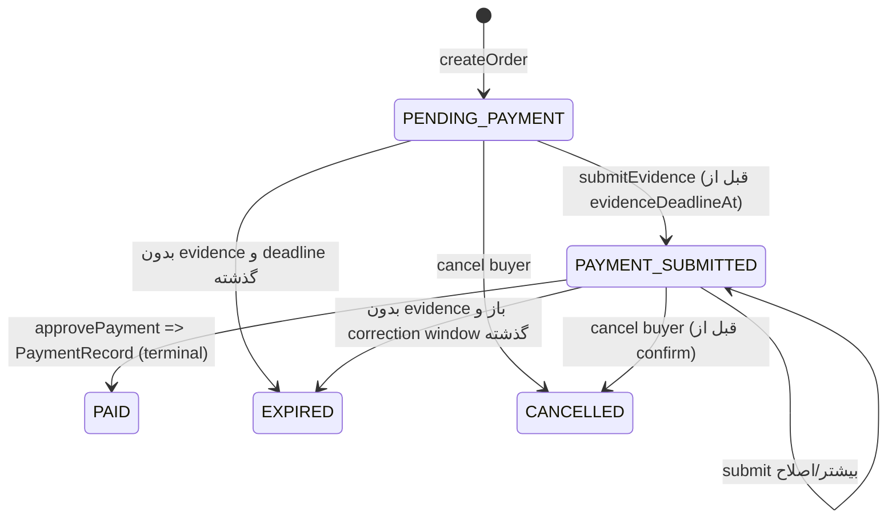
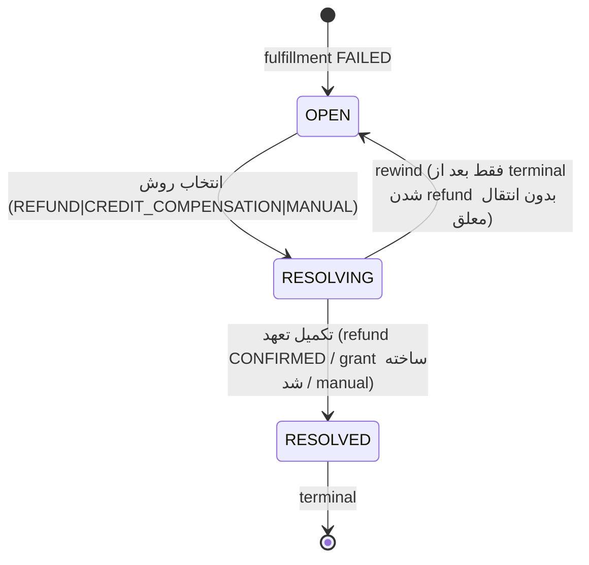

# طرح مادر تجاری‌سازی WeshBazar — سند جامع طراحی، پیاده‌سازی، تست و انتشار

> **نوع سند:** مرجع مادر فنی/محصولی (ممیزی‌شده از repository واقعی)  
> **زبان:** دری افغانستان؛ اصطلاحات فنی، نام جدول‌ها/ستون‌ها/راه‌ها/enumها/قطعه‌کدها به انگلیسی و مطابق repository  
> **وضعیت:** `PROPOSED — نیازمند تأیید مالک پیش از پیاده‌سازی`  
> **محدودهٔ مجاز این مأموریت:** تنها ایجاد همین یک فایل Markdown مجاز بود؛ هیچ کد، Schema، Migration، API، تست، تنظیمات امنیتی، وابستگی یا Git تغییری نکرده است.  
> **نسخهٔ سند:** `1.0` · **تاریخ تهیه:** از روی وضعیت زندهٔ repository در همین جلسه

---

## ۰. یادداشت دربارهٔ طول سند (شفاف)

این سند با هدف «عمق واقعی مهندسی» نوشته شده است، نه «رسیدن به یک عدد خط مشخص». تمام فصل‌های اجباری (۳۵ فصل + فازبندی + registerها) با محتوای واقعی پوشش داده شده‌اند؛ اما از تکرار چندبارهٔ یک الزام، جدول خالی، placeholder و شکستن مصنوعی جمله‌ها خودداری شده است. در نتیجه تعداد خطوط نهایی هرچه باشد، نمایانگر «محتوای کامل و قابل استفاده» است، نه حد بالایی تحمیلی. تعداد خط واقعی در انتهای گزارش نهایی اعلام می‌شود.

---

## فهرست مطالب

1. پوشش، نسخه، وضعیت و دامنه
2. خلاصهٔ اجرایی
3. روش ممیزی repository
4. معماری وضعیت فعلی
5. رفتار محصول/تجاری وضعیت فعلی
6. تحلیل تفاوت (Delta) بین تاریخچه، مستندات و کد
7. اصول محصول و مدل تجاری
8. سقف آگهی فعال کاربر عادی (۲۰)
9. پول / AFN / pul / credits
10. کاتالوگ Plan و تصمیم‌های قیمت‌گذاری
11. واژه‌نامهٔ دامنه
12. مدل داده
13. State Machineها
14. جریان پرداخت
15. Fulfillment و CommercialException
16. جریان Refund
17. Subscription و Credit Ledger
18. Promotion
19. یکپارچه‌سازی چرخهٔ حیات Listing/Seller
20. امنیت / RBAC
21. مالکیت / مجوزها / Triggerهای PostgreSQL
22. تراکنش‌ها / قفل‌گذاری / هم‌زمانی
23. قرارداد API / نسخه‌بندی
24. جریان‌های Frontend
25. Jobها / Reconciliation
26. Audit / گزارش‌دهی / حریم خصوصی
27. Observability / عملیات
28. استراتژی تست و کاتالوگ تست
29. Migration / استقرار / Rollback
30. فازهای پیاده‌سازی و مسئولیت‌ها
31. دروازه‌های پذیرش
32. Decision Register
33. Traceability Matrix
34. پرسش‌های باز / ریسک‌ها
35. ضمیمه: نمایهٔ شواهد repository و واژه‌نامه

---

## ۱. وضعیت، دامنه و مسئولیت‌ها

| مورد | مقدار |
|---|---|
| نسخهٔ سند | `1.0` |
| وضعیت طرح | `PROPOSED — NOT IMPLEMENTED` |
| وضعیت تأیید | نیازمند تصویب نهایی مالک محصول؛ پیشنهادها در Decision Register با `PROPOSED_NOT_APPROVED` ثبت می‌شوند |
| دامنهٔ مدل درآمدی | آگهی رایگان + `Boost Standard/Featured` + اشتراک `Business/Business Plus` + پرداخت دستی قابل ردیابی (نسخهٔ اول) |
| خارج از دامنه | Gateway خودکار، Wallet، Escrow، Commission/Take-rate، Redis/Kafka، میکروسرویس |
| قاعدهٔ سند | هر ادعای فنی دارای شاهد (مسیر فایل + نماد/خط) است؛ ادعای «انجام/امن/آزموده» بدون شاهد ممنوع است |

**پنج دستهٔ اجباری برای هر ادعا:** (۱) شاهد repository؛ (۲) تصمیم قطعی مالک؛ (۳) تصمیم طرح قبلیِ هنوز معتبر؛ (۴) پیشنهاد نیازمند تأیید؛ (۵) نامعلوم/تعارضی. این دسته‌ها هرگز با هم مخلوط نمی‌شوند و هیچ پیشنهاد عاملی `CONFIRMED_BY_OWNER` نمی‌شود.

---

## ۲. خلاصهٔ اجرایی

WeshBazar بازار آنلاین آگهی برای افغانستان است. ممیزی زندهٔ این جلسه نشان داد **هیچ کد تجاری‌سازی در repository پیاده نشده**؛ مفاهیم مالی (`Payment`, `Subscription`, `Promotion`, `Credit`, `Refund`) فقط در مستندات/طرح‌های Phase 1.0 تا 1.13 آمده‌اند. بنابراین تجاری‌سازی باید یک ماژول جدید از صفر ساخته شود، بدون شکستن قرارداد منجمد `/api/v1`.

دو ستون محصولی سند: (الف) **مدل درآمدی**: آگهی عادی و تمدید عادی رایگان بماند؛ درآمد اولیه از Boost و اشتراک فروشندهٔ حرفه‌ای؛ (ب) **تغییر سقف آگهی فعال کاربر عادی از ۵۰ به ۲۰** (فصل ۸). هیچ‌کدام نباید آگهی موجود را خودکار حذف/بایگانی کند.

معماری پیشنهادی Phase 1.0-1.13: تفکیک «تأیید پرداخت» از «ارائهٔ خدمت» با دو تراکنش (`PaymentRecord` تغییرناپذیر + `FulfillmentStatus`)، مدل پول integer small-unit (پیشنهاد `pul` = 1/100 AFN، نه قطعی)، `CommercialPlanRevision` تغییرناپذیر برای snapshot، و ledger اعتبار مستقل از ledger پول. همهٔ این‌ها «طراحی شده ولی پیاده/تست نشده» هستند.

---

## ۳. روش ممیزی repository

بررسی read-only با این ابزارها انجام شد و برای هر ادعای مهم، مسیر فایل + شمارهٔ خط ثبت شد:

- **Git:** `git rev-parse --abbrev-ref HEAD`، `--short HEAD`، `git status --porcelain` (وضعیت ابتدا و انتها مقایسه شد).
- **ساختار/پیکربندی:** `package.json` (backend/frontend)، `tsconfig.json`، `prisma/schema.prisma`، `prisma.config.ts`، `docker-compose.yml`، `.env.example` (فقط نمونه؛ `.env` واقعیِ رازآلود خوانده نشد)، `AGENTS.md`.
- **کد:** جستجوی نماد + خواندن مستقیم controllers/services/DTO/presenters/guards/config/jobs.
- **اسناد:** `AGENTS.md`، `README` (backend/frontend)، `docs/ROADMAP.md`، `docs/RUNBOOK.md`، `weshbazar-backend/docs/{architecture.md, api-freeze-summary.md, openapi.json, api-contract-audit.md, implementation-status.md, frontend-api-contract.md, frontend-error-map.md}`، `docs/audit/*.md`.

**محدودیت‌های صادقانه:**
- هیچ تستی اجرا نشد (شرط read-only؛ فقط «وجود» test suiteها و ادعاهای CI/مستندات ثبت شد؛ هیچ نتیچه PASS ادعا نمی‌شود).
- `.env` واقعی خوانده نشد (راز).
- دیتابیس زنده در دسترس نبود؛ بنابراین هیچ grant/trigger/index/role/ownership «verified on PostgreSQL» ادعا نمی‌شود. هر آیتم وابسته به DB با `UNVERIFIED`/`DESIGNED_NOT_TESTED` ثبت می‌شود.
- سقف‌ها و transitionها از کد واقعی (`env.schema.ts`, `listings.service.ts`, `listing-state.ts`, `configuration.ts`, `config.types.ts`, `error-codes.ts`) استخراج شد.

---

## ۴. معماری وضعیت فعلی

| لایه | وضعیت واقعی | شاهد |
|---|---|---|
| Backend | NestJS (Fastify)، modular monolith | `package.json`؛ `README` ("modular monolith") |
| Runtime | Node.js ≥24، TypeScript strict | `package.json` `engines`؛ `tsconfig.json` |
| ORM/DB | Prisma 7 (`@prisma/adapter-pg`+`pg`) → PostgreSQL 17 | `schema.prisma` datasource؛ `docker-compose.yml` |
| Auth | JWT دوتوکنی + Argon2 + OTP موبایل | `modules/auth/*` |
| Validation | `class-validator`+`class-transformer` (whitelist) + `zod` env | `common/validation/validation.pipe.ts`؛ `config/env.schema.ts` |
| RBAC | `UserRole=USER\|MODERATOR\|ADMIN` + permission map (TS) | `schema.prisma` enum؛ `permissions.ts:35-39` |
| Listing lifecycle | `DRAFT→PENDING_REVIEW→ACTIVE→SOLD/ARCHIVED` (+REJECTED، expiry/stale-draft jobs) | `listing-state.ts:64-130` |
| Search | `pg_trgm`؛ sorts = `newest/price_asc/price_desc/most_viewed` | `search.provider.ts:25` |
| Jobs | درون‌فرآیندی؛ ۵ job + archived-image (off/dry-run) | `jobs.service.ts:60-67`؛ `env.schema.ts:144-148` |
| Storage | `STORAGE_PROVIDER=local` (dev), pluggable | `providers/storage/*` |
| Analytics | `Listing.views/favoriteCount` + `ListingDailyStat` | `schema.prisma:722-742` |
| Idempotency | `IdempotencyKey` unique `[scope,subject,key]` + `requestHash` + `responseBody` | `schema.prisma:748-769` |
| Audit | `AuditLog` append-only (فقط `.create`)؛ `AuditAction` ۲۷ مقدار (هیچ‌کدام مالی) | `schema.prisma:662-716`؛ `audit.service.ts:82-108` |
| Frontend | Next.js 15 App Router، React 19، TS strict، Tailwind/shadcn، TanStack Query، Jest | `weshbazar-frontend/package.json` |
| زبان/جهت | دری `fa-AF`، RTL | `config/site.ts:13`؛ `layout.tsx` |
| Contract | `openapi.json` (3.0.0، 88 operationId)؛ global prefix `api/v1` | `bootstrap.ts:100-105`؛ `openapi-document.ts:38` |

**وضعیت Git:** branch `qwen`، HEAD `df75a8d` (نخستین ممیزی این گفتگو HEAD `a086f39` بود — repository بین دو ممیزی پیش رفته است). `git status --porcelain` پیش از این سند **خالی** بود (working tree پاک). تنها تغییری که این مأموریت ایجاد می‌کند، همین فایل سند است.

---

## ۵. رفتار محصول/تجاری وضعیت فعلی (شواهد)

- **انتشار و تمدید رایگان:** هیچ سازوکار پرداخت/اشتراک/ارتقا در کد نیست. جستجوی `Payment|Subscription|Plan|Promotion|Boost|Featured|Credit|Refund|Wallet|Commission|Payout` در `apps/api/src/**` و `weshbazar-frontend/src/**` فقط ارجاع به مستندات/قواعد `.devin/rules` داد، نه کد پیاده‌شده.
- **سقف فعلی آگهی:** ۵۰ فعال / ۱۰ pending برای هر `SellerAccount`. تعریف: `env.schema.ts:128-129` (`MAX_ACTIVE_LISTINGS_PER_USER: intEnv(50)`, `MAX_PENDING_LISTINGS_PER_USER: intEnv(10)`)، نگاشت `configuration.ts:94-95`، تایپ `config.types.ts:91-92`، اعمال در `assertPublishAllowance` (`listings.service.ts:1167-1191`).
- **نقاط فراخوانی `assertPublishAllowance`:** `submitForReview` (`:417`)، `approve` (`:713`)، `restoreByAdmin` (`:865`). شمارش با `prisma.listing.count({ where: { sellerAccountId, status: 'ACTIVE'|'PENDING_REVIEW', deletedAt: null } })` انجام می‌شود. خطا: `LISTING_LIMIT_REACHED` (HTTP 409) با `details.scope` و `details.limit` (`error-codes.ts:310-313`).
- **پیام دری موجود:** `features/listings/sell/errors.ts:17-18` («به سقف مجاز آگهی‌های حساب خود رسیده‌اید؛ برای ثبت آگهی جدید یکی از آگهی‌های قدیمی را بایگانی کنید.») و `features/admin/errors.ts:35-36`.
- **قیمت کالا در برابر قیمت خدمات:** `PricingType = PAID|FREE|CONTACT` و `Listing.price Decimal(14,2)` + `currency=AFN` (`schema.prisma:380-384, 423-425`) فقط برای کالای آگهی است؛ برای قیمت خدمات WeshBazar هرگز بازاستفاده نمی‌شود.
- **مسیرهای خارج‌کردن Listing از ACTIVE:** `MARK_SOLD`، `ARCHIVE`، `ADMIN_ARCHIVE`، `EXPIRE` (job)، `ARCHIVE_STALE_DRAFT` (job) — از طریق `resolveListingTransition` و `commitTransition` (conditional `updateMany` با `version`، خطای `LISTING_VERSION_CONFLICT`).

**محدودیت شناسایی‌شده در شمارش quota:** `assertPublishAllowance` یک `count` جداگانه و **بدون** `FOR UPDATE` روی `SellerAccount` است؛ بنابراین در فاز پیاده‌سازی سقف ۲۰، برای تضمین race-free بودن (دو publish هم‌زمان از ۱۹→۲۱) باید قفل `SellerAccount`/شمارش اتمی اضافه شود. این موضوع دقیق در فصل ۸ تحلیل می‌شود.

---

## ۶. تحلیل تفاوت (Delta) — تاریخچه، مستندات، کد

| ادعای تاریخی | وضعیت واقعی امروز | دسته |
|---|---|---|
| API `/api/v1` و «frozen» | `AGENTS.md:1` «Backend API is frozen at v1.0.0» + `openapi.json`; global prefix `api/v1` (`bootstrap.ts:100`); `enableVersioning` فعال **نیست** | شاهد کد |
| `IdempotencyKey` با `[scope,subject,key]` + `responseBody` | موجود (`schema.prisma:748-769`)؛ سرویس/میان‌افزار عمومیِ مصرف‌کننده پیدا نشد (فقط جدول + error codes) | شاهد کد + شکاف |
| `AuditLog` append-only | `.create` فقط؛ بدون `.update/.delete` در سرویس | شاهد کد |
| `UserRole = USER|MODERATOR|ADMIN` | دقیق | شاهد کد |
| `SellerAccountType = INDIVIDUAL` فقط | دقیق (`schema.prisma:92-94`) | شاهد کد |
| `SellerAccount.ownerUserId @unique`، `Listing.sellerAccountId` | دقیق | شاهد کد |
| سقف ۵۰ فعال / ۱۰ pending | دقیق (`env.schema.ts:128-129`) | شاهد کد |
| هیچ Payment/Subscription/Promotion/Credit/Refund در کد | دقیق؛ فقط در مستندات/طرح | شاهد کد |
| Payment/fulfillment/refund/credit/promotion models (Phase 1.5-1.13) | فقط طرح؛ **هیچ** migration/model/route/test ندارد | `PROPOSED_NOT_APPROVED` |

**تعارض/ناهماهنگی مستندشده:** سقف گزارش‌شدهٔ قدیمی ۵۰ است؛ **سیاست جدید موردنظر ۲۰ است** (فصل ۸). هیچ پیاده‌سازی برای سقف ۲۰ هنوز وجود ندارد. گزارش `api-freeze-summary` می‌گوید ۷۰ مسیر/۸۳ operationId، ولی `openapi.json` فعلی ۸۸ `operationId` دارد — این تفاوت عددی ثبت می‌شود ولی تأثیری بر طراحی ندارد.

---

## ۷. اصول محصول و مدل تجاری

**اصول غیرقابل مذاکره:**
1. آگهی عادی و تمدید عادی **رایگان** بماند، مگر مالک تصمیم صریح و مستند دیگری بگیرد.
2. quota به‌صورت پنهانی یا بدون تحلیل اثر رشد کاهش نیابد؛ کاهش ۵۰→۲۰ صرفاً برای مجبورکردن کاربر به خرید اشتراک نیست.
3. فروشنده بداند دقیقاً بابت چه خدمتی پول می‌دهد.
4. وضعیت پرداخت، اعتبار و ارائهٔ خدمت از هم تفکیک شوند.
5. پلتفرم خدمتی را «ارائه‌شده» گزارش نکند مگر شواهد انجام آن وجود داشته باشد.
6. گزارش مالی از آمار بازدید/کلیک Listing جدا باشد.
7. `Listing.price` هرگز مبلغ کارمزد یا قیمت خدمات WeshBazar نیست.

**مدل درآمدی پیشنهادی (نیازمند تأیید):** درآمد اولیه از `Boost Standard` (ارتقای دیده‌شدن)، `Boost Featured`، و اشتراک `Business/Business Plus`. درآمدهای آینده (تبلیغات، lead generation، commission/escrow، خدمات اعتمادسازی) فقط در صورت توجیه عملیاتی/حقوقی و تصمیم جداگانهٔ مالک.

---

## ۸. سقف آگهی فعال کاربر عادی (۲۰) — تحلیل کامل

> **تصمیم قطعی مالک (CONFIRMED_BY_OWNER):** حداکثر آگهی فعال هم‌زمان کاربر عادی `20` (تغییر از `50`). **سقف pending فعلی `10` بدون تغییر.** این یک **تغییر سیاست محصولی است، نه کد موجود**؛ هیچ پیاده‌سازی برای آن هنوز انجام نشده است (وضعیت `D-001` در Decision Register = `CONFIRMED_BY_OWNER`).

### ۸.۱ وضعیت فعلی enforcement (شواهد دقیق)

| لایه | محل | رفتار |
|---|---|---|
| env | `env.schema.ts:128-129` | `MAX_ACTIVE_LISTINGS_PER_USER=50`, `MAX_PENDING_LISTINGS_PER_USER=10` |
| config | `configuration.ts:94-95` → `config.types.ts:91-92` | `maxActivePerUser`, `maxPendingPerUser` |
| GUI/service | `listings.service.ts:1167-1191` | `assertPublishAllowance`: count `ACTIVE`/`PENDING_REVIEW` (deletedAt null)؛ throw `LISTING_LIMIT_REACHED` |
| فراخوانی | `submitForReview :417`، `approve :713`، `restoreByAdmin :865` | هر سه مسیر قبل از activate دوباره بررسی می‌کنند |
| خطا | `error-codes.ts:310-313` | `LISTING_LIMIT_REACHED` (409) + `details.scope` |
| تست موجود | `test/e2e/listings.e2e-spec.ts` (ادعا از مستندات، نه اجرا) | رفتار سقف را با `LISTING_LIMIT_REACHED` پوشش می‌دهد |
| test env | `test/setup/test-env.ts:67-68` | مقدار 50/10 برای تست |

### ۸.۲ پرسش‌های تحلیل‌گرایانه و پاسخ مبتنی بر کد

1. **کدام لایه‌ها enforce می‌کنند؟** یک جا: `assertPublishAllowance` (سرویس Listings). هیچ constraint دیتابیسی برای سقف وجود ندارد.
2. **active count فقط ACTIVE است؟** بله؛ `status:'ACTIVE'` و در مسیر pending جدا `status:'PENDING_REVIEW'`. هیچ وضعیت دیگری شمرده نمی‌شود.
3. **pending جدا است؟** بله؛ سقف جداگانهٔ ۱۰.
4. **آیا publish/renew/relist/edit/approval/bulk از یک guard مشترک است؟** همه از `assertPublishAllowance` عبور نمی‌کنند؛ نقاط تأییدشده: submit (`:417`)، approve (`:713`)، admin restore (`:865`). `renew` (re-activate) از مسیر `approve` نمی‌گذرد؛ برای سقف ۲۰ باید مسیرهای renew/relist به‌صورت صریح audit شوند.
5. **race بین دو درخواست ۱۹→۲۱؟** `count` بدون `FOR UPDATE` روی `SellerAccount` است، پس در شرایط هم‌زمان **می‌تواند** از سقف عبور کند. این یک شکاف تأییدشدهٔ فعلی است.
6. **counter/reservation یا lock؟** برای سقف ۲۰ باید `SellerAccount` به‌طور `FOR UPDATE` قفل شود، سپس count، سپس transition — یا یک شمارندهٔ اتمی.
7. **کاربری که بیش از ۲۰ دارد؟** سیاست پیشنهادی: grandfathering (نگه‌داشتن آگهی‌های موجود، ممنوع‌کردن فعال‌سازی جدید تا زیر سقف).
8. **pending هنگام انتشار؟** `approve` دوباره quota را بررسی می‌کند (`:713`)، پس pending فعلی از طریق approval در معرض سقف ۲۰ قرار می‌گیرد.
9. **entitlement تجاری؟** هنوز تصمیم قطعی ندارد؛ هیچ quota بالاتر/نامحدود و استثنایی خودسرانه تعریف نمی‌شود.
10. **quota بر اساس User یا SellerAccount؟** فعلاً `SellerAccount` (`assertPublishAllowance(sellerAccountId, …)`). چون امروز ۱:۱ (`SellerAccount.ownerUserId @unique`)، عملاً هر دو معادل‌اند؛ سند بر SellerAccount مبنای فعلی را حفظ می‌کند.
11. **خطا/متن/UI/رفع مشكل؟** `LISTING_LIMIT_REACHED` + متن دری موجود؛ برای سقف ۲۰ متن جدید لازم است.
12. **admin/moderator/import؟** مسیر admin restore هم `assertPublishAllowance` را صدا می‌زند (`:865`)؛ «import/system» مسیر جدا ندارد، پس باید سیاست آن صریح شود (پیش‌فرض: همان سقف، بدون استثنا).

### ۸.۳ تحلیل race-condition برای سقف ۲۰ (اجباری)

سناریوهای لازم و راه‌حل پایه (از الگوی transaction فعلی، بدون تحمیل طرح فرضی):

| سناریو | راه تضمین |
|---|---|
| دو `publish` هم‌زمان یک User | قفل `SellerAccount FOR UPDATE` قبل از count+transition؛ count اتمی داخل همان transaction |
| `approve` هم‌زمان چند pending | `approve` (`:713`) قبل از activate؛ همان قفل SellerAccount |
| publish هم‌زمان با archive | archive از `commitTransition` (قفل ردیف Listing)؛ هر دو در گذر از «قفل SellerAccount» serialize می‌شوند |
| publish هم‌زمان با suspension | قفل ترتیب `User→SellerAccount` (مطابق طرح Phase 1.13)؛ suspension ابتدا وضعیت را غیرفعال می‌کند، سپس publish رد می‌شود |
| renew هم‌زمان با expiry | renew/expiry هر دو از `resolveListingTransition`+`commitTransition` (قفل ردیف Listing) |
| دو SellerAccount برای یک User | امروز ۱:۱ (`ownerUserId @unique`)؛ امکان چندتایی وجود ندارد؛ در صورت آینده، سقف باید به‌ازای هر SellerAccount بازتعریف شود |
| retry idempotent پس از timeout | `IdempotencyKey` موجود (unique `[scope,subject,key]`) برای دستورات create/submit |

**معیار پذیرش (اصلاح‌شده برای سازگاری با grandfathering):** پس از commit هر تراکنش، تعداد آگهی‌های `ACTIVE` (deletedAt null) برای یک `SellerAccount` عادی **نسبت به مقدار موجود لحظهٔ rollout افزایش نیابد** (و هرگز از سقف پایهٔ ۲۰ عبور نکند، مگر کاربر از قبل grandfathered باشد که سقف مؤثر او = مقدار فعلی‌اش). یعنی: کاربرِ ۱۹ → حداکثر ۲۰؛ کاربرِ ۲۱ (grandfathered) → حداکثر ۲۱ و ممنوعیت هر افزایش جدید تا زیر سقف پایه.

### ۸.۴ سیاست کاربران فعلی (grandfathering) — تأییدشده توسط مالک

- از لحظهٔ فعال‌شدن policy، کاربر عادی نمی‌تواند آگهی فعال جدید تا جایی که مجموع فعال‌هایش از ۲۰ بیشتر شود، ایجاد/فعال کند.
- آگهی‌های موجود پیش از release خودکار حذف/archive/reject/غیرفعال **نمی‌شوند**.
- کاربر دارای بیش از ۲۰ در لحظهٔ rollout: آگهی‌های موجود grandfathered می‌مانند؛ فعال‌سازی جدید تا کاهش زیر سقف ممنوع.
- هیچ hard-delete/بایگانی انبوه برای اجرای quota طراحی نشود.
- تمدید/renew که منجر به ادامهٔ فعال‌بودن یا بازفعال‌سازی پس از انقضا می‌شود: رایگان‌بودن renewal به معنای معافیت از سقف نیست.
- `approve` آگهی pending دوباره quota را بررسی کند (بررسی فقط در submit کافی نیست).
- بدون تصمیم قطعی account/business entitlement، هیچ quota بالاتر/unlimited/استثنا تعریف نشود.

### ۸.۵ UX/پیام برای سقف ۲۰ (خلاصه)

حالت‌ها: کاربر ۱۹ فعال (مجاز)، ۲۰ فعال (رد جدید)، ۲۱+ grandfathered (رد جدید)، pending منتظر تأیید، archive/sold یک آگهی سپس تأیید pending، درخواست هم‌زمان، suspension، admin override (اگر مجاز). پیام باید بگوید چه چیزی محدود شده و چه اقدام معقولی ممکن است؛ کاربر را به خرید اشتراک مجبور یا گمراه نکند مگر entitlement تجاری واقعاً تعریف/تأیید شده باشد.

### ۸.۶ تعریف «کاربر عادی» و پوشش کامل مسیرهای فعال‌سازی

- **کاربر عادی** = `SellerAccount` با `type=INDIVIDUAL` و بدون entitlement تجاری افزایش‌سقف. چون امروز `SellerAccountType` فقط `INDIVIDUAL` است (`schema.prisma:92-94`)، همهٔ فروشندگان عادی‌اند.
- **اشتراک Business/Business Plus به‌صورت خودکار سقف ۲۰ را افزایش نمی‌دهد.** افزایش احتمالی سقف فقط با entitlement جداگانهٔ تأییدشدهٔ مالک (D-004) انجام می‌شود؛ هیچ quota بالاتر/unlimited/نباید به‌صورت خودسرانه تعریف شود.
- **تمام مسیرهایی که وضعیت Listing را به `ACTIVE` می‌رسانند و باید توسط سقف ۲۰ کنترل شوند (فاز پیاده‌سازی باید هر یک را audit/تست کند):**
  1. انتشار (`submitForReview` → ACTIVE در AUTO_APPROVE).
  2. تأیید pending (`approve`).
  3. بازیابی توسط admin (`restoreByAdmin`).
  4. تمدید/بازفعال‌سازی (`renew`؛ ACTIVE→ACTIVE تمدید runway یا ARCHIVED→DRAFT سپس بررسی مجدد).
  5. هر `EDIT` یا مسیر آینده‌ای که وضعیت را دوباره به ACTIVE می‌برد (soft-delete restore و…).
- قفل `SellerAccount FOR UPDATE` + count + transition باید در **یک جریان تراکنشی منسجم** باشد؛ نمی‌توان فرض کرد مسیرهای archive/approval به‌طور خودکار همان قفل را دارند (امروز `assertPublishAllowance` بدون قفل است — risk تأییدشده).

---

## ۹. پول، واحدها و قیمت‌گذاری

### ۹.۱ جداسازی پول از قیمت Listing

- تمام مبالغ خدمات تجاری از `Listing.price` جدا هستند.
- **پیشنهاد واحد پایه:** `pul` با `1 AFN = 100 pul`، ذخیره **integer**، بدون floating point، `amountPul` + واحد صریح. **این تعریف هنوز قطعی نیست** (`OWNER_DECISION_REQUIRED`).
- اگر مالک تصمیم دیگری دهد، فاکتور تبدیل باید در Decision Register ثبت شود و در API/UI به‌صورت مستند تبدیل شود.
- `credits` (اعتبار خدمات) از `amountPul` (پول) و از `Listing.price` (کالا) و از analytics metrics (بازدید/کلیک) کاملاً جدا است.

### ۹.۲ کاتالوگ قیمت پیشنهادی قبلی (غیرقطعی)

| محصول | AFN پیشنهادی | pul پیشنهادی | مدت/اعتبار پیشنهادی |
|---|---:|---:|---|
| Boost Standard | 50 | 5,000 | 3 روز |
| Boost Featured | 100 | 10,000 | 7 روز |
| Business Monthly | 99 | 9,900 | 30 روز، 3 credits |
| Business Annual | 999 | 99,900 | 365 روز، 30 credits |
| Business Plus Monthly | 199 | 19,900 | 30 روز، 8 credits |
| Business Plus Annual | 1,999 | 199,900 | 365 روز، 80 credits |

**نیازمند تأیید مالک:** قیمت‌های نهایی؛ قیمت‌گذاری در برابر تورم/هزینه؛ entitlements دقیق Business/Business Plus؛ carry-over اعتبار؛ هزینهٔ credit برای Boost (پیشنهاد قبلی Standard=1، Featured=2)؛ ظرفیت slotهای Featured؛ تخفیف/مالیات/اصلاح قیمت؛ زمان شروع plan ماهانه/سالانه.

---

## ۱۰. کاتالوگ Plan و تصمیم‌های قیمت‌گذاری

**`CommercialPlan` (کاتالوگ، علی الظاهر mutable با audited change) و `CommercialPlanRevision` (تغییرناپذیر — snapshot):**

| فیلد کلیدی `CommercialPlanRevision` | معنای پیشنهادی (DESIGNED_NOT_TESTED) |
|---|---|
| `id`, `planId`, `version` | هویت؛ unique `[planId, version]` |
| `code` | `BOOST_STANDARD`, `BOOST_FEATURED`, `BUSINESS_MONTHLY`, `BUSINESS_ANNUAL`, `BUSINESS_PLUS_MONTHLY`, `BUSINESS_PLUS_ANNUAL` |
| `kind` | `SUBSCRIPTION | PROMOTION` |
| `tier` | `STANDARD | FEATURED | BUSINESS | BUSINESS_PLUS` |
| `amountPul` | قیمت پولی snapshot (integer pul)؛ `currency` افغانی |
| `billingPeriod` | `MONTHLY | ANNUAL` (null برای promotion) |
| `durationDays` | مدت (promotion=3/7؛ subscription=30/365) |
| `creditsRequired` | هزینهٔ credit برای redeem (فقط promotion) |
| `creditsIncluded` | credit اعطاشده توسط subscription (فقط subscription) |
| `storefrontTier`, `analyticsTier`, `conditionRef` | entitlements و نسخهٔ شرایط پذیرفته‌شده |

قانون سازگاری: `kind=SUBSCRIPTION ⇒ creditsIncluded>0 AND creditsRequired=0`؛ `kind=PROMOTION ⇒ creditsRequired>0 AND creditsIncluded=0` (CHECK در migration).

**اصل تغییرناپذیری:** کاتالوگ تغییر قیمت/entitlement = ایجاد revision جدید (`version++`)؛ order/subscription/promotion همیشه به revision انتخابی زمان خرید pin شده است و تغییر بعدی کاتالوگ بر آن اثر ندارد. `CommercialPlanRevision` در سطح DB با trigger `BEFORE UPDATE OR DELETE` + `REVOKE` محافظت می‌شود.

---

## ۱۱. واژه‌نامهٔ دامنه

| واژه | تعریف دقیق (طراحی؛ پیاده‌نشده) |
|---|---|
| `amountPul` | مبلغ پولی به integer در کوچک‌ترین واحد پولی (پیشنهاد pul؛ قطعی نشده) — **نه** credit، **نه** `Listing.price` |
| `credits` | اعتبار خدمات (integer) — قابل برداشت/انتقال نیست؛ فقط مصرف promotion |
| `PurchaseOrder` | سفارش پولی با snapshot قیمت/entitlement؛ منبع کاش، نه credit redeem |
| `PaymentSubmission` | evidence کاربر (شواهد پرداخت)؛ proof پرداخت نیست |
| `PaymentReviewDecision` | تصمیم نهایی روی یک submission (`APPROVED|REJECTED|SUPERSEDED`)؛ تغییرناپذیر |
| `PaymentRecord` | واقعیت تأییدشدهٔ دریافت پول؛ تغییرناپذیر؛ یکی برای هر order |
| `FulfillmentStatus` | projection ارائهٔ خدمت (`PENDING|FULFILLED|FAILED|COMPENSATED`) |
| `Subscription` | entitlement فروشگاه؛ مالکیت `SellerAccount`؛ یک ACTIVE در هر فروشگاه |
| `CreditGrant` | اعتبار اعطاشده؛ منبع `SUBSCRIPTION|COMPENSATION`؛ counters |
| `CreditConsumption` | مصرف اتمی credit؛ تغییرناپذیر |
| `CreditReversal` | بازگرداندن کامل مصرف (idempotent، یک عدد برای هر consumption) |
| `CreditExpiration` | رویداد منقضی‌شدن اعتبار باقی‌مانده؛ تغییرناپذیر |
| `Promotion` | پنجرهٔ دیده‌شدن پولی روی یک listing؛ funding `DIRECT_PAYMENT|SUBSCRIPTION_CREDIT` |
| `CommercialException` | مسئلهٔ مالی/ارائهٔ خدمت؛ `OPEN→RESOLVING→RESOLVED` (rewind مجاز) |
| `RefundRequest` | درخواست بازپرداخت با مبلغ ثابت؛ فقط `status` mutable |
| `RefundTransferAttempt` | تلاش انتقال (facts تغییرناپذیر + projection کنترل‌شده `terminalStatus`) |
| `RefundTransferEvent` | رویداد append-only (`SENT|FAILED|CONFIRMED`) با شواهد/بازبین |

---

## ۱۲. مدل داده (خلاصهٔ کامل aggregateها)

### ۱۲.۱ جداول پیشنهادی (هیچ‌کدام در schema فعلی وجود ندارد)

**Cash flow:** `CommercialPlan`, `CommercialPlanRevision`, `PurchaseOrder`, `PaymentSubmission`, `PaymentReviewDecision`, `PaymentRecord`, `RefundRequest`, `RefundTransferAttempt`, `RefundTransferEvent`, `RefundStatusChange`, `CommercialException`, `CommercialExceptionEvent`.

**Credit flow:** `Subscription`, `CreditGrant`, `CreditConsumption`, `CreditReversal`, `CreditExpiration`.

**Shared outcome:** `Promotion`.

### ۱۲.۲ دسته‌بندی جداول از نظر تغییرپذیری (برای فصل ۲۱)

| دسته | جداول |
|---|---|
| Immutable fact/event | `PaymentSubmission`, `PaymentReviewDecision`, `PaymentRecord`, `RefundTransferEvent`, `RefundStatusChange`, `CommercialExceptionEvent`, `CreditConsumption`, `CreditReversal`, `CreditExpiration`, `CommercialPlanRevision` |
| Mutable projection (فقط ستون‌های مشخص) | `PurchaseOrder.status/fulfillmentStatus`, `RefundRequest.status`, `Subscription.status`, `Promotion.status`, `CreditGrant.consumedCredits/expiredCredits`, `CommercialException.status/resolution` |
| Controlled projection + immutable facts | `RefundTransferAttempt` (`terminalStatus` تنها ستون mutable؛ بقیه immutable) |
| Mutable catalog | `CommercialPlan` (`isActive`, `version`؛ audited) |

### ۱۲.۳ روابط کلیدی مالکیت (بر اساس کد فعلی)

- `User.sellerAccount` (1:1) → `SellerAccount`؛ `SellerAccount.ownerUserId @unique`.
- `Listing.sellerAccountId` → `SellerAccount` (مالکیت آگهی).
- `Subscription` → `SellerAccount` (مالک فروشگاه)؛ خریدار = `User` که مالک آن SellerAccount است.
- `PurchaseOrder.buyerUserId` و `PurchaseOrder.sellerAccountId` با invariant «buyer مالک store است».

---

## ۱۳. State Machineها (طراحی؛ پیاده‌نشده)

هر transition با: transition مجاز/غیرمجاز، actor/permission، lock order، atomicity، idempotency، retry، audit/event، terminal، recovery، و مسیر (API/job/internal) مشخص می‌شود.

### ۱۳.۱ PurchaseOrder (cash)


- **دسترسی:** ایجاد/cancel توسط `USER` (مالک)؛ approve توسط `PAYMENT_APPROVE`؛ expire توسط job (سیستم).
- **قفل:** اولین قفل مشترک `PurchaseOrder`. submit و expire هر دو `PurchaseOrder FOR UPDATE`.
- **correctionDeadlineAt:** بعد از REJECT، ۴۸ ساعت (`PROPOSED`)؛ تصمیم نهایی مالک لازم.

### ۱۳.۲ PaymentSubmission → PaymentReviewDecision

- `PaymentReviewDecision.submissionId @unique` (یک تصمیم نهایی برای هر submission).
- تصمیم‌ها: `APPROVED`, `REJECTED`, `SUPERSEDED`.
- با APPRive یک submission، سایر submissionهای undecided همان order به `SUPERSEDED` در همان transaction.

### ۱۳.۳ CommercialException (refund/exception)


قواعد resolution (جدول Stage): `OPEN→OPEN` فقط `NONE`؛ `OPEN→RESOLVING` یک روش؛ `RESOLVING→RESOLVING` بدون تغییر؛ `RESOLVING→OPEN` فقط `NONE`؛ `RESOLVING→RESOLVED` همان روش؛ `RESOLVED` تغییرناپذیر.

### ۱۳.۴ RefundRequest / RefundTransferAttempt / Event

- `RefundRequest.status`: `OPEN → COMPLETED|CANCELLED|SUPERSEDED|FAILED_TERMINAL` (terminal تغییرناپذیر).
- `COMPLETED` فقط با `RefundTransferEvent(CONFIRMED)` و بدون unsettled attempt.
- `CANCELLED/SUPERSEDED/FAILED_TERMINAL` فقط وقتی هیچ unsettled attempt و (برای cancel/fail) هیچ confirmed نباشد.
- Attempt فقط با `terminalStatus=NULL`؛ یک unsettled و یک confirmed برای هر request (partial unique indexes).

### ۱۳.۵ Subscription / Promotion / Credit

- `Subscription`: `PENDING→ACTIVE→EXPIRED/CANCELLED/REFUNDED`؛ suspension → `SUSPENDED` (reversible)؛ یک ACTIVE در هر فروشگاه.
- `Promotion`: `PENDING→ACTIVE→COMPLETED/CANCELLED/REFUNDED`؛ فقط ACTIVE در نمایش/رتبه.
- `CreditGrant` تعادل: `remaining = totalCredits - consumedCredits - expiredCredits`.

---

## ۱۴. جریان پرداخت (دستی، قابل ردیابی)

### ۱۴.۱ Transaction A — تأیید پول

```
BEGIN;
  SELECT id FROM "PurchaseOrder" WHERE id=:oid FOR UPDATE;   (قفل)
  validate: submission undecided; submission.amountPul == order.amountPul (FK);
           approver != buyer (SELF_APPROVAL_FORBIDDEN)
  INSERT PaymentReviewDecision(APPROVED) + SUPERSEDED برای siblings;
  INSERT PaymentRecord(orderId, submissionId, approverUserId, transactionRefNormalized);  (تغییرناپذیر)
  UPDATE PurchaseOrder SET status='PAID', fulfillmentStatus='PENDING';
COMMIT;
```

### ۱۴.۲ Transaction B — ارائهٔ خدمت

```
BEGIN;
  lock PurchaseOrder; (re-check status=PAID و fulfillmentStatus=PENDING)
  subscribe: seller ACTIVE -> INSERT Subscription(ACTIVE) + CreditGrant
  promote:   listing ACTIVE + seller ACTIVE -> INSERT Promotion(ACTIVE, paymentRecordId)
  eligible -> fulfillmentStatus=FULFILLED
  نه -> fulfillmentStatus=FAILED + INSERT CommercialException(OPEN)
COMMIT;
```

- Crash بین A و B ⇒ `PAID + PENDING` پایدار؛ job دوباره B را idempotent اجرا می‌کند.
- `PaymentRecord` هرگز به دلیل شکست B rollback نمی‌شود.

### ۱۴.۳ قواعد پولی

- `PaymentSubmission.amountPul` باید برابر `PurchaseOrder.amountPul` باشد (FK). مبلغ اشتباه در v1 قابل تأیید نیست و override مالی وجود ندارد.
- یک submission فقط یک‌بار approve؛ یک order فقط یک `PaymentRecord` (`orderId @unique`).
- مرجع تراکنش نرمال‌شده در `PaymentRecord` unique است (جلوگیری از تأیید دوبارهٔ یک انتقال).

---

## ۱۵. Fulfillment و CommercialException

- **جداسازی بنیادی**: `PAID` (پول تأیید شد) ≠ `FULFILLED` (خدمت ارائه شد). خرابی ارائهٔ خدمت هرگز واقعیت پرداخت را پاک نمی‌کند.
- **fulfillmentStatus** روی PurchaseOrder: `PENDING → FULFILLED | FAILED | COMPENSATED`.
- **CommercialException** (Open/Resolving/Resolved) رکورد پایدار مسئلهٔ مالی/ارائهٔ خدمت است؛ با rewind قابل حل شدن به OPEN در صورت شکست نهایی refund (بدون انتقال معلق).
- **دفع‌بدون-پرداخت**: اگر listing در Transaction B دیگر ACTIVE/واجد شرایط نباشد (SOLD/ARCHIVED/rejected/deleted یا seller suspended) ⇒ `FAILED` + `CommercialException`؛ نه فعال‌سازی promotion و نه حذف PaymentRecord.
- **retry**: فقط PENDING؛ FULFILLED/FAILED بدون retry خودکار (FAILED مسیر admin).

---

## ۱۶. جریان Refund

```
RefundRequest(OPEN, مبلغ ثابت)
  └─ RefundTransferAttempt (facts immutable, terminalStatus=NULL)
        └─ RefundTransferEvent(SENT) [auto-created توسط AFTER INSERT trigger]
        └─ RefundTransferEvent(CONFIRMED|FAILED) [terminal، با evidence+reviewer]
```
- **رزرو:** مجموع `confirmed + outstanding(OPEN)` هرگز از `PaymentRecord.amountPul` بیشتر نمی‌شود؛ با قفل `PaymentRecord FOR UPDATE` در ایجاد و تأیید.
- **SENT = نامعلوم**؛ رزرو آزاد نمی‌شود تا attempt به CONFIRMED/FAILED برسد.
- **CONFIRMED** نیازمند `confirmationRef` نرمال‌شده + `verifiedByUserId`؛ **FAILED** نیازمند `failureEvidence` غیرخالی + reviewer.
- partial refund = requestهای جدا با مبلغ ثابت.

---

## ۱۷. Subscription و Credit Ledger

- مالکیت اشتراک = `SellerAccount`؛ یک ACTIVE در هر فروشگاه (partial unique). خرید توسط `User` مالک فروشگاه.
- grant منبع: `SUBSCRIPTION` (subscriptionId NULLتشدنی ولی در این حالت NOT NULL) یا `COMPENSATION` (subscriptionId NULL، exceptionId FK، reason، expiresAt، issuedBy).
- `totalCredits/consumedCredits/expiredCredits`؛ `remaining = total - consumed - expired`.
- **مصرف اتمی:** guarded `UPDATE` با `expiresAt > clock_timestamp()` و `remaining >= :n` و owner ACTIVE؛ قفل ترتیب `User → SellerAccount → Subscription(اگر لازم) → CreditGrant`.
- **Reversal:** یک full reversal برای هر consumption (`consumptionId @unique`؛ `credits == consumption.credits` via composite FK).
- **Expiration:** فقط وقتی باقی مثبت؛ یک `CreditExpiration` برای هر grant (`grantId @unique`).
- **Reconcile:** CTE جدا برای consumption/reversal/expiration (جلوگیری از fan-out).

---

## ۱۸. Promotion

- محصول‌ها: `Boost Standard` (3 روز، 50 AFN/5000 pul) و `Boost Featured` (7 روز، 100 AFN/10000 pul) — غیرقطعی.
- Funding: `DIRECT_PAYMENT` (PaymentRecord) یا `SUBSCRIPTION_CREDIT` (CreditConsumption)؛ CHECK و composite FK تضمین «دقیقاً یک منبع».
- فقط روی listing ACTIVE قابل خرید/فعال‌شدن؛ در طول promotion اگر listing SOLD/ARCHIVED/deleted یا seller suspended شد، promotion لغو می‌شود (همان transaction چند transition، + filter زنده در مصرف‌کننده).
- نمایش/رتبه فقط `status=ACTIVE`؛ `PENDING` نامرئی.
- slot محدود + rotation روزانه/context-based؛ بدون تضمین impressions/کلیک/فروش.

---

## ۱۹. یکپارچه‌سازی چرخهٔ حیات Listing/Seller

- مسیرهای خارج‌کردن از ACTIVE که باید promotionها را در همان transaction لغو کنند: `MARK_SOLD`، `ARCHIVE`، `ADMIN_ARCHIVE`، `REJECT`، `EXPIRE` (job)، `ARCHIVE_STALE_DRAFT` (job) و هر soft-delete آینده. (فهرست واقعی از `listing-state.ts` و `commitTransition` استخراج شود.)
- suspension کاربر/فروشنده: subscription فعال → `SUSPENDED` و promotionهای PENDING/ACTIVE → `CANCELLED` (مسیر admin suspend). restore فقط در صورت باقی‌بودن مدت؛ promotion لغوشده خودکار فعال نمی‌شود.
- مصرف‌کننده/ranking مستقل از job، وضعیت promotion+listing+seller+user را کنترل می‌کند (فیلتر زنده).

---

## ۲۰. امنیت / RBAC

**ماتریس مجاز (پیشنهادی؛ permissionها در کد امروز وجود ندارند و additive خواهند بود):**

| Permission | دارنده | کاربرد |
|---|---|---|
| `PAYMENT_REVIEW` | `FINANCE`, `ADMIN` | خواندن صف/جزئیات پرداخت |
| `PAYMENT_APPROVE` | `FINANCE`, `ADMIN` | تأیید پرداخت + فعال‌سازی |
| `PAYMENT_REJECT` | `FINANCE`, `ADMIN` | رد evidence با دلیل |
| `REFUND_MANAGE` | `FINANCE`, `ADMIN` | refund/compensation |
| `COMMERCIAL_PLAN_MANAGE` | `FINANCE`, `ADMIN` | مدیریت کاتالوگ (audited) |
| `FINANCIAL_REPORT_VIEW` | `FINANCE`, `ADMIN` | گزارش تجاری |

- **تفکیک وظیفه:** `FINANCE` از moderation (`LISTING_*`, `USER_*`)، taxonomy، locations جدا است. moderation `MODERATOR` مجوز مالی ندارد.
- `UserRole` فعلی `USER|MODERATOR|ADMIN` است؛ `FINANCE` یک مقدار جدید additive (`ALTER TYPE ... ADD VALUE`) است و در `permissions.ts` یک entry جدید می‌شود.
- self-approval ممنوع (`approver` ≠ `buyer`).
- permission در لایهٔ API (`@RequirePermissions` + guard) enforcement می‌شود؛ DB نقش/ستون‌ها در فصل ۲۱.

### Threat model (خلاصه)

| تهدید | asset | کنترل | residual |
|---|---|---|---|
| direct SQL writer | مبلغ/وضعیت مالی | column-level REVOKE + trigger تغییرناپذیری | migration owner باید جدا باشد |
| replay/duplicate | order/submission | `IdempotencyKey` + uniques | — |
| wrong amount | order/submission | FK amount equality | — |
| forged transfer ref | PaymentRecord/RefundEvent | normalization + partial unique | prev در صورت کمبود مجوز |
| credit double-spend | CreditGrant | guarded UPDATE + unique | نیازمند قفل مالک |
| over-refund | PaymentRecord | rزرو با FOR UPDATE + جمع | — |
| reviewer سوءاستفاده | decisions | permission + self-approval guard | — |
| credential escalation | role inheritance | `FINANCE` بدون ارث moderation | — |
| job crash/replay | fulfillment/refund | idempotent conditional updates | — |
| log leakage | evidence | redaction / no raw refs in logs | policy |

---

## ۲۱. مالکیت / مجوزها / Triggerهای PostgreSQL

- **اصول:** جداول/functionها/triggerها مالک `weshbazar_migrator` هستند؛ runtime role `weshbazar` مالک نیست و فقط DML حداقلی می‌گیرد.
- **مجوزهای جدول (دسته‌بندی فصل ۱۲.۲):**
  - Immutable: `SELECT, INSERT` فقط؛ `REVOKE UPDATE, DELETE, TRUNCATE` + `REVOKE FROM PUBLIC`.
  - Mutable projection: `GRANT UPDATE (col)` ستونی.
  - `RefundTransferAttempt`: `GRANT UPDATE ("terminalStatus")` (فقط؛ بقیه immutable).
- **`SELECT ... FOR UPDATE`:** نیازمند مجوز UPDATE (حداقل یک ستون)؛ به همین دلیل ستون projection باید مجوز UPDATE داشته باشد. مجوز table-level قبلی باید اول `REVOKE` شود.
- **TRUNCATE:** با trigger ردیفی مسدود نمی‌شود؛ با نبود مالکیت + `REVOKE TRUNCATE` کنترل می‌شود.
- **Trigger ordering:** چند trigger هم‌نوع الفبایی اجرا می‌شوند؛ trigger قدیمی must صریحاً `DROP` شود؛ stack نشود.
- **Triggerهای کلیدی (طراحی):** `trg_attempt_insert_guard` (قفل والد + terminalStatus NULL + request OPEN + no unsettled)، `trg_attempt_auto_sent` (AFTER INSERT → SENT)، `trg_attempt_update` (immutability facts + NULL→FAILED|CONFIRMED با event)، `refund_event_projection_consistent` (deferred)، `trg_refund_event_order`، `trg_refund_event_evidence`، `trg_refund_request_status`، `trg_refund_request_immutable`، `trg_refund_request_insert_status`، `trg_exception_transition`، `trg_plan_revision_immutable`.

---

## ۲۲. تراکنش‌ها / قفل‌گذاری / هم‌زمانی

### ۲۲.۱ Lock-order registry (نهایی)

| جریان | ترتیب قفل |
|---|---|
| Refund/Exception | `PaymentRecord → CommercialException → RefundRequest → RefundTransferAttempt` |
| Credit spend / suspension | `User → SellerAccount → Subscription(در صورت grant اشتراکی) → CreditGrant` |
| PurchaseOrder submit/expire/approve | `PurchaseOrder` اول |
| Listing transition + promotion cancel | همان transaction، با قفل ردیف Listing (`commitTransition`) |

هر عملیات چند-row دقیقاً این ترتیب را رعایت می‌کند؛ هر دو جریان که یک ردیف مشترک را با ترتیب متفاوت بگیرند = deadlock cycle، ممنوع.

### ۲۲.۲ Concurrency test matrix (ضروری)

`approve vs expire`، `دو approve`، `دو submission`، `refund request vs request`، `دو attempt`، `CONFIRMED vs FAILED یک attempt`، `confirmation vs cancellation`، `credit spend vs suspension`، `دو credit spend`، `expiration vs spend`، `promotion activation vs listing archive`، `promotion vs seller suspension`، `دو publish vs cap=20`، `چند pending approval vs cap=20`، `job retry after crash`.

---

## ۲۳. قرارداد API / نسخه‌بندی

- **واقعیت:** global prefix `api/v1` (`bootstrap.ts:100`)؛ `enableVersioning` فعال نیست؛ controllerها با `@Controller('...')` بدون version.
- **پیشنهاد namespace:** `/api/commercial/v1/**` جدا از `/api/v1/**`؛ با global prefix `api` و commercial controllers با `VERSION_NEUTRAL` + مسیر literal `commercial/v1/...`.
- **بدون تغییر route قدیمی:** route snapshot قبل/بعد باید byte-identical بماند (RFC: 88 operationId فعلی).
- **OpenAPI:** سند v1 دست‌نخورده؛ سند دوم `openapi-commercial.json` از `buildSwaggerConfig` دوم (generator فعلی unique-operationId را enforce می‌کند).
- **خطاهای دامنه:** `error.code` empty catalog جدا؛ پیام دری؛ no DB error leak.

---

## ۲۴. جریان‌های Frontend (طراحی UX؛ RTL/دری)

- **اصول فعلی:** Next.js App Router، React 19، TypeScript strict، Tailwind/shadcn، TanStack Query، RHF+Zod، `nuqs`، Jest؛ RTL `fa-AF` (`config/site.ts:13`). بدون سیستم component موازی.
- **جریان‌ها:** مشاهدهٔ plan/benefit؛ ایجاد order؛ نمایش دستور پرداخت دستی؛ ارسال evidence؛ وضعیت در حال بررسی؛ اصلاح submission در correction window؛ نمایش approval/rejection با علت؛ `PAID` جدا از `FULFILLED`؛ نمایش `CommercialException` با پیام قابل فهم (بدون افشای داخلی)؛ subscription/credit balance/history؛ خرید/مصرف Boost؛ promotion pending/active/expired/cancelled؛ درخواست refund و وضعیت انتقال.
- **سقف ۲۰ UX:** حالات ۱۹ (مجاز)/۲۰ (رد)/۲۱+ (grandfathered رد جدید)/pending approval/آرشیو-سپس-تأیید/هم‌زمان/suspension/admin override. پیام دری دقیق و غیرگمراه‌کننده.
- **اصول UX:** RTL، دری افغانستان، AFN و قالب عدد مناسب، responsive برای اینترنت ضعیف، عدم افشای شناسهٔ فنی/stack/وضعیت مالی داخلی، accessibility، loading/empty/error/success، جلوگیری double-submit، نمایش دقیق deadline/انقضا بر اساس timezone policy.

---

## ۲۵. Jobها / Reconciliation / عملیات

با قابلیت فعلی درون‌فرآیندی (`@nestjs/schedule`، `JOBS_ENABLED`)؛ بدون Redis/Kafka.

| Job پیشنهادی | scope/قفل | idempotency |
|---|---|---|
| PurchaseOrder expiry | status IN (PENDING_PAYMENT,PAYMENT_SUBMITTED) + deadline + no undecided | conditional UPDATE |
| Fulfillment retry | status=PAID AND fulfillmentStatus=PENDING | re-run Tx B (unique + status guard) |
| Credit expiration | grant expiresAt<=now AND remaining>0 | `expiredCredits=0` guard + event unique |
| Subscription expiration | expiresAt<=now AND ACTIVE | partial unique + owner lock |
| Promotion expiration/cancel | status=ACTIVE AND expiresAt<=now | conditional UPDATE |
| Refund outstanding attempt | SENT بدون terminal | manual admin reconcile (no auto re-transfer) |
| Unmatched/undecided submissions | submission بدون decision | report/admin |
| Stale OPEN exception | status=OPEN قدیمی | report/admin |
| Quota drift | count(ACTIVE) > 20 | alert (بدون حذف خودکار) |

هر job: schedule/timezone، batch، lock، retry/backoff، failure handling، metrics/logs، alert threshold، manual recovery، feature flag.

---

## ۲۶. Audit / گزارش‌دهی / حریم خصوصی

- **تفکیک گزارش‌ها:** gross confirmed payments؛ fulfilled orders؛ failed fulfillment؛ refunds requested/reserved/outstanding/confirmed؛ credit granted/consumed/reversed/expired؛ active subscriptions؛ active promotions؛ promotion impressions/clicks (اگر وجود داشته باشد)؛ listing views/leads (درآمد نیست)؛ revenue recognized در برابر cash received (فقط اگر تعریف حسابداری تصویب شود). از دوباره‌شماری اجتناب.
- **Audit:** `AuditLog` append-only برای «who/when/why» فنی؛ مالی amounts فقط در جداول تغییرناپذیر. evidence/transfer reference: retention، access control، masking (بیش از ۴ رقم آخر نمایش نده)، عدم ورود خام به log/analytics عمومی.

---

## ۲۷. Observability / عملیات

pino structured events با `requestId`؛ رویدادهای کلیدی: `order.created`, `payment.submitted/approved/rejected`, `entitlement.activated`, `credit.granted/consumed/reversed/expired`, `promotion.started/completed/cancelled`, `refund.requested/sent/confirmed/failed`, `exception.opened/resolving/resolved`. Redact PII و reference خام. alert: quota near-cap، pending review old، outstanding SENT old، reconciliation mismatch.

---

## ۲۸. استراتژی تست و کاتالوگ تست

| Test ID | هدف | invariant | DB/runtime |
|---|---|---|---|
| T-001 | wrong amount | `fk_sub_amount` | real PG |
| T-002 | duplicate evidence | uniques/IdempotencyKey | real PG |
| T-003 | double approval | `PaymentRecord.orderId @unique` | real PG |
| T-004 | approve vs expire | PurchaseOrder lock | real PG barrier |
| T-005 | payment fact persists on fulfillment fail | PaymentRecord immutable | real PG |
| T-006 | crash A↔B | PENDING پایدار | real PG |
| T-007 | fulfillment retry idempotency | status guard+uniques | real PG |
| T-008 | refund cap | PaymentRecord lock + جمع | real PG |
| T-009 | partial refunds | request جدا | real PG |
| T-010 | SENT reservation | no-cancel unsettled | real PG |
| T-011..T-025 | (به فصل ۲۲/۱۵ رجوع) | — | real PG |
| T-026 | cap=20 concurrent publish | SellerAccount lock | real PG barrier |
| T-027 | pending approval vs 20 | approve re-check | real PG |
| T-028 | grandfathered >20 | no auto archive | real PG |
| T-029 | old API unchanged | route snapshot | contract |

هر تست: setup/action/expected DB state/expected API/UI/invariant/محل تست/نوع DB+role/pass-fail. تست‌های وابسته به lock/index/deferred trigger/role باید روی PostgreSQL واقعی با role `weshbazar` اجرا شوند؛ mock/SQLite جایگزین نیست.

---

## ۲۹. Migration / استقرار / Rollback

- **فقط additive:** enum مقادیر جدید (`FINANCE`, commercial enums, `AuditAction` مالی) + جداول جدید + FK/composite unique/partial unique/CHECK + triggerهای جدید + indexes additive (create concurrently).
- **rollback مخرب مالی ممنوع** پس از اولین رکورد واقعی (boundary = اولین `PurchaseOrder`/`PaymentSubmission`/`PaymentRecord`، نه «اولین پرداخت تأییدشده»). قبل از آن drop جداول مجاز است.
- **روال استقرار:** schema deploy → app deploy با flag خاموش → seed catalog → finance readiness → staff pilot → درصد/لیست محدود → progressive enable → metrics/alerts → stop conditions → rollback app → DB forward-fix (بدون حذف مالی).

---

## ۳۰. فازهای پیاده‌سازی و مسئولیت‌ها

هر فاز با: هدف، دلیل ترتیب، پیش‌نیازها، خارج از scope، فایل‌های درگیر، domain، DB، API، Frontend، امنیت، قفل/تراکنش، idempotency/retry، jobs، تست، acceptance، شواهد، failure modes، rollback/fix، مسئولیت، شرایط ورود به فاز بعد توصیف می‌شود.

| فاز | هدف | پیش‌نیاز | خروجی کلیدی | دروازه |
|---|---|---|---|---|
| Phase 0 | Repository Truth & Baseline Freeze | — | inventory + baseline + quota فعلی + gapهای مستند | تأیید baseline |
| Phase 1 | Domain & Decision Freeze | P0 | واژگان، aggregates، state machine، lock order، quota=20، قیمت‌ها (تصمیم مالک) | register بسته |
| Phase 2 | Database Foundation & Security | P1 | schema additive، FK/index/check/trigger، migrator/runtime ownership | migration روی PG خالی |
| Phase 3 | Catalog & Purchase Orders | P2 | plan/revision، order lifecycle، expiry، idempotency | order tests |
| Phase 4 | Manual Payment & Finance Review | P3 | submission، correction، approve/reject/supersede، finance role | payment tests |
| Phase 5 | Payment Fact & Fulfillment | P4 | PaymentRecord، PAID/FULFILLED، دو تراکنش، exception | crash/retry tests |
| Phase 6 | Refund & Transfer | P5 | reservation، attempt/event، SENT auto، terminal projection | refund tests |
| Phase 7 | Subscription & Credit Ledger | P5 | grant/consume/reverse/expire، compensation، reconcile | credit tests |
| Phase 8 | Promotion Engine | P7 | boost products، eligibility، funding، slot/rotation | promotion tests |
| Phase 9 | Listing Quota 20 | P1 (می‌تواند زودتر) | enforcement اتمی، grandfathering، pending approval، UI/پیام | cap race tests |
| Phase 10 | API & Authz Completion | P3-P8 | routes، guards، error catalog، OpenAPI، snapshot | contract tests |
| Phase 11 | Frontend Commercial Workflows | P10 | UI flowها + quota UX + RTL | e2e + UI |
| Phase 12 | Jobs & Ops | P5-P9 | jobs، reconcile، metrics/alerts، runbooks | ops tests |
| Phase 13 | Independent Verification & Release Gate | all | full matrix روی PG واقعی با role، migration، security، staging pilot | مالک تأیید release |

**ترتیب خاص quota=20:** به دلیل وابستگی به مدل تجاری (خطای `LISTING_LIMIT_REACHED` و grandfathering) می‌تواند هم‌زمان با Phase 2/3 اما حداقل پیش از Phase 11 انجام شود؛ تصمیم quota نباید گم شود یا بدون تست بماند.

**مسئولیت‌های منطقی (اگر یک ایجنت همه را انجام دهد → workstream):** Product Owner (قیمت/policy/entitlement/rollout)، Backend (domain/API/authz/مراکنش)، Database (schema/trigger/grants/ownership)، Frontend (UX/اتصال)، QA (unit/integration/e2e/contract/concurrency)، Security (privilege/threat/data)، Operations/Release (deploy/flags/rollback).

---

## ۳۱. دروازه‌های پذیرش

- هیچ migration تا `prisma validate` و اجرای روی PG خالی سبز نشود.
- هیچ claim `PASS` بدون اجرای واقعی؛ نتایج واقعی دستورها ثبت شود.
- تست‌های lock/index/deferred-trigger/grant روی PostgreSQL واقعی با role `weshbazar`.
- route snapshot `/api/v1` قبل/بعد byte-identical.
- سقف ۲۰: race tests پاس؛ no auto-deletion؛ grandfathered رفتار مستند و تست‌شده.
- Feature flags خاموش به‌صورت پیش‌فرض؛ rollback غیرمخرب مالی.
- پس از Phase 13 و، بدون تأیید مالک، هیچ تغییر Backend/Schema نخورد.

---

## ۳۲. Decision Register

| ID | موضوع | گزینه/تصمیم | وضعیت | شاهد | اثر فنی | مسئول تأیید |
|---|---|---|---|---|---|---|
| D-001 | سقف آگهی فعال کاربر عادی | ۵۰ → **۲۰** | `CONFIRMED_BY_OWNER` | `env.schema.ts:128` (فعلی 50) | تغییر سقف + enforcement اتمی | مالک |
| D-002 | کاربران >۲۰ | grandfathering؛ ممنوعیت فعال جدید تا زیر سقف | `CONFIRMED_BY_OWNER` | — | سیاست rollout | مالک |
| D-003 | سقف pending | ۱۰ (بدون تغییر) | `CONFIRMED_BY_EXISTING_CODE` | `env.schema.ts:129` | — | — |
| D-004 | اثر اشتراک بر quota | اشتراک به‌طور خودکار سقف ۲۰ را افزایش نمی‌دهد | `CONFIRMED_BY_OWNER` | — | بدون quota بالاتر؛ افزایش آینده فقط با entitlement جداگانه | مالک |
| D-005 | قیمت نهایی planها | جدول فصل ۹/۱۰ | `PROPOSED_NOT_APPROVED` | — | snapshot | مالک |
| D-006 | نسبت AFN/pul | 1 AFN=100 pul | `OWNER_DECISION_REQUIRED` | — | integer small-unit | مالک |
| D-007 | هزینه credit boost | Standard=1،Featured=2 | `PROPOSED_NOT_APPROVED` | — | `creditsRequired` | مالک |
| D-008 | refund cooling-off | 72h | `PROPOSED_NOT_APPROVED` | — | refund eligibility | مالک |
| D-009 | correction window | 48h | `PROPOSED_NOT_APPROVED` | — | `correctionDeadlineAt` | مالک |
| D-010 | شواهد/verified ref | CONFIRMED:ref+reviewer؛ FAILED:evidence+reviewer | `PROPOSED_NOT_APPROVED` | — | trigger/uniq | مالک |
| D-011 | refund terminal timeout | 72h | `PROPOSED_NOT_APPROVED` | — | fail-terminal | مالک |
| D-012 | compensation هنگام rewind | یک Exception = یک تعهد | `PROPOSED_NOT_APPROVED` | — | `credit_grant_exception_uk` | مالک |
| D-013 | promotion slot caps | config | `PROPOSED_NOT_APPROVED` | — | bounded tray | مالک |
| D-014 | auto-cancel promotion on suspension | بله؛ بدون auto-restore | `PROPOSED_NOT_APPROVED` | — | suspension tx | مالک |
| D-015 | PaymentSubmission immutability | immutable | `PROPOSED_NOT_APPROVED` | — | trigger+REVOKE | مالک |
| D-016 | zero-credit expiration | بدون رویداد | `PROPOSED_NOT_APPROVED` | — | expiry guard | مالک |
| D-017 | reversal بعد expiry | restored-on-expired + compensation | `PROPOSED_NOT_APPROVED` | — | reconcile | مالک |
| D-018 | finance role | `FINANCE` additive | `PROPOSED_NOT_APPROVED` | `UserRole` فعلی ۳ مقدار | enum+permissions | مالک |
| D-019 | مسیر API commercial | `/api/commercial/v1/**` | `PROPOSED_NOT_APPROVED` | `bootstrap.ts:100` | routing | مالک |
| D-020 | feature flag names | `COMMERCIAL_PUBLIC_ENABLED` و… | `PROPOSED_NOT_APPROVED` | — | guards | مالک |
| D-021 | retention/privacy evidence | mask + retention policy | `UNKNOWN` | — | ops | مالک |

**قاعده:** هیچ `PROPOSED_NOT_APPROVED` در پیاده‌سازی به‌عنوان «قطعی» تلقی نمی‌شود.

---

## ۳۳. Traceability Matrix

| Req | الزام | منبع | component | DB invariant | API/UI | Test | Phase |
|---|---|---|---|---|---|---|---|
| RQ-COM-001 | آگهی رایگان | تصمیم مالک | listings | — | متن دری | — | P1 |
| RQ-COM-002 | جدایی Listing.price | کد/تصمیم | commercial | `amountPul` جدا | — | — | P1 |
| RQ-COM-003 | Payment fact immutable | طرح | PaymentRecord | trigger+REVOKE | — | T-005 | P5 |
| RQ-COM-004 | paid ≠ fulfilled | طرح | PurchaseOrder | fulfillmentStatus | UI | T-006 | P5 |
| RQ-COM-005 | refund cap | طرح | Refund | FOR UPDATE + جمع | — | T-008 | P6 |
| RQ-COM-006 | credit atomic | طرح | CreditGrant | guarded UPDATE + unique | — | (فصل ۲۲) | P7 |
| RQ-COM-007 | promotion eligible only | طرح | Promotion | live predicate | — | (فصل ۲۲) | P8 |
| RQ-COM-008 | finance ≠ moderation | طرح | RBAC | `FINANCE` بدون moderation | guards | — | P4 |
| RQ-COM-009 | runtime نتواند immutable تغییر | طرح | DB grants | REVOKE+trigger | — | (فصل ۲۱) | P2 |
| RQ-COM-010 | API قدیمی backward | طرح | routing | snapshot | route snapshot | T-029 | P10 |
| RQ-LST-020 | سقف فعال ۲۰ | تصمیم مالک | listings | enforcement اتمی | پیام دری | T-026 | P9 |
| RQ-LST-021 | concurrency دور نمی‌زند ۲۰ | تصمیم مالک | listings | SellerAccount lock | — | T-026 | P9 |
| RQ-LST-022 | no auto-delete در rollout | تصمیم مالک | rollout | grandfathering | — | T-028 | P9 |
| RQ-LST-023 | approve pending re-check quota | تصمیم مالک | listings | approve+assert | — | T-027 | P9 |

---

## ۳۴. پرسش‌های باز / ریسک‌ها

- نسبت AFN/pul قطعی نشده (D-006)؛ قیمت‌ها قطعی نیستند (D-005).
- هیچ PostgreSQL واقعی تست نشده؛ grant/trigger/owner/effective privileges `UNVERIFIED`.
- رفتار تجاری بر quota (D-004) نامعلوم.
- `assertPublishAllowance` فعلی race دارد (count بدون قفل)؛ برای سقف ۲۰ باید قفل SellerAccount اضافه شود.
- مسیر `renew`/relist از `assertPublishAllowance` عبور نمی‌کند؛ audit کامل لازم.
- `IdempotencyKey` سرویس عمومی ندارد (فقط جدول)؛ باید سرویس کوچک ساخته شود.

---

## ۳۵. ضمیمه: نمایهٔ شواهد repository

- `AGENTS.md:1-7` (freeze/RTL/قرارداد).
- `weshbazar-backend/package.json` (NestJS/Prisma/workspaces)؛ `weshbazar-frontend/package.json` (Next 15/React 19).
- `prisma/schema.prisma` (User/SellerAccount/Listing/PricingType=PAID|FREE|CONTACT/ListingStatus/AuditLog/IdempotencyKey/ListingDailyStat).
- `apps/api/src/config/env.schema.ts:128-129` (سقف 50/10)؛ `configuration.ts:94-95`؛ `config.types.ts:91-92`.
- `apps/api/src/modules/listings/listings.service.ts:1167-1191` (`assertPublishAllowance`) و فراخوانی `:417/:713/:865`.
- `apps/api/src/modules/listings/listing-state.ts:64-130`؛ `commitTransition` `:1332-1373`.
- `apps/api/src/common/authz/permissions.ts:35-39` (RBAC).
- `apps/api/src/common/errors/error-codes.ts:310-313` (`LISTING_LIMIT_REACHED`).
- `apps/api/src/bootstrap.ts:100-105` (global prefix)؛ `common/http/openapi-document.ts:38`.
- `apps/api/src/modules/audit/audit.service.ts:82-108` (append-only).
- `apps/api/src/modules/jobs/jobs.service.ts:60-67` (jobs).
- `weshbazar-frontend/src/features/listings/sell/errors.ts:17-18`؛ `features/admin/errors.ts:35-36` (متن دری سقف).
- `docker-compose.yml` (Postgres فقط، ADR-005).

> این سند فقط طرح و مرجع است؛ هیچ بخش آن پیاده‌سازی یا روی PostgreSQL آزمایش نشده است. هر ادعای «وجود/امن/آزموده» در زمان پیاده‌سازی باید با اجرای واقعی اثبات شود.